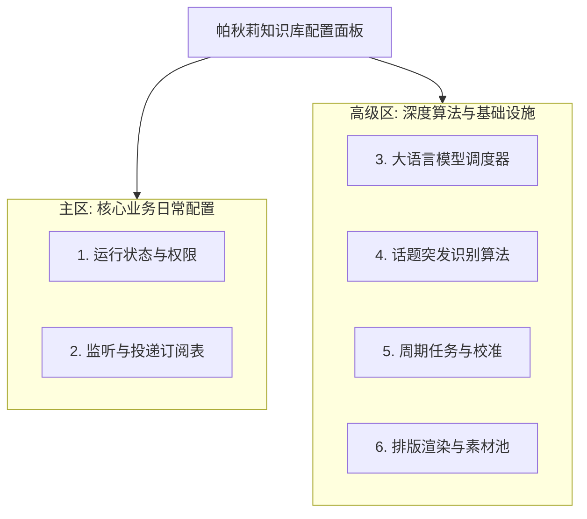

## ① 订阅表的列设计与行内控件选择

将「监听白名单（`channels`）」与「投递目标（`albumDelivery`）」解耦并重组成「订阅关系映射表」，核心是将散落在各处的群号、相册、生成开关收拢到**同一行数据流**中，形成直观的「输入源 ➔ 输出目标 ➔ 行为开关」心智模型。

### 1. 订阅表格列清单与控件选型

| 列名 | 承载业务语义 | 推荐控件 | 尺寸/对齐 | 默认值 |
| :--- | :--- | :--- | :--- | :--- |
| **监听群（来源）** | 机器人需要监听消息的群聊 | **带搜索建议的输入框（Combobox）**：下拉列出 Bot 当前已加入的所有群（展示「群名 (群号)」），支持模糊搜索与手动键入纯数字 | 宽度占比 25%，左对齐 | 空（占位符：“选择或输入群号”） |
| **投递方式与目标** | 词条生成后推送到哪里 | **分段下拉/级联控件（Cascader）**：<br>① 一级选项：`当前群文字` / `指定群文字` / `群相册(长图)`<br>② 二级输入：若选后两者，弹出对应输入框 | 宽度占比 35%，左对齐 | `当前群文字`（最省心的同群闭环） |
| **词条生成** | 是否将高密话题提取为词条 | **行内紧凑型开关（Switch）** | 宽度 70px，居中对齐 | `开启`（True） |
| **每日主题** | 是否每日跑该群的主题校准 | **行内紧凑型开关（Switch）** | 宽度 70px，居中对齐 | `开启`（True） |
| **操作** | 单行生命周期维护 | **危险操作图标按钮（Trash Icon）**，带气泡二次确认 | 宽度 60px，居中对齐 | — |

#### 布局视觉参考（ASCII 示意）
```text
+-------------------+--------------------------------------+----------+----------+------+
| 监听群 (来源)     | 投递方式与目标                       | 词条生成 | 每日主题 | 操作 |
+-------------------+--------------------------------------+----------+----------+------+
| 示例群一(1000..)   | [ 当前群文字 v ]                     |   [ON]   |   [ON]   | [x]  |
| 示例群二(1000..)   | [ 指定群文字 v ] [ 100000006 ]        |   [ON]   |  [OFF]   | [x]  |
| 示例群三(1000..)   | [ 群相册(长图) v ] [ 1000../ALBUM01 ] |   [ON]   |   [ON]   | [x]  |
+-------------------+--------------------------------------+----------+----------+------+
| + 添加监听群                                                                          |
+---------------------------------------------------------------------------------------+
```

### 2. 列层级划分（常显 vs 折叠次要）

* **常显列**：监听群、投递方式、词条开关、每日主题、删除操作。这是 90% 用户在 99% 的场景下唯一需要配置的字段。
* **次要/行内扩展（更多设置）**：
  * **行内局部覆盖参数**：单群个性化静默时间、单群最小触发条数等高级参数（原 `trigger` 字段）。
  * **交互呈现**：在操作列增加一个 `···`（更多）轻量折叠按钮，点击后向下方展开一个灰色行内子表单（Row Expansion）。默认隐藏，普通用户完全感知不到其存在。

### 3. 新增一行的交互流程

1. 用户点击表底部的虚线长按钮：`+ 添加监听群`。
2. 表格末尾插入一条新行，焦点自动聚焦在第一列「监听群」输入框中。
3. **输入预测与群选择**：输入框自动弹出下拉菜单，展示从宿主接口拉取的「已加群列表」：
   ```text
   [ 搜索或输入群号...           ]
   |-- 示例群一 (100000001)
   |-- 示例群二 (100000004)
   |-- 自定义未列出群 (输入纯数字并回车)
   ```
4. **默认值继承**：投递方式自动填充为 `当前群文字`，两个开关默认全开，用户只要选完群号，这一行就已经配置完成，实现「一步即用」。

### 4. 当投递目标切换为「群相册」时的行内控件动态形变

当用户将一级下拉切换至 `群相册(长图)` 时，该单元格产生**内联组合形变**：
* **控件形态**：下拉框右侧平滑伸展出一个文本输入框，形成 `[ 群相册 v ] - [ 输入 群号/相册ID ]` 的并排紧凑布局。
* **输入框占位符提示（Placeholder）**：`目标群号/相册标识码 (如 100000001/ALBUM01...)`。
* **校验高亮**：若未检测到 `/` 分隔符或前后参数格式错误，输入框边框泛浅红，并在输入框下方浮现微型说明文字 `需包含群号与相册Key`，阻断非法保存。

### 5. 「订阅表留空 / 全群监听」的全局语义处理方案

* **现状陷阱**：在现有逻辑中，「留空 = 监听全部群」。但在表格交互中，一张**空表格**传递的视觉暗示是「当前没有任何生效规则」或「插件未启用」，会导致用户误以为不需要监听，实际上却在后台全量静默监听，引发群聊隐私与流量灾难。
* **推荐方案：在表格上方提供显式的「监听范围单选组（Radio Group）」**：
  * `[●] 仅监听白名单群（推荐）`：仅表格中添加的群生效。此时空表格代表「不监听任何群」。
  * `[○] 监听所有群（通配模式）`：当切换到此项时，表格第一行变为固定的置顶只读行：`* 所有已加入的群`，此时表格其余行转变为「例外规则（如某些群单独发相册）」。
* **推荐理由**：B 端系统最忌讳「隐式默认」。将全群监听提升为用户的主动安全授权选择，不仅杜绝了空表的语义歧义，还完全契合用户对数据安全和防扰民的预期。

---

## ② 主区 / 高级区的分组命名与信息层级

遵循**渐进式披露（Progressive Disclosure）**原则，将 30+ 平铺字段重构为「2 个一级功能区（主区/高级区）」与「6 个二级语义功能块」，确保所有历史字段 100% 妥善归位。



### 1. 完整分组树与字段归属映射

#### 【主区】核心业务日常配置（所有用户可见）
日常运营 99% 的时间只需停留在此区域。

* **1. 运行状态与权限（Basic Status & Permissions）**
  * *副标题*：控制知识库机器人的总启停状态与敏感操作授权名单。
  * *包含字段*：
    * `enabled`（总开关）：布尔开关，置顶居左展示。
    * `adminUsers`（管理员 QQ 名单）：Tag 标签式输入框，支持回车添加多个管理员账号。
* **2. 监听与投递订阅（Channel Subscriptions & Delivery）**
  * *副标题*：决定机器人在哪些群工作，以及知识库词条生成后的推送形式。
  * *包含字段*：
    * `channels`（监听群）+ `albumDelivery`（群相册相关：词条投递开关、改道群号、目标相册）：全面合并为上一节设计的**订阅映射表**。

---

#### 【高级区】深度算法与基础设施配置（默认折叠）
算法调优、模型选型、底层素材池配置，日常无需修改。

* **3. 大语言模型调度器（LLM Engine & Credentials）**
  * *副标题*：配置知识提取背后的大语言模型驱动、密钥凭据及生成发散度。
  * *包含字段*：
    * `apiToken`：统一敏感凭证输入框（密码遮罩模式）。
    * `dispatcher.provider`：动态条件表单（OpenAI / Claude / 本地 Ollama 等切换）。
    * `dispatcher.temperature`：模型随机度（滑块 0.0 ~ 1.0）。
    * `dispatcher.maxTokens`：最大输出长度限制（数值步进器）。
    * `dispatcher.enableAutoTuning`：提示词自适应调优开关。
* **4. 话题突发识别算法（Topic Burst & Trigger Algorithms）**
  * *副标题*：决定群聊达到何种密集度与热度时触发总结，非算法专家建议保留默认。
  * *包含字段（原 `trigger` 12 个参数）*：
    * 触发窗口（时间范围滑动窗）
    * 突发倍率（消息频率倍率系数）
    * 静默秒数（判定话题结束的冷场时长）
    * 冷却比（同一群连续总结的防刷间隔）
    * 最小讨论条数（入选总结的最低有效发言数）
    * 缓冲区上限（内存消息队列长度）
    * EWMA 系数（指数加权移动平均平滑值）
    * 阈值下限（基础激活得分阈值）
    * 其余 4 个底层微调数学参数
* **5. 周期任务与校准（Cron Schedules & Topic Calibration）**
  * *副标题*：自动汇总全天话题走势，定时投递周报及清理过热漂移。
  * *包含字段*：
    * `albumDelivery.cron`（周报/汇总投递定时）：标准 Cron 语法输入。
    * `topics`（8 个参数）：每日主题聚类算法校准、主题衰减半衰期、主题合并相似度阈值、历史保留天数等 8 个参数。
* **6. 排版渲染与素材池（Rendering & Media Pool）**
  * *副标题*：控制长图渲染视觉上限，以及长图背景图、配图素材的抓取池维护。
  * *包含字段*：
    * `cardMaxHeight`（长图参数）：长图最大切割高度（px 限制）。
    * `media`（8 个参数）：离线素材缓存模式、本地图片水位警戒线、单次批量拉取数、冷却小时数、素材存储绝对目录、插图来源图库、名言语录来源、图床 API Key。

### 2. 视觉层级设计规范（字重、字号、色彩相对关系）

为了在没有复杂 CSS 支持的表单渲染系统中拉开视觉纵深，通过文字对比度和间距建立严谨的层级：

| 层级对象 | 字符大小 (Font Size) | 字重 (Font Weight) | 字体色彩 (Color Hex) | 间距规则 |
| :--- | :--- | :--- | :--- | :--- |
| **一级区域标题**<br>(如: 基础配置 / 高级配置) | 18px / 1.3em | 600 (Semibold) | 主色偏黑 (`#1F2328`) | 顶部 Margin 32px，底部附带 1px 浅灰分割线 (`#E1E4E8`) |
| **二级功能块标题**<br>(如: 话题突发识别算法) | 15px / 1.1em | 600 (Semibold) | 标题黑 (`#24292F`) | 顶部 Margin 20px，下方直接贴附块说明 |
| **功能块说明（副标题）** | 12px / 0.9em | 400 (Regular) | 辅助灰 (`#656D76`) | 紧随块标题，行高 1.4，底部间距 12px |
| **字段标签（Field Label）** | 13px / 1.0em | 500 (Medium) | 正文黑 (`#24292F`) | 左侧对齐或表单上方对齐 |
| **字段说明（Help Text）** | 11px / 0.85em | 400 (Regular) | 弱化灰 (`#8C959F`) | 位于控件正下方，行高 1.3，字号明显退缩 |
| **控件占位符与数值** | 13px / 1.0em | 400 (Regular) | 占位灰 (`#AFB8C1`) / 输入黑 (`#1F2328`) | 标准表单控件字体 |

---

## ③ 折叠交互的具体形态

### 1. 约束条件下的折叠形态评估

在 Koishi schema 纯自动渲染且宿主环境可能缺乏原生 `<details>` 或可点击折叠面板的现实下，评估三种低侵入落地形态：

* **形态 A（分隔线 + 纯平铺到尾部）**：全部 30 个字段仍在同一页面中，仅靠一条 `<hr>` 和文字「以下为高级设置」区分。
  * *缺点*：滚动条极长，首屏依然被压抑，未解决「认知过载」核心痛点。
* **形态 B（伪树状缩进）**：通过 description 写大量缩进字符。
  * *缺点*：视觉脏乱，排版容易错位。
* **形态 C（模式单选切换 / 条件隐藏控制，推荐）**：利用 schema 的条件渲染与 `.hidden()` 能力，在表单中设计一个显式的「配置深度选择器」或「高级配置开关」。

### 2. 推荐形态方案：双模切换开关（Mode Selector + `.hidden()` 联动）

**推荐落地交互**：
在主区下方，放置一个**显式的形态切换分段控制器或复选框**：
`⚙ 配置模式：[ 极简模式（日常推荐） ]  [ 专家模式（全部参数） ]`（或者单个开关：`[ ] 展开高级参数配置（包含算法微调、LLM底层与素材池）`）。

```text
======================= 主区配置 (常规生效) =======================
[总开关: ON]
[管理员: 10001, 10002]
[订阅表: 2 条已配置群]

------------------------------------------------------------------
⚙️ 高级配置模式
[ ] 显示高级设置与算法调优 (日常使用无需修改，保持默认即可稳定工作)
==================================================================
(当勾选后，下方平滑展开四大高级区块；未勾选时，下方 DOM 彻底隐藏)
```

**为什么这种形态最契合 Schema 渲染机制？**
1. **天然兼容**：Koishi Schema 深度支持字段间的联动条件显隐（基于当前表单数据的上下文判定 `.hidden((cfg) => !cfg.advancedMode)`），不需要任何前端 UI 库组件的 Hack。
2. **绝对减负**：未激活时，页面高度缩减 75% 以上，彻底杜绝无意误触底层参数的风险。
3. **零布局副作用**：不会引发由于第三方折叠组件导致的 CSS 高度计算错误、输入焦点错位或滚动条弹跳。

### 3. 冷启动首屏清单（First-Screen Inventory）

新安装或日常打开插件时，用户在垂直 800px 视口内能一眼看全的**完整首屏清单**：

1. **页面 Header**：
   * 插件名「帕秋莉知识库 (Patchouli-Wiki)」与一句话功能简介。
   * 全局总开关 `enabled`：紧凑型 Switch，带状态标签（已启用 / 已停用）。
2. **权限配置**：
   * `adminUsers`：单行展示管理员 QQ，默认预置机器人主人 QQ。
3. **订阅表区域**：
   * 监听范围单选：`[● 仅监听白名单]  [○ 监听全群]`。
   * 订阅映射表（空状态展示：友好的空状态插画或提示文案「暂未添加监听群，点击下方按钮开始监听」，带一个高亮的 `+ 添加监听群` 按钮）。
4. **底部锚点**：
   * 虚线分割线。
   * `[ ] 开启高级配置模式`（默认未勾选，右侧附灰色说明：“包含 LLM 模型分发器、突发判据系数、Cron 定时任务等”）。

整个首屏在不需要滚动鼠标的情况下完整呈现，核心路径一目了然：**启用插件 ➔ 添加一个群 ➔ 保存**。

### 4. 高级区展开后的「防平铺」子分组策略

当用户勾选「专家模式」后，若直接涌出剩余 25+ 个字段，仍会重新退化为平铺噩梦。通过以下两套机制进行二级降噪：

1. **子对象分块（Card Boxing）**：
   * 严格按照第 ② 节规划的 4 大块（大模型、突发算法、周期任务、素材池）组织为 Schema 的嵌套 Object。
   * 在 Koishi 的自动渲染中，嵌套对象会自带缩进框线与浅灰底色（Card Container），视觉上分割为 4 个清晰的「独立卡片」，而非一泻千里的长文本。
2. **预设挡位化（Preset Tuning）消灭 12 个判据字段**：
   * 在「4. 话题突发识别算法」内部，不直接暴露 12 个数学参数，而是在顶部提供一个**「灵敏度预设（Preset）」单选下拉**：
     * `[ 适中 (推荐默认) ]`
     * `[ 激进 (水群少、讨论少的小群，容易触发) ]`
     * `[ 严苛 (消息爆炸的大群，仅超级热点才触发) ]`
     * `[ 自定义微调 (专家档) ]`
   * 只有当用户显式选择 `自定义微调` 时，那 12 个令人头疼的 EWMA 系数、突发倍率、缓冲区等参数才在下方展示出来；选择前三者时，参数全部隐藏并在后台赋予工业调优好的最佳推荐值。

---

## ④ 视觉密度建议与微交互细节

### 1. 间距与尺寸度量规范（基于桌面端）

为确保表单具备现代 B 端系统的整洁感，消除紧迫拥挤感：

* **表单项垂直间距（Field Gap）**：标准表单控件之间保持 `16px`；逻辑相关项（如群号与相册 ID 输入框）之间缩紧至 `8px`。
* **功能块间距（Block Gap）**：各卡片/分组容器之间保持 `24px` 的外边距。
* **表格行高与内边距**：
  * 表格行高（Row Height）：推荐 `48px`（紧凑而不逼仄，既能放下 32px 的标准输入框，又能保证触控不会误点）。
  * 单元格内边距（Padding）：上下 `8px`，左右 `12px`。
* **输入框控件高度**：标准高度 `32px`，圆角 `4px` 或 `6px`。

### 2. 字段说明（Help Text）的呈现策略

针对不同严重程度的说明信息，采用差异化的呈现形式，避免全页面到处都是灰色小字：

* **行内即时小字（Inline Permanent Text）**：
  * *适用对象*：**格式关键型字段**（离开提示用户根本不知道怎么填的）。
  * *位置*：位于输入框正下方 `4px` 处，字号 `11px`，颜色 `#656D76`。
  * *范例*：目标相册下的“格式为：群号/相册ID，中间用英文斜杠隔开”。
* **悬浮问号提示（Tooltip Hover）**：
  * *适用对象*：**原理解释型/概念型字段**（普通用户不需要懂，懂的人看名词就明白）。
  * *位置*：紧贴在字段 Label 右侧的一个小圆圈问号图标 `(?)`，鼠标悬浮（Hover）时浮出浮层展示 1~2 句解释。
  * *范例*：`EWMA 系数 (?)` ➔ 浮层提示：“指数加权移动平均系数，数值越小历史权重越重，平滑度越高”。
* **折叠式说明/展开详情（Collapsible Help）**：
  * *适用对象*：复杂的系统级工作机制。例如「话题判定机制说明」，可在算法块顶部放一行可点击的蓝字 `查看突发算法计算公式与原理 ▾`，展开查看图文解说。

### 3. 高风险/易错字段的针对性微设计

#### A. 定时任务表达式（`albumDelivery.cron`）
* **现状痛点**：用户手写 `0 0 * * 1` 极易漏位或搞错日月星期。
* **微设计**：
  * **语义实时解析标签**：在输入框右侧或下方提供实时的**自然语言翻译反馈**。
    * 输入 `0 4 * * 1` ➔ 立即呈现绿色标签：`✔ 每周一 04:00 执行`。
    * 输入非法格式 ➔ 立即呈现红色标签：`✖ 格式错误，标准为 5 位 Cron 语法`。
  * **快捷预设胶囊按钮（Quick Preset Chips）**：在输入框上方提供常用选项点击直接填入：
    `[ 每周一早8点 ]` `[ 每天午夜0点 ]` `[ 每月1号 ]`。

#### B. 群号（`channels` / 来源群）
* **现状痛点**：用户常复制带空格、前缀（如 `qq:123456`）或全角字符的群号。
* **微设计**：
  * **防呆粘贴清洗**：失焦（Blur）时自动过滤非数字字符（自动截取其中的连续纯数字）。
  * **数字长度即时拦截**：QQ 群号通常在 5 到 11 位之间，少于 5 位或包含非数字时提示 `请输入合法的纯数字群号`。
  * **元信息反查（若宿主 API 支持）**：一旦输入完整，输入框内部右侧即时加载出一个轻量的小头像与群名称 Chip（如展示 `[示例群一] 100000001`），给用户极强的安全感。

#### C. 相册 ID（`群号/相册ID` 复合字段）
* **现状痛点**：形如 `"100000001/ALBUM01..."`，用户经常漏打 `/`，或者拿群相册名称去填而不是相册 Key。
* **微设计**：
  * **输入控件分裂**：将单输入框设计为**双联前缀输入框**：
    `[ 前置群号输入框 ]  /  [ 相册 Key 输入框 ]`
    系统在底层自动以 `/` 拼合，在 UI 表现上彻底终结用户手动打斜杠的失误率。
  * **示例引导占位符**：相册 Key 输入框内明确展示 `如: ALBUM01...`，提示该值应为一段字母数字混合串。

#### D. 安全凭证（`apiToken`）
* **现状痛点**：裸露明文易泄露，脱敏遮罩又看不到自己有没有输错。
* **微设计**：
  * **密码学输入框**：默认呈现 `••••••••••••••••` 密文遮罩，右侧自带「小眼睛」图标用于临时切换明文预览。
  * **前缀检测**：若选择 OpenAI Provider，输入非 `sk-` 开头时轻量提示 `通常以 sk- 开头，请核对是否复制完整`。

### 4. 移动端/窄屏（360px ~ 420px）响应式降级方案

在手机端打开 Koishi Web 控制台时，横向 5 列的桌面表格会导致内容严重挤压、出现横向滚动条或文字竖排折断。必须采用**表格向卡片列表（Card List）的响应式降级**：

#### 窄屏卡片化降级形态（ASCII 示意）
```text
+---------------------------------------------+
| 📍 示例群一 (100000001)             [ ✕ ] |
+---------------------------------------------+
| 投递目标: [ 群相册(长图)                  v ] |
| 相册信息: [ 100000001/ALBUM01...         ] |
+---------------------------------------------+
| 词条生成: [ ON ]      每日主题: [ ON ]      |
+---------------------------------------------+

+---------------------------------------------+
| 📍 示例群二 (100000004)               [ ✕ ] |
+---------------------------------------------+
| 投递目标: [ 当前群文字                    v ] |
+---------------------------------------------+
| 词条生成: [ ON ]      每日主题: [ OFF ]     |
+---------------------------------------------+

[ + 添加监听群 ]
```

#### 移动端微交互转换规则
1. **行化为卡片（Row to Card）**：每一条订阅关系收拢为一个带浅色边框与微阴影的圆角卡片，卡片之间保持 `12px` 垂直间距。
2. **头部定锚**：卡片顶行放置加粗的群名称/群号，删除图标 `[ ✕ ]` 固定置于右上角，防止大拇指单手误触。
3. **表单纵向堆叠（Stacking）**：投递方式与目标输入框转为 100% 容器宽度的上下两行。
4. **开关横向双列布局**：将「词条生成」和「每日主题」并列排布在卡片底部底栏，左侧文字右侧开关，方便大拇指盲操。
