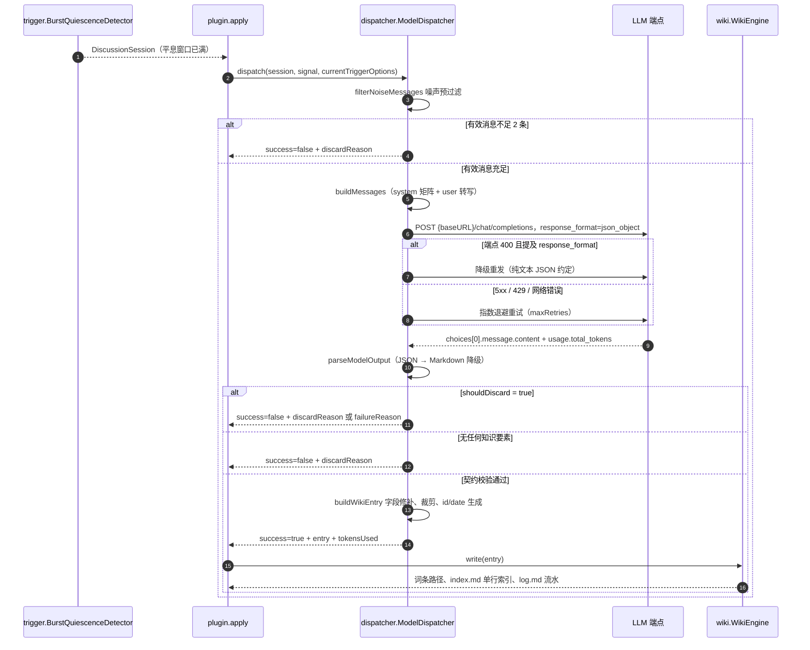
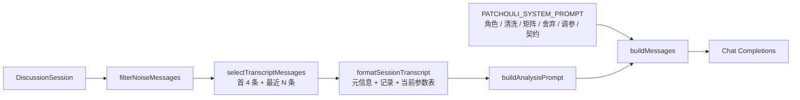

# src/dispatcher — 模型调度与 Prompt 矩阵（L2 模块声明）

> **代号**：帕秋莉的抄写台
> **上游**：`src/types.ts`（`DiscussionSession` / `WikiEntry` / `DispatcherResult` / `DispatcherConfig`）
> **调用方**：`src/plugin`（触发器结算后）
> **下游**：`src/wiki`（消费 `WikiEntry`）

---

## 1. 模块定位

讨论热潮平息后，触发器交出 `DiscussionSession`。本模块负责把它**送进模型、再安全地取回来**：

1. **装配 Prompt**：以帕秋莉·诺蕾姬的智性视角，把杂乱群聊转写成可分析的讨论记录，并给出清洗准则与知识矩阵提取规范；
2. **调度模型**：Node 原生 `fetch` 调用 OpenAI Chat Completions 兼容端点（`baseURL` / `apiKey` / `model` / `temperature` 可配）；
3. **解析与校验**：把模型返回的 JSON 或 Markdown 收敛为严格的 `WikiEntry` 契约对象，缺失字段按会话事实修补；
4. **安全舍弃**：非知识讨论（纯刷屏、纯情绪、纯寒暄）不落库，返回 `discardReason`；
5. **自适应反馈**：模型审视本次消息密度与噪声比，给出触发器参数的绝对数值建议。

### 1.1 职责边界

| 本模块负责 | 本模块不负责 |
| :--- | :--- |
| Prompt 文本与输出契约 | 讨论是否值得沉淀（触发器判定） |
| 单次模型的 HTTP 调用、超时、重试、格式降级 | 定时、队列、并发控制 |
| 端点协议映射（Responses / Gemini 原生 / Chat Completions）与自动探测、请求体与响应解析 | 各业务的 Prompt 内容（由 `prompts.ts` 负责） |
| 噪声预过滤与会话转写 | 群聊白名单、消息采集、缓存 |
| JSON / Markdown 解析、字段修补、契约校验 | Markdown 文件落盘、`index.md` / `log.md` 维护 |
| 参数建议的白名单校验与区间钳制 | 参数是否真正写回触发器（插件决定） |

### 1.2 模块结构

| 文件 | 内容 |
| :--- | :--- |
| `prompts.ts` | 系统提示矩阵、输出契约、参数白名单、噪声过滤、会话转写、`buildMessages` |
| `dispatcher.ts` | `ModelDispatcher`、HTTP 传输、JSON/Markdown 解析、`WikiEntry` 构造与校验 |
| `protocols/` | 可插拔端点协议：`responses.ts`（默认）、`gemini.ts`（Gemini 原生）、`chat-completions.ts`（兼容）、注册表 / 端点归一化 / 自动探测链 |
| `README.md` | 本文件（L2 声明 + L3 时序） |

---

## 2. 对外契约

### 2.1 `ModelDispatcher`

```ts
new ModelDispatcher(config: DispatcherConfig, runtime?: DispatcherRuntimeOptions)
```

| 成员 | 类型 | 说明 |
| :--- | :--- | :--- |
| `chatUrl` | `string`（getter） | 当前生效协议的实际端点（兼容字段名：Responses 为 `/responses`，Gemini 为 `/models/{model}:generateContent`，Chat 为 `/chat/completions`） |
| `protocolId` | `ProtocolId`（getter） | 当前生效的端点协议；未发出任何请求前 = 主候选（Gemini 端点 → `gemini`，否则 `responses`），自动探测成功后固定 |
| `route` | `'chatluna' \| 'standalone'` | 实际通道：`chatluna` 继承平台凭据 / `standalone` 直连自定义端点 |
| `model` | `string` | 模型名（构造期校验非空） |
| `temperature` | `number` | 已钳制到 `0 ~ 2` |
| `maxTokens` | `number` | 已钳制到 `128 ~ 32000` |
| `contractRetries` | `number` | 契约校验未通过时的追加重试次数（`0~3`，默认 `1`），见 §5.4 |
| `dispatch(session, options?)` | `Promise<DispatcherResult>` | 单次沉淀调度；**可预期失败不抛异常** |

`DispatchOptions`（继承 `PromptBuildOptions`）：

| 字段 | 默认 | 说明 |
| :--- | :--- | :--- |
| `signal?: AbortSignal` | — | 外部取消；取消时返回 `success: false`，`discardReason` 为「调度已取消」 |
| `currentTriggerOptions?: Partial<TriggerOptions>` | — | 当前触发器参数，作为调参基准写入 Prompt，并用于过滤无操作建议 |
| `maxMessages` | `280` | 提交给模型的最大消息条数 |
| `maxCharsPerMessage` | `400` | 单条消息字符上限 |
| `maxTotalChars` | `12000` | 讨论记录总字符预算 |
| `noiseFilter` | `true` | 是否在转写前做确定性噪声清洗 |
| `systemPromptPreset` | 自定义提示词 / 内置 | 显式覆盖：命名预设（`default` / `concise`，`compact` 同义）或自定义系统提示文本 |

系统提示词的解析优先级：`dispatch(options.systemPromptPreset)` > `DispatcherConfig.customSystemPrompt`（去空白后非空）> 内置 `PATCHOULI_SYSTEM_PROMPT`。
`customSystemPrompt` 不再是 Koishi 配置项：它由悬浮窗设置页经 `POST <base>/api/prompt` 热更新，
并落盘到 `<wikiDir>/.patchouli/custom-prompt.txt`，插件启动时自动回灌——调度器持有配置对象的
实时引用，下一轮请求即换用新提示词；`ModelDispatcher.systemPrompt` 暴露同一条解析结果供 WebUI 查阅。

`DispatcherRuntimeOptions`（非插件配置，测试与宿主适配）：

| 字段 | 默认 | 说明 |
| :--- | :--- | :--- |
| `fetch` | 原生 `fetch` | 可注入的传输实现 |
| `timeoutMs` | `60000` | 单次请求超时 |
| `maxRetries` | `1` | 网络 / 408 / 409 / 425 / 429 / 5xx 的重试次数 |
| `retryDelayMs` | `800` | 指数退避基数 |
| `jsonMode` | `true` | 是否请求结构化 JSON 输出（按协议映射到 `text.format` / `response_format`） |
| `logger` | — | 仅记录降级/重试/节奏观察，**不记录消息正文与密钥** |

### 2.2 `invokeRaw(messages, signal?)`

供主题聚合等**非沉淀**场景复用同一条模型通道：

```ts
const { text, tokensUsed } = await dispatcher.invokeRaw(
  buildTopicMessages(input, TOPIC_CURATOR_SYSTEM_PROMPT),
);
```

- 内部直接复用私有 `complete()`：ChatLuna / 自定义端点双通道（各用自己的模型键）、输出格式降级、协议自动探测与有界重试全部一致；
- 与 `dispatch()` 的区别有两条：① **不做沉淀输出校验**（不解析 `qualityScore` / `discardReason`，不构造 `WikiEntry`），失败直接向上抛，由调用方决定零写入还是降级；② **不继承 `responseFormat` 的 structured 契约**——`structured` 下发的是词条 JSON Schema（15 个必填字段、`additionalProperties:false`），主题校准返回 `{topics:[…]}` 必然不符；`invokeRaw` 固定按 `json_object`（`responseFormat==='text'` 时按 `text`）请求，主题输出由提示词骨架 + 本地校验约束；
- 因此 `invokeRaw` 不得被用来绕过 dispatcher 的沉淀契约写入词条。

### 2.3 `DispatcherResult`
| 字段 | 语义 |
| :--- | :--- |
| `success` | 是否产出有效词条 |
| `entry` | 通过契约校验的 `WikiEntry` |
| `discardReason` | 词条被安全舍弃的**或**调度失败的原因（失败原因以「模型调度失败：」「模型输出…」开头） |
| `contractRetries` | 本次因契约未通过而追加的重试次数（0 / 缺省 = 一次即过），仅用于观测 |
| `tokensUsed` | 端点返回的用量总数（Responses / Chat：`usage.total_tokens`；Gemini：`usageMetadata.totalTokenCount`），未提供时为 `undefined` |

### 2.4 导出的纯函数

`prompts.ts`：

| 导出 | 用途 |
| :--- | :--- |
| `PATCHOULI_SYSTEM_PROMPT` / `PATCHOULI_SYSTEM_PROMPT_CONCISE` | 完整 / 精简系统提示 |
| `resolveSystemPrompt(preset?)` | 预设解析；未知字符串按自定义提示处理并补输出契约 |
| `TUNABLE_PARAMETER_SPECS` | 参数白名单、区间与调整直觉（Prompt 与校验共用） |
| `renderTunableParameterTable(current?)` | 渲染参数表（系统提示与用户提示同构） |
| `isNoiseMessage` / `filterNoiseMessages` | 噪声判定与确定性清洗（连续复读保留首次） |
| `selectTranscriptMessages` | 「开头少量背景 + 结尾大部分近况」的截取策略 |
| `formatSessionTranscript` / `buildAnalysisPrompt` / `buildMessages` | 转写与 Prompt 装配 |
| `truncateText` / `formatLocalDate` / `formatTimestamp` | 文本与时间工具 |

`dispatcher.ts`：

| 导出 | 用途 |
| :--- | :--- |
| `normalizeBaseURL` | 端点归一化（容忍尾斜杠、完整 `/responses` / `/chat/completions` 与 Gemini `/models/<m>:generateContent`） |
| `chatCompletionsUrl` / `geminiUrl` / `geminiBaseURL` | 各协议的实际端点拼接（Gemini 补 `/v1beta` 并把模型名嵌进路径） |
| `resolveProtocolChain(config)` / `isGeminiEndpoint(baseURL)` | 自动探测链与端点形状判定 |
| `normalizeDispatcherProvider(value)` | 历史 provider 值收敛为 `chatluna` / `custom`（插件层日志共用） |
| `parseModelOutput(text)` | JSON 代码块 → 裸 JSON → 平衡括号 → Markdown 链路解析 |
| `parseMarkdownAnalysis(text)` | Markdown 小节降级解析 |
| `buildWikiEntry(payload, context)` | 契约构造与字段修补；无知识要素时返回 `undefined` |
| `sanitizeParameterFeedback(raw, current?)` | 参数建议校验（白名单、区间、整数化、无操作剔除、`cooling < burst`） |
| `DEFAULT_DISPATCHER_BASE_URL` / `DEFAULT_TEMPERATURE` / `DEFAULT_MAX_TOKENS` / `DEFAULT_TIMEOUT_MS` | 默认常量 |

---

### 2.5 端点协议 Seam (`protocols/`)

`DispatcherConfig.provider` 只有两个值（历史值在运行时归一化，见 `normalizeDispatcherProvider`）：

| provider | 语义 |
| :--- | :--- |
| `chatluna`（默认） | 恒走 ChatLuna 服务，模型标识取 `chatlunaModel`；ChatLuna 异常原样上抛，**不再**拿模型名去直连端点（跨命名空间没有意义）。历史值 `auto` 归一化到此 |
| `custom` | 恒直连自定义端点，模型名取 `customModel`，从不触碰 ChatLuna。历史值 `standalone` 归一化到此 |

`DispatcherConfig.protocol` 选择协议，默认 `auto`（自动探测）；显式值锁定单一协议，未知 id 回退 `responses` 并告警。

```ts
interface ModelProtocol {
  id: 'responses' | 'gemini' | 'chat-completions';
  label: string;
  /** Gemini 的模型名内嵌在路径里，故 `url` 带可选的 `model`。 */
  url(baseURL: string, model?: string): string;
  build(input: ProtocolBuildInput): { url; headers; body };
  read(response: Response): Promise<{ text; tokensUsed?; cachedTokens?; finishReason? }>;
  parse(payload: unknown): { text; tokensUsed?; finishReason? };
  isFormatRejection(detail: string): boolean;
}
```

| 协议 | 端点 | 请求形状 | 结构化输出 |
| :--- | :--- | :--- | :--- |
| `responses`（默认） | `POST {baseURL}/responses` | `instructions` + `input[]` + `max_output_tokens` + `stream:true` + `store:false` + `prompt_cache_key` | `text.format = {type:'json_schema'\|'json_object'}` |
| `gemini` | `POST {baseURL}/v1beta/models/{model}:generateContent` | `systemInstruction:{parts[]}` + `contents[]`（`user` / `model`，相邻同角色合并）+ `generationConfig:{temperature,maxOutputTokens,responseMimeType[,responseSchema]}` | `structured` 时把 `MODEL_OUTPUT_JSON_SCHEMA` 翻译成 Gemini 方言一并下发（去 `additionalProperties`、`type:[X,'null']` → `nullable:true` 且 enum 去 `null`、补 `propertyOrdering`）——**键名由解码器约束**；`json_object` 只给 `responseMimeType`；`text` 两者都不给。响应取 `candidates[0].content.parts[].text`（跳过 `thought:true` 分区），`usageMetadata.totalTokenCount` → `tokensUsed`，`finishReason='MAX_TOKENS'` → `length` |
| `chat-completions`（兼容） | `POST {baseURL}/chat/completions` | `messages[]` + `max_tokens` | `response_format = {type:'json_schema'\|'json_object'}` |

#### 自动探测（`protocol: 'auto'`）

`resolveProtocolChain({ baseURL, model, protocol })` 给出候选顺序，构造期取链首为主候选
（`protocolId` / `chatUrl` 始终反映当前生效协议）：

| 端点形状 | 探测链 |
| :--- | :--- |
| Gemini（host 含 `generativelanguage.googleapis.com`，或 baseURL 含 `v1beta` / `:generateContent`） | `gemini` → `chat-completions` |
| 其余（OpenAI 兼容 / 未知网关） | `responses` → `chat-completions` |
| 显式 `protocol`（`responses` / `gemini` / `chat-completions`） | 单元素，永不切换 |

- **顺延只由「协议不被该端点支持」触发**：HTTP 404 / 405，或 400 且错误体命中 `unknown url` / `not found` / `unsupported` / `invalid endpoint` 之类措辞——且该措辞不匹配当前协议的 `isFormatRejection`、也不是凭据错误（如 Gemini 的 `API key not valid`）。
- 网络错误 / 408 / 409 / 425 / 429 / 5xx 仍在**同一协议**上按 `maxRetries` 重试；400 的格式拒绝只把输出格式降为 `text`。两者都不切换协议。
- 切换成功后固定生效协议（`activeProtocol`），后续请求不再重探；一路失败到链尾时按普通 HTTP 失败语义返回。
- 日志只记录协议切换与状态码，**不记录**消息正文与密钥。

- Gemini 鉴权走 `x-goog-api-key` 头而非 `?key=` 查询参数（query 更易被代理与访问日志留存）；`normalizeBaseURL` / `geminiBaseURL` 容忍 `https://generativelanguage.googleapis.com`、`.../v1beta`、`.../v1beta/` 与完整 `.../v1beta/models/<m>:generateContent`。
- Gemini 响应出现 `promptFeedback.blockReason` 或空 `candidates` 时抛 `ProtocolParseError`（安全策略拦截不属于可重试错误）。
- 端点不接受 `responseSchema` 时回 400，调度器按 `isFormatRejection`（含 `response_schema`）把输出格式降为 `text` 重试一次，不切换协议。
- Responses 默认 **SSE 流式**：`read()` 按 `content-type: text/event-stream` 分流，累加 `response.output_text.delta`，从 `response.completed` 取 usage 与完整 output；网关忽略 `stream` 返回 JSON 时自动退回普通解析。
- 缓存：`prompt_cache_key = 'patchouli-knowledge'` 提升同前缀请求的缓存路由命中率；`usage.input_tokens_details.cached_tokens` 解析为 `cachedTokens` 并以 info 日志输出。`store:false` 只关闭响应留存，不影响前缀缓存。
- 流式失败（`response.failed` / `error` 事件）转 `ProtocolParseError`，不进入重试。

- 传输层（fetch、超时、取消、重试、鉴权头之外的降级）不属于协议；协议模块只做「URL / 请求体 / 响应体」三件事。
- 新增协议：在 `protocols/types.ts` 扩展 `ProtocolId`，实现 `ModelProtocol`，在 `protocols/index.ts` 的 `MODEL_PROTOCOLS` 登记一行并在 `resolveProtocolChain` 里决定候选位置；配置 Schema 的枚举同步加值。
- 响应解析失败抛 `ProtocolParseError`，调度器转成不可重试的 `ModelResponseError`；400 且 `isFormatRejection` 为真时把输出格式降为 `text` 重试一次。
- ChatLuna 通道完全绕过协议层：协议配置只对 `provider=custom` 生效，插件启动时会打印一行提示并在 ChatLuna 缺失时给出明确告警。

## 3. L3 调度时序图



### 3.1 Prompt 装配数据流



---

## 4. Prompt 设计架构

系统提示按「先立人格，再立工序，最后立契约」分层：

| 段落 | 作用 | 关键约束 |
| :--- | :--- | :--- |
| 一、角色定位 | 不动的大图书馆知识整理者、沉静敏锐的观察家 | 不站队、不奉承、不替人补观点；忠实原文高于文采 |
| 二、清洗准则 | 从信息洪流中剔除噪声 | 签到/表情包/纯情绪/复读/+1/无关碎碎念；**语气粗糙但有论据的消息必须保留** |
| 三、知识矩阵 | 规定提取粒度 | 论题核心、立场阵营、论据链条、交锋点、共识、未决问题、2~5 条逐字原话 |
| 四、安全舍弃 | 允许并规范「不沉淀」 | 纯刷屏/纯玩梗/无实质论点 → `shouldDiscard: true`，给出枚举原因 `NOISE_SPAM` / `LOW_DENSITY` / `FRAGMENTED` |
| 五、自评打分 | 输出知识密度评分 | 对本轮讨论打出 0.0~1.0 的 `qualityScore`，驱动宿主非对称 AIMD 控制器 |
| 六、输出契约 | 锁定机器可解析性 | 单 JSON 对象（推荐 fenced code block），字段齐全，空内容用空数组 |

> 系统提示只描述「工序与契约」；具体会话由用户提示承载（元信息 + 转写 + 当前参数 + 沉淀指令），避免把数据写进 system 角色。

### 4.1 质量评分与舍弃归因契约

模型不再直接输出触发器参数绝对值，调参权全量收归宿主 AIMD 控制器：
- `qualityScore`: 0.0 ~ 1.0 连续浮点数，反映讨论的论证深度与知识复用价值。评分 $\ge 0.8$ 视为高价值讨论，触发宿主 AIMD 加性放宽步进。
- `discardReason`: 当 `shouldDiscard: true` 时必须给出结构化枚举值（`NOISE_SPAM` | `LOW_DENSITY` | `FRAGMENTED`），供宿主控制器区分加性收紧、碎片化延展或信息熵滤波拦截。
### 4.2 模型输出骨架

```json
{
  "shouldDiscard": false,
  "discardReason": "",
  "title": "一句话点明论题",
  "summary": "一句话导语（≤60字）：焦点 + 落点",
  "background": "一句话起因（≤80字）",
  "narrative": "第三人称讨论脉络，3~5 段，段间空行（词条主体）",
  "status": "tentative",
  "tags": ["中文短语"],
  "participants": ["本场全部有效发言人昵称"],
  "debateMatrix": [
    {
      "viewpoint": "阵营主张",
      "proponents": ["支持者昵称"],
      "opponents": ["提出反驳或质疑的发言人昵称"],
      "arguments": ["论据"],
      "counterArguments": ["反驳"]
    }
  ],
  "consensus": ["共识"],
  "openQuestions": ["未决问题"],
  "glossary": [{ "term": "群内黑话或专有名词", "note": "本场语境含义" }],
  "keyQuotes": [{ "author": "发言人", "quote": "逐字原话", "context": "语境" }]
}
```

字段语义：`narrative` 是词条主体（3~5 段、700~1400 字，**按「问题如何推进」组织而非按发言人轮流点名**：每段对应论证一步、段首点明争点，发言人只作论点出处嵌入句中、每段点名不超过 3 人，段间以因果/转折承接；原话用「」逐字嵌入；第三人称旁观者叙述，Markdown 渲染为 `## 讨论脉络`）；`debateMatrix` 降为脉络的结构化索引（「争点对照」），每方 `arguments` / `counterArguments` 各 1~2 条、**每条一句 ≤50 字**；`glossary` 收群内黑话 / 专有名词（0~6 条，**note 只写能从本场消息原文确定的含义，禁止用外部知识补全作品设定/年份/活动名/别称，不收通用词**）；`keyQuotes` 2~4 条，优先未嵌入脉络的原话；**署名规范：提到群友直接写昵称原文，不加「」『』、引号或括号，「」只用于逐字原话**。`narrative` / `debateMatrix` / `consensus` / `openQuestions` 必须互相一致。

---

### 4.3 主题校准 Prompt

`TOPIC_CURATOR_SYSTEM_PROMPT` / `buildTopicMessages` 是跨时间主题聚合的提示词；主题提示词与沉淀提示词**不共享**：

- 输入：待归入词条摘要、已有主题时间轴、确定性候选分组；
- 输出：`{ topics[], timeline... }` 单 JSON；`timeline[].entryId` 必须属于给定分组；
- 主题提示词可通过面板设置页覆盖，保存即热生效。

## 5. 解析、降级与舍弃

### 5.1 解析链路（顺序执行，先命中先返回）

| 顺序 | 策略 | 说明 |
| :--- | :--- | :--- |
| 1 | ` ```json ` 代码块 | 逐个尝试 `JSON.parse`，跳过非 JSON 的 fenced 块 |
| 2 | 裸 JSON | 文本以 `{` 开头时直接解析 |
| 3 | 平衡括号扫描 | 从首个 `{` 起做字符串感知的括号配对，容忍前后散文 |
| 4 | Markdown 降级 | 按小节标题（摘要/背景/参与者/观点矩阵/共识/未决/原话/参数/舍弃）抽取；`###` 视为观点分条；`- 支持者：A、B` / `- 质疑者：C` / `- 论据：…` / `- 反驳：…` 结构化 |
| 5 | 放弃 | 返回 `discardReason: '模型输出既非合法 JSON，也未识别出 Markdown 知识结构'` |

### 5.2 字段修补

| 缺失字段 | 修补策略 |
| :--- | :--- |
| `title` | 摘要首句 → 首条非噪声消息前 30 字 → `群聊讨论沉淀 · <date>` |
| `summary` | 允许为空；但摘要/叙事/矩阵/共识/未决/原话**全部为空**时判定舍弃 |
| `narrative` | 别名 `narrative / 讨论脉络 / 脉络 / 叙述`；`\r\n` 归一、≥3 换行折叠为段落分隔、保留段落空行；上限 4000 字；非空即可独立构成实质内容 |
| `glossary` | 别名 `glossary / terms / 名词注 / 术语`；仅收 `term+note` 对象（容忍 `词/释义` 键），term ≤24 字、note ≤160 字、按 term 去重、最多 8 条；缺字段条目丢弃 |
| `background` | 由会话事实生成：日期、频道、触发缘由、消息数、参与者数 |
| `id` | 清洗模型 id（仅 `a-z0-9-`）；不可用时生成 `<date>-<title 英文词>`，无英文则 `<date>-session-<sessionId>` |
| `date` | 模型值需通过 `YYYY-MM-DD` 真实日期校验，否则取 `session.endTime` 本地日期 |
| `status` | 合法值原样保留；否则有共识 → `tentative`，无共识 → `open` |
| `tags` | 去 `#`、去重、去空，最多 8 个；为空时补 `['群聊讨论']` |
| `participants` | 模型名单优先，再与会话清洗后的发言人合并去重（最多 40），保证词条头部名单完整 |
| `debateMatrix` | 最多 8 条；`opponents` 按 `质疑者/反驳者/opponents/critics` 别名收敛；无 `viewpoint` 时用首条论据兜底；字符串条目包装为单一观点 |
| `keyQuotes` | 最多 5 条；字符串条目作者补「未署名」；空引语丢弃 |
| `metadata` | 消息数、时长（分钟）、峰值速率由会话计算；`participantCount` 优先取去重后的 `participants.length` |

### 5.3 安全舍弃判定

| 触发条件 | `discardReason` |
| :--- | :--- |
| 会话消息为空 | 会话为空：没有可供沉淀的消息 |
| 全部消息为噪声 | 会话共 N 条消息，全部为签到/表情/复读等无知识密度噪声 |
| 有效消息 < 2 | 有效消息不足 2 条，无法构成可沉淀的思维碰撞 |
| 模型 `shouldDiscard: true` 或 `isKnowledge: false` | 模型给出的 `discardReason` |
| 解析后无任何**结构化**要素 | 模型输出缺少讨论脉络、观点矩阵、共识、未决问题、原话等任何结构化要素（只有摘要/起因不构成词条——否则格式降级后模型写一句「抱歉」就会被当成词条落库并群播报） |

> 舍弃路径返回 `discardReason` 与 `qualityScore`；调参由宿主 AIMD 控制器按自评信号自行步进，模型不再产出参数建议。

### 5.4 契约重试（`dispatcher.contractRetries`，默认 1，钳制 0~3）

「通过」的定义 = 解析出 JSON/Markdown **且**能构造 `WikiEntry`；模型明确 `shouldDiscard` 也算通过（那是合法结论，绝不重试）。

未通过时追加重发一次调用：把**上一次原始输出**（截断 4000 字）+ **具体失败原因** + **逐字符字段名清单**（含"禁止 leet / 同形替换 / 下划线 / 中文键名"）拼成一条 user 消息追加在原对话之后，再请求一次。
- 用「单条 user 追加」而非 assistant 回放：三种协议（Responses / Gemini / Chat Completions）对中位 assistant 消息的支持不一致。
- 每次重试 = 一次完整模型调用，故默认只有 1 次；`maxTokens` 截断（`finishReason === 'length'`）时额外要求压缩篇幅，且**截断类失败最多重试一次**——同预算重发只会再烧一次同样的上限。
- **输出格式降级是粘性的**：端点 400 拒绝 `structured` / `json_object` 后，实例把生效格式固定为 `text` 并以 warn 级留痕，后续轮次不再每轮先撞一次 400（与协议切换的粘性一致）。`DispatcherResult.tokensUsed` / `contractRetries` 会进插件日志与丢弃留证 `verdict`，观测期据此判断 schema 约束是否仍在生效。
- 结果通过 `DispatcherResult.contractRetries` 回报实际重试次数（0 = 一次即过，缺省不写）；日志单独记录「第 N 次契约重试后输出通过校验」。重试成功与一次通过同权，不参与 AIMD 控制。

---

## 6. 配置与失败语义

`DispatcherConfig`（来自 `src/types.ts`）：

| 字段 | 默认 / 回退 | 说明 |
| :--- | :--- | :--- |
| `provider` | `chatluna` | `chatluna` / `custom`；历史值 `auto` → `chatluna`、`standalone` → `custom`，统一经 `normalizeDispatcherProvider` 收敛（`auto` 的跨通道回退已废除） |
| `chatlunaModel` | 留空 = 继承 ChatLuna 默认模型 | ChatLuna 通道的模型标识（`<platform>/<model>` 或「无」），端点通道从不读取 |
| `customModel` | 无 | 端点侧模型名（自由文本），仅 `custom` 使用；ChatLuna 通道从不读取 |
| `model` | 无 | **历史单键**（0.8.43 及以前）：仅当当前通道没有新键时被 `resolveDispatcherModels` 回填一次，绝不跨通道复制 |
| `baseURL` | `https://api.openai.com/v1` | 仅 `custom` 使用；容忍尾斜杠、完整 `/responses` / `/chat/completions`，以及 Gemini 的 `.../v1beta` 与 `.../v1beta/models/<m>:generateContent` |
| `protocol` | `auto` | `auto`（按端点形状探测，见 §2.5）/ `responses` / `gemini` / `chat-completions`；未知 id 回退 `responses` 并告警 |
| `responseFormat` | `json_object` | `json_object` / `structured`（OpenAI Structured Outputs，`json_schema` + `MODEL_OUTPUT_JSON_SCHEMA`）/ `text`；运行时 `jsonMode: false` 强制为 `text` |
| `apiKey` | `PATCHOULI_API_KEY` → `OPENAI_API_KEY` | 缺失时不发鉴权头（适配本地端点）；Gemini 协议下作为 `x-goog-api-key` 头发送，绝不拼进 URL |
| `temperature` | `0.35` | 钳制 `0 ~ 2` |
| `maxTokens` | `2048` | 钳制 `128 ~ 32000`，映射为 `max_tokens` |
| `customSystemPrompt` | 空串（= 内置完整矩阵） | **不受配置表单控制**：由悬浮窗设置页写入并落盘，启动时回灌；非空即整段覆盖内置提示词并自动补齐输出契约 |
| `enableAutoTuning` | `true` | 控制宿主是否根据模型自评运行非对称 AIMD 闭环调节 |
失败一律收敛为 `success: false`（仅构造期配置错误抛异常）：

| 场景 | 行为 |
| :--- | :--- |
| 网络错误 / 超时 / 429 / 5xx | 指数退避重试 ≤ `maxRetries`，仍失败则 `discardReason: 模型调度失败：…` |
| 400 且提及 `response_format` / `json_schema` / `response_schema` / `json_object` / `responseMimeType`（含 Gemini 的 `responseSchema` 拒绝） | 自动降级为 `text`（不带格式声明）重发一次（不计重试次数） |
| 404 / 405，或 400 命中 `unknown url` / `not found` / `unsupported` / `invalid endpoint`（且非格式拒绝、非凭据错误） | `auto` 时顺延探测链到下一协议（成功后固定）；显式协议直接失败，不再切换 |
| 401 / 403 / 其他 4xx | 不重试，返回脱敏后的 HTTP 状态与片段（Gemini `API key not valid` 归此类，绝不触发协议切换） |
| 响应体不可解析 / 缺 `choices[0]` / 缺 `candidates[0]` | `模型调度失败：…` |
| 外部 `AbortSignal` | `调度已取消（AbortSignal 触发）` |

密钥脱敏：错误文本中的 `sk-*` 与配置的 `apiKey` 均替换为 `***`。

---

## 7. 使用示例

```ts
import { ModelDispatcher } from './dispatcher/dispatcher';

const dispatcher = new ModelDispatcher(config.dispatcher, {
  logger: { warn: (message) => ctx.logger('warn', message) },
});

const result = await dispatcher.dispatch(session, {
  signal: controller.signal,
  currentTriggerOptions: config.trigger,
});

if (result.success && result.entry) {
  await wiki.write(result.entry);
} else if (result.discardReason) {
  ctx.logger('debug', `[patchouli] 本轮舍弃：${result.discardReason}`);
}
```

---

## 8. 验证与 CDC 维护

- **类型**：`npx tsc --noEmit`（本模块零 `any`，外部数据一律 `unknown` + 类型守卫）。
- **离线测试**：注入 `runtime.fetch` 即可覆盖正常沉淀、Markdown 降级、输出格式降级、5xx 重试、401 脱敏、纯噪声舍弃、参数钳制、Gemini 请求/响应形状与协议自动探测（`tests/protocols.test.mjs` 的 `PROTOCOL-06..11`），无需真实端点。
- **防腐同步**：修改 Prompt 段落、参数白名单区间、解析链路、协议注册表 / 探测链或 `DispatcherResult` 语义时，必须同步更新本 README 与 `tests/test-suite.md` 中 `DISPATCH-*` / `PROTOCOL-*` 用例。
