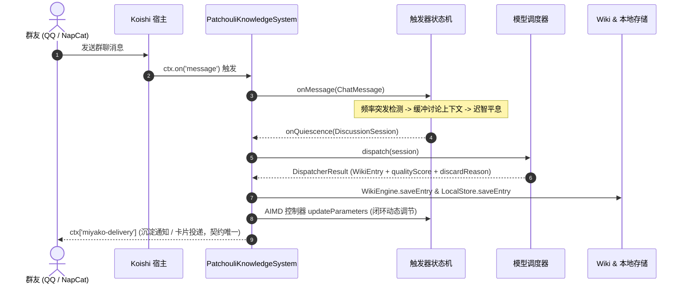

# Patchouli Knowledge - 插件与交互层 (L2 Specification)

> 路径：`src/plugin/`
> 职责：对接 Koishi 框架事件循环、NapCat QQ 消息流接入、生命周期管控与群交互指令。

---

## 1. 架构与交互流



---

## 2. 导出指令集

> 以下为**代码中实际注册**的子指令（`src/plugin/index.ts` 的 `apply()`，`grep -n "subcommand"` 可核）。
> 历史文档里出现过的 `patchouli.ask` / `patchouli.recent` / `patchouli.search` / `patchouli.show` / `patchouli.topics` / `patchouli.tune` 在当前源码中**没有注册**。`AskService` 已删除（2026-11-10），群内不再有任何可主动调用的查词/取卡指令；`TopicScheduler`、`/api/tune` 只以服务与 HTTP 面存在。不要按旧表调用。

| 指令 | 级别 | 参数 | 功能描述 |
| :--- | :--- | :--- | :--- |
| `patchouli.status` | 管理员 | `adminUsers` | 查看当前群聊的实时瞬时速率、EWMA 常态基线、突发倍率、状态机阶段与 AIMD 三闸门 |
| `patchouli.logon` | 管理员（`adminUsers` 白名单） | 无 | 自动书记**开始**：录制期相位锁定 `BURSTING`、消息落 `<wikiDir>/.patchouli/scribe/<channelId>.jsonl`、2h 静默熔断。回包「自动书记开始」 |
| `patchouli.logoff` | 管理员（`adminUsers` 白名单） | 无 | 自动书记**结束**：立即交付缓冲（不足 2 条丢弃）并删除录制文件。回包「自动书记结束」 |

命令面刻意只有这三个（出图走 HTTP：`GET <base>/api/card/:id`）。
`adminUsers` 默认 `[]`（fail closed），可在控制台插件配置页直接填；非白名单用户发 `logon`/`logoff` 只得到固定拒绝，不改变任何状态。

## 2.1 投递与查询的服务边界

- 投递统一走 `ctx['miyako-delivery']`（`koishi-plugin-miyako-delivery`）；**不是** `ctx.notifier`——目标宿主上后者已被 `@koishijs/plugin-notifier` 占用。**服务缺失即 `NO_DELIVERY_SERVICE`，没有 bot 直发降级**——投递属于生态基础设施，契约不满足就显式失败。
- 每日主题校准由 `src/plugin/topic-scheduler.ts` 调度，内核在 `src/wiki/topics.ts`；调度器只记日切水位与重试，绝不直接调用模型或写词条。

## 2.2 群相册候选目录（`src/plugin/albums.ts`）

- 同一份探测结果用在两处，但**生效时机不同**：
  - `albumDelivery.albums` = `Schema.array(Schema.dynamic(ALBUM_SCHEMA_KEY))`（`ALBUM_SCHEMA_KEY = 'patchouli.album'`），候选是**单选** const union，首位空值 `''` = 不上传；由 `ctx.schema.set` 注入，Console 数据服务订阅 `internal/schema` 后向在线页面广播，**无需重启插件或刷新页面**。
  - `subscriptions[].targets` = `Schema.array(albumSchemaUnion(..., { targets: true })).role('select')`：**多选标签**，候选 = `@chat`（本群聊天） + **按群分段**（每组一条 `#group:<群号>` 的不可选标题项 `Schema.disabled()`，下拉里就是分组标题；上游只渲染平铺 `<el-option>`，没有 `el-option-group`）+ 每个相册（**取值 = 唯一可读名**：相册名；同批重名一律改成 `群名 · 相册名`、群名也重再追加 `（群号）`、仍重再加 `#n`；相册名缺失回退稳定地址 `群号/相册ID`；`@chat` 与 `#group:` 是保留值，相册名撞上时同样走限定名），外加「已配置但本轮未探测到」的保留项。schemastery-vue 的 `<el-option>` 没有 `:label`、标签只显示 value，所以可读名必须直接当值；「不会错投」由**枚举内名字唯一 + 保存时绑定 + 只按绑定表解析**保证（保存订阅表时名字换成 `群号/相册ID` 写进 `settings.json` 顶层 `targetBindings`，投递期 `resolveTarget` 只查这张表，查不到就丢弃并 warn，绝不猜；详见 §3.5.2），升级前的稳定地址 `群号/相册ID` 仍按形状兼容。候选由 `readStartupTargetValues()` 在**模块加载时**同步读一次（首次启动即可用），并由 `refreshSubscriptionTargets()` 在 `apply()` 每次**重载**、以及每轮相册探测后**原地替换** union 的 `inner.list`——`require` 缓存让重载不重跑模块顶层，不替换的话新相册永远进不了下拉；`Schema.toJSON()` 每次序列化都现读 `list`，控制台下次拉 schema 就拿到新候选（`type` / `role` / `inner` 都不动，`isMultiSelect()` 与 `toColumns(inner)` 的结论不变）：实例配置的 `plugins` 树里找到本插件块（键名 `patchouli-knowledge`，容忍 `~` 前缀 / `:id` 后缀 / 分组嵌套）→ 取 `storage.wikiDir`（缺省 `data/llmwiki`）→ 读 `<wikiDir>/.patchouli/albums.json`，再合并同一批插件块 `subscriptions[].targets`（+ 历史 `target`）；**任何异常都降级为空候选**（模块加载期抛错会…
- 探测范围＝**订阅表里出现的监听群**（`subscriptionTable().rows` 的 `source`，上限 40）；只有 `*` 行（监听全部群）或「表为空且旧白名单为空」才回退到机器人 `get_group_list` 的全量群——候选是给订阅表用的，把机器人所在的几十个群全探一遍只会让下拉变成噪音。
- 探测优先 `ctx['miyako-delivery'].listAlbums`，空结果/服务缺失时回退 bot 直查（`get_qun_album_list` + `attach_info` 翻页，兼容顶层与 `data` 两种响应形状）。
- **隐藏 Bot 不参与探测**：`chatluna-sandbox` 会注册一个 `hidden = true` 的 onebot Bot，其 `internal` 是 Proxy——任何动作都回「NapCat 基线不支持 OneBot action：_get」，不跳过就会每次探测刷一屏 `[E]`；`probeGroupAlbums` / `listBotGroupIds` 都按 `hidden !== true` 过滤（`miyako-delivery` 0.3.1 起 `resolveBot` / `listAlbums` 同样跳过）。
- 合并规则：本轮有结果的群整体覆盖；本轮为空的群**保留旧候选**（掉线 / 限流不得抹掉下拉项）；退群的群丢弃。合并结果还要按探测范围再过一遍（`scopeAlbumCandidates`）：**表外群的历史缓存直接丢**——缓存按群累积，退订群的相册不砍掉就会一直挂在下拉里；只有 `configured` 里点名的**具体相册**作为例外保留（它们所属群的其它相册照旧丢），因为静态 union 的严格校验不能少一个已保存的值。缓存落 `<wikiDir>/.patchouli/albums.json`（写回的是过滤后的集合），apply 阶段先读缓存填下拉，`ready` 后再真探测，此后每 15 分钟复探；`console/connection`（有人打开控制台）也会按 60 秒节流补探一次——**这只刷新 `albumDelivery.albums` 的在线候选**；订阅表的 `targets` 候选也在每轮探测后原地换成新的 `inner.list`，并在每次插件重载时重算，因此新增相册不再需要重启进程。
- **订阅表恢复成表格（实测边界）**：`subscriptions` 声明 `.role('table')`。schemastery-vue 的表格在渲染前按 `toColumns(schema.inner)` 校验列，只有**静态** const union 能过；`Schema.dynamic()` = `Schema.any().role('dynamic')`，解析发生在渲染期组件里，`isConstUnion(inner)` 永远为假 → validate 失败 → 退回卡片行。**表格与动态候选互斥**，这里选表格（已与用户确认）；候选由 `apply()` 原地替换 union 的 `inner.list`，新增相册重载插件即出现。已配置但未探测到的目标由 `readStartupTargetValues().configured` 带进 union——否则静态 union 的严格校验会让整个插件配置过不了。
- **面板候选**：`GET /api/albums` 走 `loadAlbumCatalog(wikiDir, probe)`——缓存有内容直接回（`probedAt` 取文件 mtime），为空才探测一次并回写；失败返回空目录而非 500。`probe` 由 `apply()` 注入（`probeAlbumsForPanel`），探测范围与 `refreshAlbumSchema` 共用 `albumProbeScope()`，不存在两套范围。

## 2.3 知识周报排程（`src/plugin/weekly-schedule.ts`）

- 定时能力由 `ctx['miyako-delivery'].scheduleCron(expr, run, { timeZone })` 提供；**表达式归本插件配置**（`topicDelivery.cron`，默认 `DEFAULT_WEEKLY_CRON = '30 4 * * 1'`），时区固定 `Asia/Shanghai`。
- 表达式先归一（收敛空白 / 空值回落默认）并检查段数为 5；`scheduleCron` 抛解析错误时不注册、只留告警——绝不静默回落到默认值改期。
- 去重键是**本次触发的分钟桶**（`Math.floor(firedAt / 60_000)`）：同一分钟内插件重载不重复上传，下一次触发必然是新区间，因此 cron 改成每天 / 每月都不会被「本周已跑」误拦。

---

## 3. 对外接口与生命周期契约

- `name = 'patchouli-knowledge'`
- `Config: Schema<PluginOptions>`
- `apply(ctx: Context, config: PluginOptions): void`
- `PatchouliKnowledgeSystem`: 核心服务聚合类，可脱离 Koishi 独立测试与模拟驱动。知识库编辑 / 删除 / 清空由 `deleteEntry(id): Promise<boolean>` 与 `clearKnowledgeBase(): Promise<void>` 两个门面方法统一编排（词条 md + raw dump + index/log 托管行 + `.patchouli` 元数据），并保留各群 `cadence` 节奏快照。
- `PatchouliKnowledgeSystem.inspector`: 可观测性 AOP 检查器（`src/telemetry`），构造即通过实例级猴子补丁织入 `detector.onMessage / startBurst / enterCooling / finalize / invokeHandler`、`dispatcher.dispatch`、`applyAimdTuning` 与 `baseline.record / decay`，`dispose()` 逆序 100% 还原（原型方法与 `hasOwnProperty` 全部回到挂载前）。只产出 trace 与 `GET <base>/api/telemetry` 快照，**不参与任何决策**，观测异常只累加 `errors` 计数。

### 3.1 配置 Schema：条件表单（provider 二值 + 分支渲染）

`dispatcher` 是 `Schema.intersect([判别字段, 分支 union, 公共高级项])`，`provider` 决定下面渲染哪一组字段：

```ts
Schema.intersect([
  Schema.object({ provider: Schema.union([chatluna, custom, /* hidden: */ standalone, auto]).default('chatluna') }),
  Schema.union([
    Schema.object({ provider: Schema.const('chatluna'), model: Schema.dynamic('model').default('无') }),
    Schema.object({ provider: Schema.const('custom').required(), baseURL, apiKey, model, protocol, responseFormat }),
    Schema.object({ provider: Schema.const('standalone').required(), ...端点段 }),  // 历史值，仅校验用
    Schema.object({ provider: Schema.const('auto').required(), ...端点段 }),
  ]),
  Schema.object({ temperature, maxTokens, enableAutoTuning })                        // 全部 .hidden()
])
```

- **ChatLuna 分支只有一个下拉框**：`model: Schema.dynamic('model')` 读 ChatLuna 注册的模型清单
  （与 ChatLuna 自身 `defaultModel`、livingmemory `mainModel` 同一个键），选 `无` 即继承平台默认模型。
- **custom 分支**：`baseURL` + `apiKey` + `model` 可见；`protocol`（默认 `auto`，自动探测
  Responses → Gemini → Chat Completions）与 `responseFormat` 是 `.hidden()` 高级覆盖。
- **历史值 `auto` / `standalone`**：仍留在 provider 枚举里（`.hidden()` 不进下拉），否则旧配置过不了
  `resolveConfig` 校验、插件直接加载失败；运行时由 `normalizeDispatcherProvider` 归一化为
  `chatluna` / `custom`，打开表单重选一次即被改写。
- **两条实测约束，改 Schema 前必读**：
  1. **ChatLuna 分支的 `Schema.const('chatluna')` 不能加 `.required()`**。`provider` 等于公共默认值时
     控制台会把该键从表单值里省略，带 `required` 的 const 会判为不匹配，整个分支塌成空白且保存成 `{}`。
     不加 `required` 时 const 仍拒绝不匹配的值，只是容忍「键不存在」。
  2. **分区标题只能挂在第一个 intersect 元素上**。`intersect` 的 `meta` 会被复制到每个元素，
     挂在 intersect 本身会让每个元素各渲染一个重复标题。
- `CONFIG-01..07` 覆盖：两个可见选项、分支字段集、custom 默认值、历史值保留、序列化契约、写回幂等。

### 3.1.1 新增的两处运行时配置（均 opt-in / fail closed）

| 配置 | 默认 | 语义 |
| :--- | :--- | :--- |
| `judge`（`enabled` / `baseURL` / `apiKey` / `model` / `timeoutMs`） | `enabled: false` | 本地 System-1 裁判（`POST {baseURL}/v1/systemone`）。关闭时预览门恒放行、边界裁决不触发；启用后超时 / 非 2xx / 不可解析一律 fail-open |
| `adminUsers`（`string[]`） | `[]` | `patchouli.rec` 的管理员白名单。空 = fail closed（任何人都不能开录制） |

### 3.2 存储根目录解析与 llmwiki 骨架

`storage.wikiDir` 由导出的 `resolveWikiDir(configured, baseDir)` 统一解析（`apply()` 传入 `ctx.baseDir`，
同时作为 `PatchouliKnowledgeSystem` 的第 5 个构造参数，脱离 Koishi 的单元测试可显式注入）：

| 配置值 | 解析结果 |
| :--- | :--- |
| 留空 / 空白串（`Config` 默认即 `data/llmwiki`） | `path.resolve(baseDir \|\| process.cwd(), 'data/llmwiki')` |
| 相对路径（`data/llmwiki` / `./wiki-store` / `../shared/llmwiki`） | `path.resolve(baseDir, value)` —— **恒以 Koishi 实例 `ctx.baseDir` 为锚**，绝不依赖进程 cwd |
| 绝对路径（如 `/path/to/koishi/data/instances/default/data/llmwiki`） | 原样使用（`path.resolve` 对绝对路径幂等） |

系统构造时立即 `ensureWikiLayout(wikiDir)` 建全 `raw/sessions/`、`wiki/debates/`、`.patchouli/`
三段骨架（失败仅 `logger.warn`，不阻断插件加载），并把解析后的绝对路径写入启动日志：
`[Patchouli] llmwiki 存储根目录: <abs path>`。

### 3.3 最新消息预览与底栏最新词条契约

监控页横条只展示**当前群最新一条被接受的消息**，全链路只读、纯内存：

- **写入点**：`onIncomingMessage` 的实际接受路径（`enabled` 且命中白名单之后），与 5 秒流量桶同源，
  因此白名单外的群聊连缓存都不产生；每群至多 1 条，**按接受顺序覆盖**，不回溯、不排序。
- **无持久化**：只驻留 `Map<channelId, LatestMessage>`，进程结束即消失，`dispose()` 显式清空；
  绝不写入 `raw/sessions/` 或 `.patchouli/store.json`。
- **字段最小化**：`LatestMessage` 只含 `id / channelId / userName / content / timestamp / elements`，不携带
  `userId`、Koishi `raw` 或原始段 `attrs`；`elements` 是安全 JSON AST，读取返回副本；全链路不持久化；
  无消息时 `latestMessage: null`，异步解析结果按 message id 防旧消息覆盖新消息。
- **文本摘要**：`toMessagePreview(content, maxChars?)`（导出）将 Koishi markup 摘要为单行纯文本；实体反转义、空白折叠，并按码点截断到 1000 字符。它用于旧消费者摘要，不再承担完整媒体渲染。
- **富元素**：`elements[]` 支持 `text / image / quote / forward / card / face / file / record / video / unknown`；只读解析优先 OneBot 原始段与 `session.elements`，再回退 `h.parse(content)`，quote 单独传入。OneBot resolver 仅使用只读 `get_msg / get_forward_msg / get_image`，有超时与次数、递归和元素上限。媒体只接受公网 HTTP(S)，不将 `raw / userId` 暴露至浏览器。
- **媒体代理**：图片及音视频子资源若来源为 HTTP，改写为同源 `/api/media/<opaqueId>`；HTTPS 媒体保留直链。代理只服务当前缓存消息登记的 URL，固定公网 DNS 地址、逐跳校验重定向、拒绝 active content、支持 Range 与正文空闲超时；IPv4 映射形式的 IPv6 字面量（`::ffff:7f00:1` / `::ffff:8.8.8.8` 等，含全展开与大小写混写）在字面量直通分支即整条拒绝，绝不进入 pinnedLookup；卡片导航与文件下载不改写为代理。
- **前端渲染**：元素使用 DOM 节点与 `textContent`，不把消息拼进 `innerHTML`；图片可放大、转发可展开、音视频使用原生控件且不自动播放，卡片 / 引用 / 表情 / 文件按元素类型呈现。同一 message id 与元素指纹相同则复用媒体 DOM 节点，轮询不会中断播放或折叠状态。
- **HTTP 暴露**：`GET /api/status?channelId=<群号>` 附带 `latestMessage: LatestMessage | null`
  （跟随群筛选，缺省群回落配置里的第一个群）；`GET /api/latest?limit=<1..20>`（缺省 20，越界收敛）
  恒定调用 `localStore.getRecentEntries(undefined, limit)`，即**独立于关键词检索与群聊筛选**的
  全局最新词条裸数组（`WikiEntryRecord[]`，最新在前），供底栏轮播使用。

### 3.4 软切片反馈隔离（AIMD 跳过条件）

`handleQuiescence` 里质量信号 → AIMD 门限步进的链路有两个跳过条件：软切片（本节）与
调度质量门（§3.4.1，在更早的位置直接 `return`，连调度都不发生）。软切片的代码如下：

```ts
if (session.partial === true) {           // 软切片：进行中讨论的中间段
  this.logger?.info(`[Patchouli] 群 ${session.channelId} 软切片交付不参与 AIMD 门限调节…`);
} else {
  await this.applyAimdTuning(session.channelId, { shouldDiscard, discardReason, qualityScore });
}
```

- **为什么**：`flushSlice` 在缓冲满 120 条时切出的是进行中对话的半截尾巴，模型必然判
  `FRAGMENTED`；而该归因的 AIMD 步进是 `minDiscussionMessages +2`，于是
  `12 → 14 → 16` 自激抬升，永久降低后续触发率（线上实证：`FRAGMENTED 0.18` → `12→14`）。
- **跳过范围**：只跳过 `applyAimdTuning`（既不调 `updateParameters`，也不写 `saveCadenceState`），
  时间衰减基准 `tuningClocks` 不受影响；词条落盘与群内播报照常。
- **非 partial 会话**（`partial === false`，即 `finalize` 交付的完整一轮讨论）照常调节，
  因此本条隔离不会削弱正常的自校准闭环。
- **缓冲不足未沉淀**：`DetectorConfig.onDiscard` 已接到 `logger.info`，文案形如
  `[Patchouli] 群 <id> 讨论不足未沉淀：缓冲 N 条 < 下限 M 条（峰值 R/m）`；
  这是「本轮什么都没发生」的唯一解释来源，与插件故障严格可区分。

### 3.4.1 调度质量门（`trigger.dispatchMargin`）

AIMD 之外的**省钱闸门**：结算峰值只是勉强过阈时，不必烧一次云端大模型。

```ts
const margin = this.config.trigger.dispatchMargin ?? 0;   // 默认 0 = 关闭
if (session.partial !== true && peak !== undefined && margin > 0 &&
    peak.quality < peak.burstThreshold * margin) {
  logger.info(`… 峰值质量未达调度门限，跳过云端调度（peakQ=… < … = Θ_burst … × ${margin}）`);
  await this.recordDiscard(session, { kind: 'GATE', qualityScore: peak.quality });
  return;                                                 // 不调 judge、不调 dispatcher、不做 AIMD
}
```

| 项 | 值 |
| :--- | :--- |
| 配置 | `trigger.dispatchMargin`，默认 **0（关闭）**；`1.3` ≈「过阈 30% 以内不调度」 |
| 判据来源 | `session.potentialPeak`（`{ quality, density, burstThreshold }`，由 detector 在 potential/shadow 结算时填充） |
| 生效范围 | 仅 `partial !== true` 的完整结算；软切片与 rate 模式（无 `potentialPeak`）天然不受影响 |
| 位置 | judge 门控**之前**：连本地裁判都不调，更不调云端模型 |
| 留证 | `recordDiscard(session, { kind: 'GATE', qualityScore })`，日志 `info` 级 |
| 反馈 | **不做 AIMD 步进**——自家闸门不构成证据，否则「门越紧 → 门限越高」自激 |

为什么默认关：判废口径来自 shadow 对照（三天窗口 13/14 次调度被模型判废，多数是「过阈但勉强」），
`dispatchMargin=1.3` 能把这类调用整轮省掉；但对照实验期间必须保持默认 0，否则对照组数据被污染。

### 3.5 公开面已下线；长图改走管理面 `/api/card/:id`

公开只读面**已整体删除**：插件不注册任何无鉴权的对外端点，词条只以长图卡片流出，管理面 `/patchouli` 绑 Koishi 后台管理员。

| 路由 | 语义 |
| :--- | :--- |
| `GET <base>/patchouli/api/card/:id` | 整篇词条长图 **JPEG q90**（1440px 宽，玻璃+环境光整片渐变下同画质体积约为 PNG 的 1/4）；**默认脱敏**；非法 id 400、缺失 404、无 `ctx.puppeteer` 时 503 + 纯文本（绝不出占位图） |

材质口径：单一暗色「玻璃」模式——画布由三层环境光（青绿 / 靛蓝 / 琥珀，纵向 1320px 无缝平铺）+ 低频噪点构成，面板为半透明白（158° 渐变 + `blur(26px) saturate(1.45)` + 顶部 1px 高光 + 斜向镜面 sheen + 双层投影）。人名一律由 `.nm` chip 包裹（`display:inline` + 零 margin + `padding:1px .3em`），色相 = `FNV-1a(name) % 360`，同名同色、跨词条一致；配色为莫兰迪微光（`--nm-bg:hsl(h 40% 52%/.15)` / `--nm-bd:hsl(h 50% 64%/.24)` / `--nm-fg:hsl(h 45% 88%)`），防止一句话多个荧光药丸撕裂灰度。`chipify` 会把名字两侧的字面空格一并吞掉（修 `text-align:justify` 拉伸缺口），邻居是 ASCII 字母数字时补 `&#8202;` 发丝空格防黏连。名单 = 视图结构化字段 ∪ 调用方 `knownNames`（假名形态，pipeline 用 `extraNames.map(maskName)` 透传）——只出现在综述正文、没进金句/观点矩阵的假名也能包 chip（LONGIMAGE-08 契约）。

脱敏边界：出图一律过 `src/wiki/mask.ts`（发言人名 / 引证署名 / 支持与质疑者 / `@提及` / 正文裸写昵称 / 5–12 位号码）。
**结构优先**：正文中人名按 prompt 契约写成 `[[昵称]]` 双链，脱敏对双链内容做**字典精确替换**（任意长度、单字同样精确，`深夜` 这类同形词天然不可能误伤），渲染时只剥人名双链的括号、概念双链原样保留。裸名规则只作旧词条与模型漏写链接的兜底：多字名整串替换，单字名走「左右双线索」上下文门（说话动词 / 顿号逗号 / 连词 / 括号引号），宁可漏判也不改写 `深夜`、`十六夜咲夜` 这类正常文本。真名清单是**三层并集**：`record.participants` ∪ `raw/sessions/<id>.json` 的全部 `userName`（权威来源，补齐模型归纳漏掉的人）∪ 视图内结构化字段；纯 ASCII 昵称（`7` / `Vader`）按词边界命中（`1527` 里的 `7` 不动），中文昵称整串替换（`与千聆进一步` 这种紧贴汉字的常态必须命中）。底图与取色：底图与一言由**素材池**（`src/media/pool.ts`）以固定目录做生产 / 消费解耦，
渲染器本身不联网——取不到素材就出无图版式，绝不因网络问题失败。

### 3.5.1 看板娘底图（`src/plugin/mascot-assets.ts`）

单个内联 SVG 里叠**两层同一张位图**（`<use href="#art-…">` 复用，data URI 只出现一次）；两张图的位置、尺寸、
遮罩参数由 `docs/mascot-tuner.html`（`scripts/build-mascot-tuner.mjs` 生成）实时调定后固化。

| 图层 | 做法 |
| :--- | :--- |
| 光晕（halo） | 同一张图 + `feGaussianBlur(30/18.5)`，套径向遮罩把不透明度压到 `haloOp` → 0，只留自身色彩的模糊外溢 |
| 本体（core） | 锐利图层，套两道遮罩相乘：径向（focus cx/cy/r 贴人物，`coreMid`→`coreOuter` 三段渐隐）贴着人物收圆；纵向（底边 0 → `hem·h` 全实）把被裁断的胸线 / 下缘化进卡面 |

| 位置 | 尺寸与锚点 |
| :--- | :--- |
| `.mascot-bust`（4K 方图版） | `top:-44px; right:-96px; width:516px; opacity:.63`（focus 449,326,r420；hem .43 / blur 30） |
| `.mascot-reading` | `bottom:-44px; left:-17px; width:562px; opacity:.56`（focus 76,452,r269；hem .75 / blur 23） |

正文排版：`.sec p:not([class])` 首行缩进 2em（中文习惯；时间轴 / 术语 / 页脚等带 class 的行不缩进）；
章节头是「左侧竖强调条 + 20px 等宽馆藏分类号 + 15.5px 章节名 + 向右淡出的引导线」——
编号不是点缀而是版面上的一枚铅字，靠 58% 透明度压回背景，只加字重会变成噪音。
观点碰撞区的立场徽标是纯图标胶囊（▲ 支持 / ▼ 质疑，`#7ee8b7` / `#ff9b8e` 固定色）；
`论据/反驳` 用左侧 2px 竖向参考线 + 同色小标签（绿=支持侧、红=质疑侧）——
立场绿/红是全卡唯一不随 `--pk-accent-h` / `nameHue` 漂移的语义色，保证一眼可辨。
时间轴在日期列与正文之间加 1px 竖向淡出轴线（`.tl::before`）+ 每节点 5px accent 色光点（`.tl-item::after`），
由「两列表格」变为「编年档案轴线」。眉题是 `#序号 // PATCHOULI KNOWLEDGE` 左对齐书脊式，
不再排最右（会被看板娘核心区吃掉）。
为什么内联：长图由 puppeteer `setContent()` 渲染，HTML 字符串里没有 baseURL，任何外部 `src` 截图时都是空白。
为什么不描摹：位图保留原画质感与渐变，描摹会掉细节且体积不可控。
为什么不用 CSS `mask-image` 单独收边：只做 alpha 渐隐仍会留下抠图切线；光晕层让边缘变成「颜色往外散」而不是「图被切开」。
`renderEntryLongImageHtml(view, { mascot: false })` 可整层关闭（无图版式 / 排障）。
预览页生成：`node scripts/build-card-preview.mjs <entriesDir> <backdrop.jpg>`（按文件名排序取前 3 篇，逐卡取色）。

生成：`node scripts/build-mascot-assets.mjs <reading.png> <bust.png>` —— 裁内容框 → 按显示宽度×2 缩放（bust 880px / reading 620px）→ alpha 重映射（丢掉 <26 的幽灵像素）+ `GaussianBlur(22)` 羽化（源图补丁的直切线必须摊成渐变，3.2px 不够）→ WebP q82。原始 PNG 不入库，仓库只留生成物（约 238 KB base64，gzip 后 ≈185 KB）。

材质：底图只当色场用（`blur(14px) saturate(1.5) brightness(.86)` + 12% 放大吃掉模糊羽化），
图与文字之间垫三层——`.veil`（柔纱）/ `.tint`（分区压暗：顶部 190px 内 `.46` 让页眉透出画面、
300px 后 `0.8→0.86` 稳住正文对比度）/ `.content`；卡片本体 `border-radius:26px + overflow:hidden`
把底图裁在圆角内，导出图就是卡片本身。取色：页内 64×64 直方图取色相主峰写 `--pk-accent-h`，
驱动状态徽章 / 章节号 / 日期 / 术语 / 共识点。

### 3.4 素材池（背景图 / 一言）

- **目录即契约**：`<mediaDir>/<image|saying>/pending/` 放可消费素材，`used/` 放离线复用中的素材。
  `<mediaDir>` 默认 `<wikiDir>/.patchouli/media`，可用 `media.dir` 覆盖。
- **生产者**（`ensureFilled`）：可用素材低于 `media.lowWater` 时抓 `media.batch` 条补齐；
  图片按 `content-type` 校验（只收 `image/*`，≤ 8 MiB），一言解析 `{ text }` 并去重、截断 120 字。
  同类补货单飞，失败静默（上游 5xx / 断网只是不补货）。
- **密钥（opt-in）**：两个来源默认用公开端点、匿名调用（实测无需任何 key）。仓库里**不预置任何密钥**；
  需要账号额度时在控制台填 `media.apiKey`（`role('secret')`，默认空），它只作为 `key` 查询参数附加到请求 URL，
  不落盘、不进日志、不进渲染产物。
- **消费者**（`take`）：按文件名 FIFO 取最早一条；在线模式读完即删，离线模式移入 `used/`。
  渲染路径为 `take('image')` → `data:` URI、`take('saying')` → 文本，二者互不依赖。
- **离线模式**（`media.offline`，控制台可见）：生产者不触网；`used/` 里超过 `media.cooldownHours`
  的素材由 `sweep` 改名回 `pending/`，于是同一批素材环形复用。启动时 `prefillMedia()` 补一次货，
  不阻塞插件挂载。
### 3.5 词条投递（讨论结束即出图）

产品决策（2026-11-10）：**知识周报只保留主题**（按周定时），词条改为**每轮讨论沉淀后立即**出图投递。

- `albumDelivery.entryEnabled`（默认开）：沉淀成功后渲染该词条长图并投递；失败只告警，不影响沉淀与结算。
- 目标：`albumDelivery.albums`（`<group>/<album>` 列表，词条与主题**共用**）。
- `albumDelivery.entryRedirectChannelId`：灰度改道。填群号（如 `100000002`）后**所有词条卡片改发该群聊天、不进相册**；
  留空恢复相册投递。主题周报不受影响。
- 与 HTTP 导出共用 `src/plugin/card-pipeline.ts`（脱敏 + 素材池 + 序号），不存在两条出图路径。
- **重试与幂等归 `miyako-delivery`**：多目标走它的 `broadcast`（一次 Write-Ahead + 每目标独立指数退避），
  本插件只透传 `retry: { maxAttempts, baseDelayMs }`，不自建队列；服务缺失或未实现 `broadcast` 一律结构化失败。
- **管理面鉴权（会话体系）**：长期令牌 `security.apiToken` 只留在服务端；`POST <base>/login {token}`
  校验后签发 **32 字节会话票据**（默认 **7 天**、过半滑动续期、最多 256 个、登出即吊销），
  **会话表落盘**到 `.patchouli/sessions.json`（只存 `sha256(sid)` + 到期时间，0600），
  因此进程重启不再要求重新输入令牌；文件绑定 `apiToken` 指纹，令牌轮换即整批作废；
  同时写 HttpOnly Cookie 并在响应体返回 `{session, expiresAt}`。守卫覆盖 `/patchouli/api/*`：
  未认证一律 **401**（`{error:'unauthorized', reason}`），运维直连可用 `Bearer <apiToken>` / `x-api-token` / `?token=`。
  另有 `GET <base>/session` 自检与 `POST <base>/logout`。守卫以 `use` 中间件挂在 `<base>/api` 上；
  **宿主 router 不支持 `use` 时插件不注册任何 `/api/*` 路由并告警**——守卫装不上就宁可不提供接口，
  绝不 fail open 成零鉴权（登录 / 自检不受影响）。`/session` 在长期令牌直连（`via === 'token'`）
  时 `session` 恒为 `null`：短票据才会回显，长期令牌绝不经由响应头 / 响应体回传。
- **前端门禁**：Console 浮窗使用 `src/web/auth-bootstrap.ts`——**打开即弹模态**（本地无未过期票据时
  不发起任何业务请求）；每个 `/api` 请求自动带 `Authorization: Bearer <sid>`，401 即清票据重新弹。
  浏览器**永不保存 apiToken**，只存 7 天会话票据（`HttpOnly` Cookie；落盘文件里也只有哈希）。
- **首次初始化**：`security.apiToken` 留空且没有已落盘密钥时，`/session` 返回 `bootstrapRequired: true`，
  面板弹「首次初始化」——留空由服务端生成 32 字节随机串，或自定义（≥16 字符）；密钥**只显示一次**
  并写入 `<wikiDir>/.patchouli/api-token.txt`（POSIX 0600），随后自动登录。初始化**先占位再落盘**：
  并发请求里只有第一个生效，其余拿 409，**绝不覆写**已写下的密钥文件；落盘失败会退回占位（500），
  面板可重试。`/bootstrap` 不会被第二个请求顶掉。**初始化只接受本机 / 内网来源**：对端必须是
  loopback / 私网；`x-forwarded-for` 只在直连对端为 loopback（反代与本进程同机）时才采信，
  并取**最右一跳**（可信反代追加的位置）——其他情况下该头完全由客户端掌控，自填 `127.0.0.1` 无效。
  公网来源直接 423 并提示改为在配置里填 `security.apiToken`。
- **素材池遥测**：`GET /api/status` 的 `media` 字段给出两侧 `pending`/`used` 水位与进程内计数
  `{ produced, failed, consumed, swept }`——`failed` 是上游抖动唯一可见的信号。

- **页眉与页脚**：页眉左侧是**按群独立的自然数序号**（每个群各自 `#1`、`#2`…，与词条 id 无关；
  首次渲染时按词条所属群分配，同一词条恒同号、改道投递也不改号，落盘
  `<wikiDir>/.patchouli/card-seq.json` 的 `channels[<群号>]` 桶，重启接着数；结构不符一律当空表
  重新从 1 数——序号是派生数据，不做历史兼容）；页脚只放一句话（一言），没有一言时整块页脚不渲染。

### 3.5.2 订阅表：多值目标 + 覆盖层（`src/plugin/subscriptions.ts` / `src/plugin/settings-store.ts`）

- 行形状：`{ source, targets: string[], entry, weekly }`。`targets` 是**多值标签**，
  元素是 `@chat`（投到**来源群**聊天）或相册的**唯一可读名**；空数组 = 不投。
  `source` 为 `*`（全部群）时 `@chat` 无法定值，编译期丢弃并只留其余目标。
- **为什么取值是可读名、又为什么不会错投**：schemastery-vue 的 `<el-option>` 没有 `:label`，
  已选标签只显示 value，所以可读名必须直接当值（否则标签里是 `100000001/ALBUM01…`）。
  错投由三条规则挡死：①枚举内名字唯一——同批重名一律改成 `群名 · 相册名`，群名也重再追加
  `（群号）`，仍重再加 `#n`，相册名缺失回退稳定地址，`@chat` / `#group:` 是保留值（相册名撞上
  时同样走限定名，**名为 `@chat` 的相册在候选里叫 `群名 · @chat`**）；②**保存时绑定**——
  保存订阅表时（`POST /api/subscriptions`），把每个 `targets` 里的名字用**当时**的候选解析成 `群号/相册ID`，与订阅表
  **同一次原子落盘**写进 `settings.json` 顶层的 `targetBindings`（名字 → 地址）；
  ③**投递只查绑定表**——`resolveTarget` / `albumValueOfTarget` 先排除保留值，再查
  `targetBindings`，最后才按旧稳定地址 `群号/相册ID` 的形状直接认。绑定表里没有 = 解析失败：
  停投并 warn `目标未绑定或相册已变更：<值>，请在面板重新选择`，**绝不回退到按当前候选猜名字**
  ——所以同群同名相册换探测顺序、唯一名消失后别的群出现同名相册，都不会悄悄换收件人。
  已有绑定只要那个相册还在候选里就原样保留（改名不动绑定；相册消失则掉绑并进 `unresolved`）。
- **首轮迁移**（升级兼容）：启动时绑定表为空但订阅表里有名字 → 用当前候选**一次性**填充并落盘，
  之后不再自动改写；一个都解析不到时不写空表（下次启动还能再试）。旧 yml 里的稳定地址不需要绑定。
- **`#group:<群号>` 是保留值**：下拉分组标题项（`Schema.disabled()`，不可选）用它当 value，
  永远不会被选中或写进配置；归一（`rawTargets`）、`resolveTarget`、面板校验、日志一律把它
  当作「非目标」跳过——手填的标题既不能被当成裸群号投递，也不该占掉一个目标位。
- **日志可读名**：启动 / 保存时的订阅日志把相册目标写成 `相册名（群号）`
  （`readStartupTargetTables().valueToName` = 当前候选的展示表；值先按绑定表解析成地址再取文案，
  解析不了的原样回显），`@chat` → `本群聊天`，一行多目标仍用 ` + ` 连接。
- **控制台字段**：`subscriptions` 声明 `role: 'table'`（每行是表格行，列头只有
  `监听群` / `投递群（可多个）` / `词条` / `周报`，没有表级说明）；`targets` 是
  `array(const union)` + `role: 'select'`（候选 `@chat` + 各相册，取值 = 唯一可读名）。
  候选初值在**模块加载时**由 `readStartupTargetValues()` 读一次（实例配置 + `<wikiDir>/.patchouli/albums.json`，
  详见 §2.2），`apply()` 每次重载与每轮探测后由 `refreshSubscriptionTargets()` 原地替换
  `inner.list`——**新增相册重载插件即进候选**（`require` 缓存让重载不重跑模块顶层）。
- **为什么候选必须静态（实测，别再试一遍）**：`Schema.dynamic()` = `Schema.any().role('dynamic')`，
  解析在 schemastery-vue 的 `dynamic` **组件**里（`plugin-console` 注册 `{type:'any', role:'dynamic'}`）；
  而表格组件 `{type:'array', role:'table', validate:(v,s)=>!!toColumns(s.inner)}` 在 `schema.vue`
  里按 `isConstUnion(schema.inner)` 校验列，此时 inner 恒为 `any` → `toColumns` 返回 `undefined`
  → validate 必失败。**结论：表格单元格只能放静态 const union，动态候选只能留在卡片里。**
  静态 union 的校验同样是严格的：yml 里已配置的目标必须出现在候选里，否则整份配置过不了校验
  ——所以 `configured` 必须来自启动期读取的配置本身，而不是「本轮探测结果」。
- **历史兼容**：宿主 yml 里的单值 `target` 在归一阶段转成 `targets: [target]`；
  「目标 = 来源群号」这种旧写法等价改写成 `@chat`，语义完全相同。旧配置不需要手改。
- 归一（`normalizeSubscriptionRows`）= 去平台前缀 + 去重 + 丢弃空串 / 超长项 + 行数 ≤256 +
  单行目标 ≤16；目标串**原样保留**（不做解析，名字能不能解析由投递期裁决），`#group:` 标题
  直接丢。裸群号（`456`）不再是合法目标——跨群聊天请用 `@chat` 或改走相册。
- 面板校验（`validateSubscriptionRows` / `targetIssue`）：值域 = 候选唯一名 ∪ 候选稳定地址 ∪
  现有值（探测抖动 / 改名后仍能原样保存）∪ `@chat`；目录为空（探测不可用）时只做形状校验。
- 运行时：`subscriptionTable()` 给面板行 + `source`（`settings` = 覆盖层 / `config` = 宿主 yml）；
  `compileSubscriptions(config, override)` 编译快照：非 `*` 行按**行自己的来源**解析 `@chat`，
  `*` 行不带来源解析，因此 `*` 行里的 `@chat` 不产生投递点（要发来源群聊天请写成具体群号的行）。
  周报相册目标按绑定表解析（`albumValueOfTarget()`：先排除 `@chat` / `#group:`，再查绑定表，
  最后按旧稳定地址形状认），未绑定的名字拿不到地址 → 该来源没有相册目标、不渲染不上传，
  由解析层的 warn 提示重选；**绝不会把「只勾了 `@chat` 的行」变成对某个相册的上传**。
- 覆盖层：面板写入 `<wikiDir>/.patchouli/settings.json` 的**顶层 `subscriptions` 键**（不在 `sections` 里，
  因为它是结构化数组而不是标量补丁）与顶层 `targetBindings` 键（名字 → `群号/相册ID`，
  清洗规则：保留值 / 超长 / 非地址形状一律丢弃，≤1024 项）。与五段标量**同文件、同一条串行写链**：
  写任一侧都读出整份文档再整份原子落盘，互不抹除；订阅表与绑定表永远同一次落盘，不会出现
  「新行 + 旧绑定」的错配。优先级 **覆盖层 > config**；`null`（文件无该键）= 完全按 config，`[]` = 面板清空了表。
  **绝不写宿主 config**（ADR-022）。
- 面板接口（守卫覆盖 `/patchouli/api/*`）：

| 路由 | 语义 |
| :--- | :--- |
| `GET <base>/api/albums` | `{ albums: [{value, groupId, groupName, albumId, albumName, label}], probedAt }`；`label` = `群名 / 相册名`。**缓存优先**（`.patchouli/albums.json` 有内容直接回，`probedAt` = 文件 mtime），为空才用注入的 `probeAlbums`（`apply()` 提供：订阅监听群 ∪ 机器人全部群，优先 `miyako-delivery.listAlbums`）探测一次并回写缓存；探测抛错 / 空结果一律 `{ albums: [], probedAt: null }`，**不 500、不写空缓存** |
| `GET <base>/api/subscriptions` | `{ rows, source, albums, probedAt }`；相册只读缓存（GET 不触发秒级探测，保鲜交给 `/api/albums`） |
| `POST <base>/api/subscriptions` | body `{ rows }` → `200 { ok: true, rows, unresolved }` / `400 { ok: false, error }`。`unresolved` = 本次解析不到相册（歧义 / 改名 / 删除）因而**没有绑定**的名字：行里保留、投递期停投，面板提示重选。校验：`source` 非空（`*` 允许）、每行 `targets` 是数组且元素只能是 `@chat` 或**探测到 / 缓存里存在 / 当前行已用**的目标、`entry`/`weekly` 布尔、单行 ≤16、总行 ≤256。相册目录为空（探测不可用）时只做形状校验，否则面板在掉线时连 `@chat` 都存不下去 |

### 3.6 自动书记存储（`src/plugin/scribe.ts`）

- 路径 `<wikiDir>/.patchouli/scribe/<channelId>.jsonl`，**只追加**，每行 `{id, channelId, userId, userName, content, timestamp}`（无 `raw`，`content` 按码点截到 2000）。
- 写入点：`onIncomingMessage` 在 `detector.onMessage` **之后**，仅当 `detector.isManualRecording(channelId)`；串行写队列，IO 异常只告警。
- 启动恢复：扫描目录 → `≥2` 条 `detector.restoreManualSession(...)`；不足 2 条的脏文件删除；解析失败的文件**保留**且不恢复（绝不丢数据）。恢复完成后才注册消息监听。
- 删除：`patchouli.logoff`、2h 熔断（`onManualSessionEnd` 回调）后删除文件与水位元数据。
- 权限：`adminUsers` 白名单，空 = fail closed；非白名单 / 私聊 / 未开启监听 / 不在群白名单一律拒绝开启。

### 3.7 判据持久化（`src/telemetry/shadow-ledger.ts`）

内存遥测（`/patchouli/api/telemetry` 的环形缓冲）重启即清零，回答不了「三天里哪套判据更准」。
本台账把裁决点与会话结算**追加落盘**，供事后 shadow 对照：

- 路径 `<wikiDir>/.patchouli/observability/shadow-YYYY-MM-DD.jsonl`（按**逻辑时间**的 UTC 日期分片，单文件超 8MB 续 `-2`，保留 14 天，启动时 `sweep`），**只追加**、串行写、目录懒创建。
- `{"kind":"decision",…}`：相位裁决点。`rate` 与 `potential` 两侧各自给出 `ready` 与全部门限（`threshold` / `burstThreshold` / `coolThreshold` / `rhoMin`），`agree` 直接标出两套判据是否一致；只在**结论跳变**（`相位|rateReady|potentialReady` 变化）或相位迁移时记一条，避免每条消息灌满台账。
- `{"kind":"session",…}`：一轮讨论结算，含 `messages` / `peakRate` / `delivered` / `reason`——这是「两套判据各沉淀多少」的唯一口径。
- `{"kind":"dispatch",…}`：调度回执（`success` / `qualityScore` / `discardReason` / `failureReason` / `durationMs`）。`session` 只说「触发了几轮」，`dispatch` 才说「真产出几篇」；`failureReason` 压平换行并截到 200 字符，只留可定位前缀。
- `{"kind":"config",…}`：参数快照（`thetaMin` / `burstMultiplier` / `rhoMin` / `minDiscussionMessages`，AIMD 时带改前值）。每群每进程记一条（`reason:'startup'`，**与 `triggerMode` 无关**——`rate` 群同样落，否则跨天比较时那些样本连当时的参数都无从核对）。判据门限会漂移，跨天比较必须先按参数分段，否则会把不同门限下的样本混在一起。
- `{"kind":"digest",…}`：**每小时**一条标定摘要（最大 Q / 最大 ρ / 最大速率 / 两侧 ready 消息数 / 满足 NEAR_MISS 原始判定的消息条数）。其中 `nearMiss` 是**判据侧**口径（未经 NEAR_MISS 频控，判据侧随 `triggerMode`），因此不等于 trace 里的 `NEAR_MISS` 条数。这是判断 `Θ_min`（20）与 `ρ_min`（1.2）定高还是定低的唯一分布数据，体积与消息量无关。
- 三张表用 `episodeId`（与内存 trace 的 `traceId` 同源）可以 join 起来：一次突发 → 一轮结算 → 一次调度。
- 健康度：`/patchouli/api/status.observability` 回 `{written, failed, lastWriteAt}`；`failed > 0` 或时间停滞说明台账断流。
- 两侧取值一律来自 `detector.evaluateVerdicts()`，与状态机共用 `burstThreshold` / `evaluateWindowEntries` / `potentialMetricsThreshold` 等同批函数，**不存在第二套公式**（`SHADOW-LEDGER-07` 锁定）。
- 落点注入：`attachTelemetry(system, { onRecord })`，回调异常只计 `inspector.errors`，绝不外溢到消息 / 结算路径。
- 报告：`node scripts/shadow-report.mjs [--dir …] [--days N] [--channel <id>] [--json]`，输出总览 / 分歧明细 / **引擎效率** / 会话 / 调度产出 / 标定分布 / 参数快照。
- **引擎效率（黑盒口径）**：发起次数 = 该模式**主判据**判 ready 的次数（`potential` 模式看 `potential.ready`，`rate`/`shadow` 看 `rate.ready`）；有效产出 = 同模式 `dispatch.success`；有效率 = 两者之比。shadow 期的势能 ready 属于「未接管」，不计入分子分母，只在「对侧 ready」列单独呈现。

---

---

## 4. 宿主服务接入契约（Koishi 4.18 实测）

- **HTTP 路由**：Koishi 4.18 的 `ctx.router` 只是 `server` 服务的别名，插件作用域内不注册也不可见；
  `server` 服务本身继承 Koa Router，因此 `registerWebUi()` 只取 `ctx.server` 注册 `/patchouli`，不再声明 `router` 可选注入。
- **ChatLuna**：`chatluna` 服务在插件 ctx 上不可见（服务按配置分组隔离），必须在
  `ctx.inject(['chatluna'], (injectedCtx) => …)` 回调内取句柄；桥接调用器常驻，触发时再解析平台。
- **模型就绪**：`chatluna.awaitLoadPlatform(platform, 30_000)` 之后 `createChatModel('<platform>/<model>')`
  才能拿到可用模型；未等待是「模型名对但实例为空」的根因。
- **消息体**：`ChatLunaChatModel.invoke()` 走 LangChain，必须传 `@langchain/core` 的
  `SystemMessage` / `HumanMessage` 实例（字面量对象会抛 `message.getType is not a function`）。
  实现从 `ctx.baseDir`（回退 cwd）用 `createRequire` 解析实例内的 `@langchain/core/messages`。
- **凭据继承**：ChatLuna 通道只透传模型标识，**从不读取 `apiKey` / `baseURL`**；`dispatcher.chatlunaModel`
  留空时回退到 `chatluna.config.defaultModel`（平台当前默认模型），因此控制台里无需填写任何渠道参数。
  端点模型名是另一个键 `dispatcher.customModel`，两条通道互不借用（否则 ChatLuna 的 `<platform>/<model>`
  会被当成端点模型名发出去）。
- **群聊作用域**：消息监听注册在 `ctx.intersect(...)` 子上下文上（`!isDirect && channels.includes(channelId)`），
  非白名单群与私聊在框架层被直接过滤，事件回调根本不会执行；`onIncomingMessage` 内保留白名单二次校验。
- **静默红线**：`notifyOnSummarized: false` 时 `onNotify` 直接返回，全链路不发任何群消息。

---

## 5. Console 下属组件注入契约（403 根因与解法）

`@koishijs/plugin-console` 的静态服务对 `@plugin-<entry>/…` 请求做越权校验
（`plugin-console/lib/node/index.js`）：

```js
if (!filename2.startsWith(this.root) && !filename2.includes('node_modules')) return ctx.status = 403;
```

- `this.root` 是 **plugin-console 自身** 的 `dist` 目录，插件的客户端产物永远不会以它开头；
- 因此 `addEntry()` 必须收到**包含 `node_modules` 的绝对路径**，否则前端必然 403；
- 实现：`registerConsoleEntry(ctx, logger)` 以 `__dirname/../../client/dist` 解析产物目录，校验
  `client/dist/index.js` 存在后调用 `ctx.console.addEntry(entryDir)`，并记录
  `${uiPath}/@plugin-<entry.id>/index.js` 便于实测取证；
- 注入时机：`ctx.inject(['console'], …)`，仅在控制台服务就绪后注册，避免产生无效条目；
  `inject.optional` 已声明 `console`，未安装控制台时静默跳过；
- 客户端产物 `client/dist/index.js` 为纯 ESM（`export default function (ctx)`），零外部依赖，
  不使用 `window.open` 与 iframe，静置 5 秒自动收回为右下角胶囊徽章（可拖动，位置仅当前会话保留）。

---

## 6. 变更记录

| 日期 | 变更 |
| :--- | :--- |
| 2026-11-24 | **审查修复：相册名 / 掉绑标记 / 候选上界 / 摊平与热更新（`B1`~`B8`）**：①`nameAlbumTargets()` 遇到**长得像稳定地址**的相册名（`2026/Spring`）追加 `（群号/相册ID）` 后缀直到不匹配——否则保存时被当「已经是地址」跳过（永不绑定）、投递时又被当地址解析；未命名相册仍回退它自己的地址；②`resolveTargetBindings(rows, albums, previous, previousRows)`：名字在上一次**落盘的行**里却没有绑定 = 上次就掉绑了，本次同样的行不再重解析（此前一次相册消失会让**下一次相同的保存**把名字绑到别的群同名相册）；标记只在绑定表**建立过**（`bindingMigration` 或非空表）时生效，用户改过该行（值变了）才重新解析；③「已配置但未探测到」的候选不再封顶 64：上限改为订阅表自身的硬上限 `MAX_SUBSCRIPTION_ROWS × MAX_TARGETS_PER_ROW`（部分已保存值被截断 = 整份配置过不了严格校验、插件拒载）；④`flattenConfig()` 改为**逐段**判定来源（顶层 → `advanced` → 默认值），顶层写了 `trigger` 时 `advanced.channels` 的白名单不再整段丢失（退化成监听全部群）；⑤`applySettingsOverrides(next, mode)`：面板保存只应用 `previous → next` **真正变化的键**（落盘的 `trigger` 段是累积的，整段重放会把每个群 AIMD 学到的 `minBurstRate` 改回快照值），启动回灌 / 文件被外部改写仍整段应用；⑥词条投递的外层闸改为「新表生效 → 由行决定；表为空回退 → 读 `entryEnabled`」（旧开关不再压制新表已勾的「词条」）；⑦`runTopicsDirect()` 入口先判 `features.topics`（`/api/topics` 绕过调度器空表照样烧模型），关闭时返回既有的 `disabled` 结果；⑧`apply()` 的相册探测提成 `refreshAlbumCandidates()`，**每个 `await` 之后**重查 `disposed`（卸载后不再 `ctx.schema.set` / 不覆盖模块级候选与解析表），`onSubscriptionsChanged` 回调同样早退 |
| 2026-11-24 | **可读名改为落盘绑定，投递只认绑定表（修两条 BLOCKER）**：①`settings.json` 顶层新增 `targetBindings`（名字 → `群号/相册ID`），与订阅表**同一份文档 / 同一条原子写链 / 同一次落盘**；清洗掉保留值键、超长键与非地址形状，≤1024 项；②`updateSubscriptions(rows, allowed, albums)` 在落盘前用**当时候选**绑定：解析不到的名字保留在行里但**不绑定**并进响应 `unresolved`（面板提示重选）；已有绑定只要相册还在候选里就原样保留，相册消失才掉绑——同群同名相册换探测顺序、唯一名消失后别群出现同名相册，都不再改投（`resolveTarget` / `albumValueOfTarget` 只查绑定表与旧地址形状，保留值优先，绝不回退到实时索引）；③首轮迁移：启动时绑定表为空但订阅表里有名字 → 用当前候选**一次性**填充并落盘，之后不再自动改写（幂等，解析不到不写空表）；④`@chat` / `#group:` 在 `buildTargetNameIndex`、旧别名索引、`albumValueOfTarget`、周报来源规划里全部排除，名为 `@chat` 的相册在候选里改名 `群名 · @chat`，周报行只勾 `@chat` 时上传数为 0；⑤`readStartupTargetMaps` → `readStartupTargetTables` / `installTargetTables`（解析表 = 绑定表，展示表 = 候选），解析失败 warn 改为 `目标未绑定或相册已变更：<值>，请在面板重新选择`；⑥新增测试 BIND-01（交换探测顺序地址不变）/ BIND-02（唯一名消失 + 新群同名 → 停投 + warn，不改投）/ WEEKLY-SCOPE-07a（相册取名 `@chat`）/ BIND-04（绑定落盘、迁移幂等、面板保存掉绑）。 |
| 2026-11-24 | **安全：IPv4 映射 IPv6 字面量不再能穿透媒体代理**：①`isPrivateIPv6` 换成真正的 IPv6 归一化解析（`::` 展开、内嵌 IPv4 尾段折成两段、大小写不敏感、非法写法保守拒绝），`::ffff:HHHH:HHHH`/点分写法都拼回 32 位再按 IPv4 规则判私网·本机·保留段（`::ffff:7f00:1` = 127.0.0.1、`::ffff:a9fe:a9fe` = 169.254.169.254、`::ffff:c0a8:101` = 192.168.1.1）——旧实现只看首段、遇到 `::` 开头靠「首段为 0」侥幸拦下，判据与实际地址无关；②新增导出 `isIPv4MappedIPv6()`，媒体代理的**字面量直通分支**一律拒绝映射写法（`http://[::ffff:8.8.8.8]/` 经 WHATWG 归一成 `[::ffff:808:808]`，内嵌 IPv4 虽是公网也不放行），与私网同路径 403，绝不进 pinnedLookup / DNS；③主机名归一收敛到 `normalizeHostLiteral()`，`isPrivateOrLocalHost` 与映射判定共用。 |
| 2026-11-24 | **订阅目标取值改回唯一可读名 + 解析失败即拒绝**（撤回下一条的「只认稳定地址」：`<el-option>` 没有 `:label`，已选标签只显示 value，`100000001/ALBUM01…` 在控制台里读不了）：①`albumTargetOptions()` 的 value = **唯一可读名**（相册名；**同批重名一律**改成 `群名 · 相册名`，群名也重再加 `（群号）`、仍重加 `#n`；名字缺失回退稳定地址；`@chat` / `#group:` 为保留值，相册名撞上时同样走限定名），`description` = value；②`readStartupTargetMaps()` → `{ nameToValue, valueToName }`：`nameToValue` 只登记枚举内唯一的名字（新命名 + 旧形态唯一别名，由新 `buildTargetNameIndex()` 构建），歧义名字**不登记**；③`resolveTarget` 固定顺序：`@chat` → 名字查表 → 旧地址 `群号/相册ID` 形状，未命中即丢弃并 warn `无法解析投递目标：<值>（相册可能已改名或删除，请重新选择）`（同值只喊一次、上限 64 条）；④`normalizeSubscriptionRows` 不再按名字换算（只 trim / 去重 / 封顶），「目标 = 来源群号 → `@chat`」只对旧单值 `target` 生效；⑤`POST /api/subscriptions` 白名单 = 候选唯一名 ∪ 候选稳定地址 ∪ 现有值 ∪ `@chat`（旧表原样保存不 400）；⑥删 `legacyNameToValues` / `legacyTargetValueOf`（归一阶段不再需要反解）。yml 里没迁移的 `群号/相册ID` 仍按形状兼容，迁移只是让标签可读。 |
| 2026-11-24 | **账号修正：投递目标只认稳定地址**（BLOCKER）：①`albumTargetOptions()` 的 value 改回 `群号/相册ID`，相册名只进 `description`（重名后缀规则不变，仅影响展示）；②删除「可读名 → 稳定值」反解（`labelToValue` / `targetValueOf` / `subscriptionTargetLabels()`），`resolveTarget` 只认 `@chat` 与 `群号/相册ID`，裸群号与分组标题一律丢弃——两个群都有「周报」或相册取名 `@chat` 都不会再改变收件人；③旧短名迁移挪到归一阶段：`readStartupTargetMaps().legacyNameToValues` 给出候选集合，`legacyTargetValueOf()` 只在**恰好一个**匹配时换算，零个或多个匹配丢弃并 warn `无法唯一确定目标，已丢弃：<值>`（`installSubscriptionTargetWarnings` 接 logger）；④`readStartupTargetMaps()` 只保留 `valueToName`（日志）与 `legacyNameToValues`（迁移）；⑤union 里已保存的旧短名留成 `Schema.disabled()` 保留项（文案说清「运行时换算为 1/a」或「无法唯一确定，已丢弃」），静态校验照旧能过。新增 SUBS-19 与 ALBUM 相关断言。 |
| 2026-11-24 | **候选里的表外群缓存清掉**：缓存按群累积，退订 / 早已移除的测试群相册会一直挂在下拉里（实测 `100000002` 已不在订阅表却仍出现，日志还报「覆盖 2 个群」）。新增 `scopeAlbumCandidates(albums, groupIds, configured)`：只保留 `groupIds` 里的群，`configured`（宿主 yml 已保存的目标）**点名的具体相册**例外保留（旧命名也能反解命中），同群其它相册照旧丢。`refreshAlbumSchema` 合并后过滤再注入/写缓存，`apply()` 的同步预过滤与 `albumProbeScope()` 共用 `subscriptionProbeSources()`（`*` / 空表才异步问机器人，先不过滤）；日志 N = 过滤后候选数、M = `albumProbeScope` 的群数。 |
| 2026-11-24 | **订阅候选收敛 + 文案极简 + 重载即刷新**：①探测范围只取订阅表 `source` 群（`*` 行或「表为空且旧白名单为空」才回退 `get_group_list` 全量，上限 40），日志改为 `群相册候选 N 个（覆盖 M 个群）`；②文案删到列头一行（`监听群` / `投递群（可多个）` / `词条` / `周报`，无表级说明）；③`targets` 取值改为**相册名**（同批重名追加 `（群名）`，群名也重再追加 `（群号）`，名字缺失回退 `群号/相册ID`；旧命名 `群名 · 相册名` 由 `legacyAlbumTargetOptions()` 继续登记进运行时映射、并作为 union 保留项标注「旧名，仍可用」）；④新增 `albumUnionItems()` 与 `refreshSubscriptionTargets()`：`apply()` 每次重载与每轮探测后**原地替换** `Config.dict.subscriptions.inner.dict.targets.inner.list`（实测 `Schema.toJSON()` 每次现读 `list`，`type` / `role` / `inner` 不动 → `isMultiSelect()` 与 `toColumns(inner)` 结论不变），新相册不再需要重启进程。 |
| 2026-11-24 | **订阅目标取值改为可读名**（修已选标签只显示 `100000001/ALBUM01…`：schemastery-vue 的 `<el-option>` 没有 `:label`，上游不可改）：`targets` 的 const value = `群名 · 相册名`（新增 `albumTargetOptions()`；同批重名追加 `（群号）`、同群同名再追加 `（群号/相册ID）`，名字缺失回退 `群号/相册ID`），新增 `readStartupTargetMaps()`（可读名 → `群号/相册ID`）与 `installSubscriptionTargetLabels()`，随 `Config` 在模块加载期求值；`resolveTarget` / 新 `albumValueOfTarget` / `validateSubscriptionRows` 先查映射再按旧形状解析，周报上传与 `POST /api/subscriptions` 的白名单同样走反解；`MAX_SUBSCRIPTION_TARGET_CHARS` 128 → 192（可读名更长，避免归一阶段静默丢目标）。代价：相册/群改名后需重新选择。 |
| 2026-11-24 | **订阅表恢复成表格**（后者是用户确认的取舍，撤回下条的「撤掉表格」）：`subscriptions` 重新声明 `.role('table')`，`targets` 改为**启动期静态** `array(const union).role('select')`——新增 `readStartupTargetValues()` 在模块加载时同步读实例配置（`plugins` 树 → 本插件块的 `storage.wikiDir` → `<wikiDir>/.patchouli/albums.json`；再合并 `subscriptions[].targets` / 历史 `target`；任何异常降级为空候选），`SubscriptionTargets` 常量随 `Config` 一起求值。删除 `Schema.dynamic('patchouli.subscription-target')` 注册与注入期 `configuredTargetValues()`。代价：**新增相册需重启 Koishi** 才进候选（表格列在渲染前校验，只认静态 const union）。 |
| 2026-11-24 | 控制台订阅目标候选补全：`configured` 同时收「生效表」与宿主 `config.subscriptions`（覆盖层顶替后仍能拿到 yml 迁移值）；`updateSubscriptions` 成功与覆盖层回灌完成后立即重注入 schema（不触发探测）；未探测值的标签文案改为 `<群号> 的相册 <相册ID>（未探测到…）`，不再显示原始 `群号/相册ID`。 |
| 2026-11-24 | 控制台订阅表的 `targets` 换成**动态候选标签多选**：`Schema.dynamic('patchouli.subscription-target')` + 注册值 `array(const union).role('select')`，候选 = `@chat` + 各相册（说明 `群名 · 相册名`），随 `ctx.schema.set` 在线刷新。同时**撤掉 `subscriptions` 的 `role: 'table'`**：实测 schemastery-vue 的表格按 `toColumns(schema.inner)` 校验列，dynamic 的 inner 恒为 `any`（解析发生在渲染期组件里），表格 validate 必失败，只能卡片行——表格与动态候选互斥。 |
| 2026-11-24 | **订阅目标下拉按群分段 + 日志可读名**：`albumTargetOptions(albums, configured)` 现在一次给出整份 `targets` 候选——`@chat` 首位、每个群一段（`#group:<群号>` 的 `Schema.disabled()` 标题项，文案就是群名，靠 `<el-option :disabled>` 当分组标题，上游没有 `el-option-group`）、组内按相册名排序、末尾接「已配置未探测」保留项；**重名后缀仍按候选原顺序分配**，排序只改展示（已保存的 value 不会换主）。`#group:` 是保留值：`rawTargets` / `resolveTarget` / 面板校验 / 日志一律跳过。日志目标改为 `相册名（群号）`（新增 `readStartupTargetMaps().valueToName`，未命中回退 `群号/相册ID`）。 |
| 2026-11-24 | 订阅表投递目标改为**多值标签**（`targets: string[]`，元素为 `@chat` 或 `群号/相册ID`，空数组不投；历史单值 `target` 读取时归一）。新增面板接口 `GET /api/albums`（缓存优先 + 冷启动探测 + 失败降级）、`GET/POST /api/subscriptions`（`source` 标明覆盖层 / 宿主配置，写入 `settings.json` 顶层 `subscriptions` 并与标量段共用原子串行写链，绝不写宿主 config）。 |
| 2026-11-13 | 新增调度质量门 `trigger.dispatchMargin`（默认 0 = 关闭）：结算后 `potentialPeak.quality < Θ_burst × margin` 时在 judge 门控之前短路，留证 `kind:'GATE'` 且不做 AIMD 步进；AIMD 的 `LOW_DENSITY` 步进同时按 `qualityScore` 连续化（判废越狠收紧越多），`FRAGMENTED` / `NOISE_SPAM` / `HIGH_QUALITY` 不变。 |
