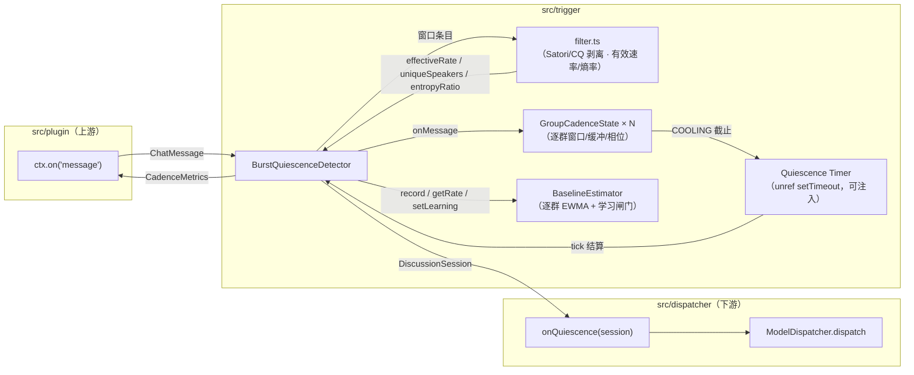
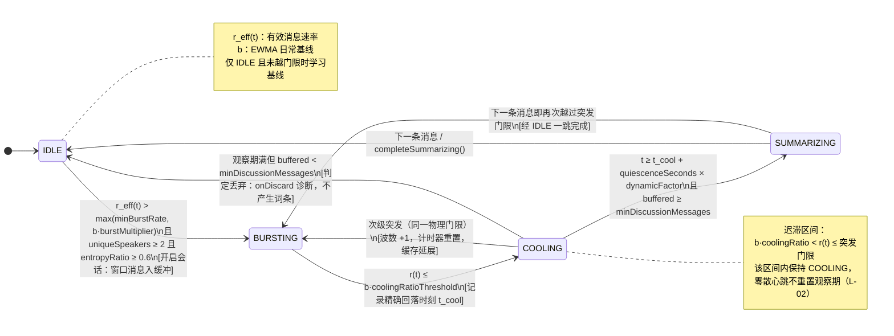

# trigger — 自适应突发与平息触发器（L2 模块声明）

> 所属系统：`patchouli-knowledge`（不动的大图书馆）
> 上游：Koishi 消息中间件（`src/plugin`）
> 下游：知识调度器 `ModelDispatcher`（`src/dispatcher`）
> 依赖：`src/types.ts`（唯一契约来源）、Node.js 内置 `crypto`
> 运行形态：纯内存状态机，**不**调用模型、**不**读写磁盘、**不**主动发言

---

## 1. 职责边界

| 负责 | 不负责 |
| :--- | :--- |
| 逐群维护长期日常基线（EWMA 均值 + 离散度） | 知识抽取、Prompt 构造（`src/dispatcher`） |
| 物理层剥离（Satori/CQ）与有效速率 / 熵率 / 发言人数度量 | llmwiki 落盘、索引维护（`src/wiki`） |
| 滑窗瞬时速率计算与双门限迟滞判定（突发侧叠加物理硬门限） | 群内任何通知/打断（迟智红线） |
| 突发期间静默缓存讨论消息，满 120 条软切片防积压 | 判定内容是否为「纯水聊」（`DispatcherResult.discardReason`） |
| 平息观察期（含动态语义延长）满后以 `DiscussionSession` 交付 | 进程级持久化调度（由插件层按 `CadenceStateSnapshot` 落盘） |
| 逐群参数热更新、状态导出/恢复 | — |

**核心红线（ADR-001）**：讨论峰值期间绝不向群内产出；但为防下游超时/超 token，缓冲满 `BUFFER_SOFT_SLICE_MESSAGES = 120` 时会向下游交付切片（相位不变，不发言）。

### 文件清单

| 文件 | 内容 |
| :--- | :--- |
| `filter.ts` | 物理层滤波：Satori/CQ 码剥离、有效文本长度、窗口 `effectiveRate / uniqueSpeakers / entropyRatio / avgCharLength` |
| `baseline.ts` | `BaselineEstimator`：逐群 EWMA 基线 / 方差 / 状态导出恢复 / 学习闸门 |
| `detector.ts` | `BurstQuiescenceDetector`：`GroupCadenceState` 状态机、缓冲、定时器、动态平息期、软切片、回调 |
| `README.md` | 本文件（L2 契约 + L3 状态机图 + 算法公式） |

---

## 2. 组件结构（L3）



---

## 3. 状态机（L3）



### 相位语义

| 相位 | 缓冲 | 基线学习 | 定时器 | 含义 |
| :--- | :--- | :--- | :--- | :--- |
| `IDLE` | 不累积 | 写入（越门限样本除外） | 无 | 日常节奏，等待突发 |
| `BURSTING` | 持续追加；满 120 条软切片交付 | **绝对冻结** | 速率回落观察点 | 讨论高峰，静默录制 |
| `COOLING` | 持续追加；满 120 条软切片交付 | **绝对冻结** | 平息截止点（含动态延长） | 热度已回落，等待观察期 |
| `SUMMARIZING` | 已移交/清空 | 已解冻（下条消息即回 `IDLE`） | 无 | 交接闩锁，下条消息自动解除 |

`SUMMARIZING` 是**交接闩锁**而非阻塞态：它只用于对外表达「本轮已交付」；插件无需等待调度器完成，下一条消息到达即自动回到 `IDLE`（也可显式 `completeSummarizing()`）。因此调度器异步化不会阻塞后续讨论的捕获。

---

## 4. 算法公式

### 4.1 瞬时速率（滑动窗口）

取窗口 $W$（`windowSizeSeconds`，默认 60 s）：

$$
r(t) = \frac{\left|\{\, ts_i \in W \;\middle|\; ts_i > t - W \,\right|\} \times 60}{W_{\text{seconds}}}\quad(\text{条/分})
$$

窗口未满时按固定分母折算（而非按已流逝时长），避免冷启动前几条消息被放大成天文速率（LESSONS L-01）。

### 4.1.1 物理层前置滤波（`filter.ts`）

先剥离 Satori 标签（``、`<at/>` 等）与 CQ 码，再解码 HTML 实体，得到纯文本；随后统计「实质字符」（字母 / 数字 / 组合记号）：

- 实质字符 < 4 的消息视为纯表情、单字回复或标点刷屏，**不计入有效速率**；
- 有效消息参与以下物理度量：

$$
r_{\text{eff}} = \frac{n_{\text{eff}} \cdot 60}{W_{\text{seconds}}}
\qquad
H = \frac{\left|\{\text{prefix}_{32}(\text{text}_i)\}\right|}{n_{\text{eff}}}
\qquad
\bar{L} = \frac{1}{n_{\text{eff}}}\sum \text{len}(\text{text}_i)
$$

`uniqueSpeakers` 取有效消息 `userId`（缺失回落到 `userName`）的去重数。突发判定使用 $r_{\text{eff}}$，与原始 $r$ 分离：噪声再多也不会推高有效速率。

### 4.2 双门限迟滞（Schmitt Trigger，ADR-002）

$$
\Theta_{\text{burst}} = \min\Bigl(\text{minBurstRate} \cdot \kappa_{\text{ceil}},\;
\max\bigl(\text{minBurstRate},\; b \cdot \text{burstMultiplier}\bigr)\Bigr)
\qquad
\Theta_{\text{cool}} = b \cdot \text{coolingRatioThreshold}
$$

其中 $\kappa_{\text{ceil}} =$ `DEFAULT_MAX_BURST_CEILING_RATIO` $= 1.8$：无论基线 $b$ 被历史峰值抬到多高，
动态门限都不得越过 `minBurstRate × 1.8`（默认 6 → 10.8 条/分），否则慢热讨论会被高位基线锁死。

- 上行穿越 $\Theta_{\text{burst}}$ → 进入 `BURSTING`，但必须**同时**满足物理硬门限：
  $r_{\text{eff}} > \Theta_{\text{burst}}$、`uniqueSpeakers ≥ 2`、`entropyRatio ≥ 0.6`；
  单人刷屏与双人复读机在 `IDLE` 即被拦截；
- 下行穿越 $\Theta_{\text{cool}}$ → 进入 `COOLING`（下行使用原始 $r$，避免短句回复把讨论误判为结束）；
- 两门限之间为迟滞带，状态保持，杜绝在阈值附近抖动。

`currentRate` 与 `baselineRate` 之比即 `burstRatio`：

$$
\text{burstRatio} = \frac{r(t)}{\max(b,\; 0.1)}
$$

分母下限 `0.1` 仅为防除零，度量本身不参与判定。

### 4.3 EWMA 日常基线

$$
b_t = b_{t-1} + \alpha\,(x_t - b_{t-1}),
\qquad
v_t = (1-\alpha)\bigl(v_{t-1} + \alpha\,(x_t - b_{t-1})^2\bigr),
\qquad
\text{deviation}_t = \sqrt{v_t}
$$

其中 $x_t = r(t)$ 为本次样本速率（与突发判定同一滑窗口径），${v}$ 为 EWMA 方差（West 形式）。

#### 静默指数衰减（Time-Aware EWMA）

基线的时间轴必须与真实时间一致，否则「昨晚水了一晚、今早慢热讨论」会被历史峰值长期压制。
每条消息到达时先按距上次基线更新的**真空档**衰减，再做常规 EWMA：

$$
\Delta t_{\text{silent}} = \max\bigl(0,\; t - t_{\text{lastBase}} - W_{\text{ms}}\bigr)
\qquad
b \leftarrow \max\bigl(b_{\text{floor}},\; b_{\text{floor}} + (b - b_{\text{floor}})\,e^{-\Delta t_{\text{silent}}/\tau}\bigr)
$$

- $b_{\text{floor}} =$ `MIN_BASELINE_FLOOR` $= 1.0$ 条/分，$\tau =$ `BASELINE_DECAY_HALF_LIFE_MS` $= 15$ 分钟；
- 只有 $b > b_{\text{floor}}$ 时才向下衰减，方差按同一因子同步收缩，绝不反向拔高；
- 空档先减去一个采样窗口 $W$：这段时间的样本已被 EWMA 吸收，重复计衰减会把正常节奏误判为静默；
- 衰减后 $b$ 贴回底噪，$\Theta_{\text{burst}}$ 随之回到 `minBurstRate`（并受 §4.2 天花板保护）。

#### 双向学习闸门

仅当相位为 `IDLE` 且本条样本未构成突发时写入 EWMA：

- **下行无条件学习**：$r \le b + \varepsilon$ 必定学习（$\alpha_{\text{eff}} = \alpha$）。这是解除高位死锁的
  唯一通道——下行也被拦住，基线就只剩「只升不降」；
- **上行严苛滞回**：$r > b + \varepsilon$ 时须同时满足 $r \le 1.3b + 0.5$ 与 $r < 0.85 \cdot \text{minBurstRate}$，
  并按消息间隔做时间加权 $\alpha_{\text{eff}} = \alpha \cdot \min\bigl(1, \Delta t_{\text{msg}} / 15\,\text{s}\bigr)$
  （首条样本缺省 $\Delta t_{\text{msg}} = 15$ s）——慢热爬坡只能逐级小步抬高基线，密集上行一律不学。

- **突发期绝对冻结**：状态机一旦脱离 `IDLE`（`BURSTING` / `COOLING`），触发器调用
  `BaselineEstimator.setLearning(channelId, false)`；即使调用方显式 `learn: true`，
  `record()` 也只登记时间戳，绝不更新 $b_t$ / $v_t$。结算回 `IDLE` 时解冻。
- **越门限样本不学习**：`IDLE` 期若本条样本速率已越过 $\Theta_{\text{burst}}$（含被物理门限
  拦下的单人刷屏 / 复读），该样本只用于判定，不写入 EWMA——防止水群把长期底噪刷高导致后续漏检。
- **学习闸门不落盘**：`exportState()` 不包含冻结标记；`importState()` 恢复后一律解冻，
  与重启后状态机从 `IDLE` 起步的语义一致。

### 4.4 精确回落时刻与平息截止

设窗口内消息按时间升序为 $ts_0 \le \dots \le ts_{n-1}$，平息门限允许的最大条数

$$
m = \left\lfloor \frac{\Theta_{\text{cool}} \cdot W_{\text{seconds}}}{60} \right\rfloor
$$

则无新消息时，速率首次满足 $r \le \Theta_{\text{cool}}$ 的时刻为

$$
t_{\text{cool}} = t_{s_{\,n-m-1}} + W_{\text{ms}} \quad (n > m),
\qquad
\text{deadline} = t_{\text{cool}} + \text{quiescenceSeconds} \times \text{dynamicFactor} \times 1000
$$

该式让「冷却起点」等于**真实回落时刻**而非「被发现时刻」，即使进程在静默期没有收到任何消息也不会把平息窗口越拖越后。$n \le m$ 时视为已回落，取最后一条消息时间。

### 4.5 平息判定、动态语义延长与软切片

`COOLING` 期间若 $t \ge \text{deadline}$ 且缓冲区消息数 $\ge$ `minDiscussionMessages`，则交出一轮 `DiscussionSession`；否则**判定丢弃**：先调用 `DetectorConfig.onDiscard` 上报判定依据（`channelId` / `messageCount` / `minDiscussionMessages` / `peakRate` / `triggerReason`），再回到 `IDLE`（冷群/短对话保护）。诊断回调先于相位迁移执行，因此运维日志里「什么都没发生」从此有明确归因；回调抛出的异常只转交 `onError`，不影响相位。`COOLING` 内只有**次级突发**（同一物理门限）会重置观察期，零散心跳不会（LESSONS L-02）。

**动态语义平息期**（`computeDynamicQuiescence`）：进入 `COOLING` 时检查缓存末尾 3 条消息的纯文本，命中以下信号即延长：

| 信号 | 判定 |
| :--- | :--- |
| 代码块 | 文本包含 ` ``` ` |
| URL | 包含 `http://` 或 `https://` |
| 问号结尾 | 任一条以 `?` / `？` 收尾 |
| 长文思考 | 末尾样本平均字符长 > 50 |

$$
\text{dynamicFactor} = \begin{cases}
1 & \text{无信号}\\
\min\bigl(2.2,\; 1.2 + 0.25 \times \#\text{signals}\bigr) & \text{否则}
\end{cases}
$$

无信号的普通闲聊完全不延长；四类信号全中时按 2.2 倍延长，避免技术交锋的长思考被截断。

**缓冲区软切片**：`BURSTING` / `COOLING` 期间缓冲达到 `BUFFER_SOFT_SLICE_MESSAGES = 120` 时，立即把当前缓冲作为独立 `DiscussionSession` 交付并清空，**相位保持不变**，后续消息继续累积下一段；`lastSettledTime` 推进到切片末尾，防止重复沉淀。`maxBufferMessages` 仍是硬上限兜底。

**`partial` 标记**：软切片交付的会话恒带 `partial: true`，平息结算（`finalize`）交付的会话恒带 `partial: false`。软切片是进行中讨论的中间段，语义上不完整，下游（插件 AIMD 控制器）**不得**用它作为门限调节依据——否则模型必判 `FRAGMENTED`，触发 `minDiscussionMessages +2` 的自激抬升：切片越碎 → 门限越高 → 后续越难触发。

### 4.6 话题边界切分与主动书记员（Phase 4 / §7.2）

**边界切分**（`noteBoundary` → `sliceAt`）：语义层给出 `{ at, confidence }`，状态机只做执行。

- 丢弃：`confidence < MIN_BOUNDARY_CONFIDENCE(0.5)`、相位不是 `BURSTING`/`COOLING`、`at <= lastBoundaryAt`（单调水位）、`at` 不落在 `[buffer[0].timestamp, buffer[len-1].timestamp]` 内、主动录制期缓冲 `< 25` 条。
- **时间基准**：`at` 与缓冲里的 `message.timestamp` 都在**原始时间戳域**，因此判据只与原始域水位 `lastBoundaryAt` 比较；不比较逻辑时间 `lastSettledTime`（逻辑时间可能因未来戳 / 投递滞后永久领先，跨域比较会把每条合法切点都判成陈旧）。「已交付不复切」由 `lastBoundaryAt` + 缓冲区间判据共同保证：缓冲只保存未交付消息。
- 交付：`timestamp < at` 的消息作为独立 `DiscussionSession`（`partial: true`，`endTime = max(该段最后一条, sessionStartTime)`，`triggerReason` 追加 `；话题边界切分（t=<at>）`），其余留在缓冲；`sessionStartTime` 推进到 `at`、`peakRate` 归零、`sessionPeakQuality` 归零、`completedSessions += 1`、`lastSettledTime` 取最大值。
- **势能侧**：交付前段之后对跟踪器执行 `PotentialTracker.applyBoundary(BOUNDARY_ENERGY_FACTOR = 0.5)`（$E$ / $N$ 同乘 ⇒ $\rho$ 不变、$Q$ 折半，二元组窗口清空），详见 §4.7；`lastPotential` 同步刷新，冷却闭式解不会沿用折半前的 $E$。
- **相位不变**：不进入 `SUMMARIZING`、不重算 $t_{\text{cool}}$、不重置平息定时器。

**主动书记员**：`startManualSession` 置 `manualRecording = true` 并强制 `BURSTING`（不清空缓冲、冻结基线学习）；录制期**跳过全部自动相位迁移**（`BURSTING → COOLING` 与自动结算都不触发），缓冲只受三道保护：

| 保护 | 触发条件 | 结算下限 |
| :--- | :--- | :--- |
| 边界切分 | 语义层边界且缓冲 $\ge 25$ 条 | 无（半截片段，`partial: true`） |
| 软切片 | 缓冲 $\ge 120$ 条 | 无（半截片段，`partial: true`） |
| 静默熔断 | `at - sessionLastMessageTime > MAX_MANUAL_IDLE_MS`（2 小时） | $\ge 2$ 条 |

`stopManualSession` 解除录制并立即以 $\ge 2$ 条为下限结算；不足 2 条只复位并走 `onDiscard`（`minDiscussionMessages` 报实际生效下限 2）。`restoreManualSession` 用于进程重启后恢复进行中的会话：不结算、不软切片、不推进 `lastSettledTime`。

### 4.7 势能判据（`triggerMode = 'potential' | 'shadow'`）

`rate` 模式（默认）完全不受影响；`potential` 用信息势能裁决相位，`shadow` 用旧判据照常裁决、只把观测写进 `metrics.potential`。

$$
\Theta_{\text{burst}} = \max\bigl(\Theta_{\min},\; b_Q \cdot \text{burstMultiplier}\bigr), \qquad
\Theta_{\text{cool}} = \min\Bigl(\max\bigl(\text{coolingRatioThreshold} \cdot \max\bigl(\tfrac{\Theta_{\min}}{\text{burstMultiplier}},\; b_Q\bigr),\; Q_{\text{peak}} \cdot \text{peakCoolFraction}\bigr),\; \Theta_{\text{burst}} \cdot 0.99\Bigr)
$$

$$
\rho_{\text{eff}} = \max\bigl(\rho_{\min},\; \text{densityMultiplier} \cdot b_\rho\bigr)
$$

- 突发就绪：$Q > \Theta_{\text{burst}}$ **且** $\rho \ge \rho_{\text{eff}}$（$Q$ = 有效讨论势能，$\rho$ = 信息密度，见 `potential.ts`）。状态机、`evaluateVerdicts` 与 `metrics.potential`（`rhoEff` / `baselineDensity` 字段）共用同一个 $\rho_{\text{eff}}$，不存在「观测一套、裁决一套」。
- 冷却起点：$Q$ 触到 $\Theta_{\text{cool}}$ 的时刻。$S_{\text{turn}}$ 在无新消息时恒定，故
  $$t_{\text{cool}} = t_k + \tau \log_2\!\left(\frac{E(t_k)}{\Theta_{\text{cool}} / S_{\text{turn}}}\right)$$
  其中 $t_k$、$E(t_k)$ 取**最后一次入环的消息快照**；$S_{\text{turn}} = 0$（单人独白）或 $Q$ 已越界时取 $t_k$。
- 冷却门限的种子基线 $\Theta_{\min}/\text{burstMultiplier}$ 只在 $b_Q$ 尚未学到正常值时生效（冷启动 $b_Q = 0$ 时若直接取 $b_Q \cdot \text{coolingRatioThreshold} = 0$，$Q > 0$ 恒不冷却，群会常驻 `BURSTING`）；$b_Q$ 一旦大于种子即退化为原式。
- **峰值比例冷却**（`peakCoolFraction`，默认 `0.5`）：$\Theta_{\text{cool}}$ 再与 $Q_{\text{peak}} \cdot \text{peakCoolFraction}$ 取大，并**封顶到 $\Theta_{\text{burst}} \times 0.99$**。$Q_{\text{peak}}$ 是本轮 `BURSTING` / `COOLING` 期观测到的最高 $Q$（`GroupCadenceState.sessionPeakQuality`，触发消息本身由 `startBurst` 播种），结算后清零。语义：门限随本轮峰值抬升 ⇒ 高势能场次在仍保有相当残余时就确认回落，避免 $\tau$ 量级的长尾把结算拖到几十分钟；低峰值、或尚未观测到峰值（$Q_{\text{peak}} = 0$）时逐位退化为纯基线口径。封顶保证迟滞带恒成立——$\Theta_{\text{cool}}$ 一旦越过 $\Theta_{\text{burst}}$，相位会在 `BURSTING` / `COOLING` 之间抖动。
- **密度基线** $b_\rho$（`densityMultiplier`，默认 `1.0`）：与 $b_Q$ 同构的第三个 `BaselineEstimator`（冷启动 `initialRate = 0`，样本是每条入环消息的 `density`），闸门逐条对齐 $b_Q$——`IDLE` 才学 / 突发期冻结 / 静默衰减（底噪下限 0）/ 前 `POTENTIAL_BASELINE_WARMUP = 20` 个样本无条件预热 / 上行滞回参照 $\max(b_\rho, \rho_{\min}) \cdot 1.3 + 0.5$ 且样本须低于 $\rho_{\min} \times 0.85$。$\rho_{\text{eff}} = \max(\rho_{\min}, \text{densityMultiplier} \cdot b_\rho)$：ADR-021 已证 $\rho$ 不是跨群分离轴，该倍数只让下限随本群量级浮动，`0` 表示只用固定 $\rho_{\min}$；冷启动 $b_\rho = 0$ 时逐位退化。`updateOptions` 切回 `rate`、`reset()` / `dispose()` 与 $b_Q$ 同步清理。
- **话题边界势能衰减**：`noteBoundary → sliceAt` 交付前段之后，对跟踪器执行 `applyBoundary(BOUNDARY_ENERGY_FACTOR = 0.5)`——`E_u` 与同核计数 `N` 同乘系数，因此 $\rho = E/N$ 不变、$Q = E \cdot S_{\text{turn}}$ 折半；`recent` / `gramCounts` 清空，跨话题重复出现的术语不再被 $\nu$ 判成「重复」（否则新话题的正常讨论会被压成噪声）。`lastPotential` 同步刷新，冷却闭式解不会沿用折半前的 $E$。
- **会话峰值**：`finalize` 与 `flushSlice` / `sliceAt` 在非 `rate` 模式且本轮观测到峰值时，给交付的 `DiscussionSession` 填 `potentialPeak = { quality, density, burstThreshold }`（`density` 取最后一次入环快照的密度）。调度质量门（`dispatchMargin`，见 `plugin/index.ts` 的 `handleQuiescence`）只读这个字段。
- $b_Q$ 是与速率基线**完全独立**的 `BaselineEstimator`（冷启动 `initialRate = 0`）。学习闸门：`IDLE` 才学、突发期冻结、静默衰减按 `BASELINE_DECAY_HALF_LIFE_MS`（底噪下限 0），并通过两段冷启动兜底，否则逐群自适应在数学上无法启动：
  1. **预热**：前 `POTENTIAL_BASELINE_WARMUP = 20` 个 `IDLE` 样本无条件入库——`b_Q` 从 0 起步时上行滞回退化为 $Q \le 0.5$，而稳态闲聊的 $Q$ 在数十量级，一个样本也学不到；
  2. **冷启动上行参照**：预热后上行滞回的参照取 $\max(b_Q, \Theta_{\min})$，即 $Q \le \max(b_Q,\Theta_{\min}) \cdot 1.3 + 0.5$ 且 $Q < \Theta_{\min} \times 0.85$。$Q$ 从 ~1 爬到数十，若始终用 $b_Q \cdot 1.3$，基线只能按 30% 步进、永远追不上本群日常量级；$b_Q \ge \Theta_{\min}$ 后退化为 §4.3 的原式。
- 注意（标定项）：$Q < \Theta_{\min} \times 0.85$ 这道冻结意味着**日常 $Q$ 高于 $0.85\Theta_{\min}$ 的群学不到基线**，$\Theta_{\text{cool}} = 1.1 \cdot \max(\Theta_{\min}/\text{burstMultiplier}, b_Q)$ 可能只比该群的日常 $Q$ 高一点点，于是「$Q$ 衰减到 $\Theta_{\text{cool}}$」的 $\tau$ 项会主导结算耗时（实测：日常 $Q = 54.0$、$\Theta_{\text{cool}} = 55.0$ 时冷却需 ~20 分钟）。这不是状态机缺陷，是门限间距的标定问题。
- 建仓回溯：突发成立时从最近消息环取 `at > lastSettledTime` 的全部消息（保留 `POTENTIAL_PREROLL_MS = 10min`，容量 `RECENT_MESSAGE_CAPACITY = 400`），因此慢聊里已滑出 60 秒速率窗口的开场长文也会进入本轮缓冲。环条目与滑窗同构（`{ message, at }`，`WindowEntry`），**cutoff 与种子过滤都用归一化逻辑时间 `at`**：逻辑时间 = `max(原始 timestamp, lastMessageTime + 墙钟流逝)`，一旦出现未来戳或投递滞后就会永久高于原始 `timestamp`，两套时基混用会让 cutoff 抬过所有诚实原始戳、环逐条自剪，`potentialSeed` 也随之恒为空（建仓时连触发消息都进不来）。
- 门限下限：`thetaMin ≥ 1e-3 > 0` 由参数域强制（见 §6），因此 `Θ_cool` 在冷启动 `b_Q = 0` 时仍然为正；否则 `potentialCrossingAt` 对非正阈值恒返 `null`，群永驻 `BURSTING`、只剩软切片。
- 结算下限：$\max\bigl(|\text{buffer}|, \lfloor N_{\text{equiv}}\rfloor\bigr) \ge \text{minDiscussionMessages}$ **且** $|\text{buffer}| \ge 4$；$N_{\text{equiv}}$ 只在 `finalize` 时用临时跟踪器顺序折算一次。

---

## 5. 对外接口契约

### 5.1 `BaselineEstimator`（`baseline.ts`）

```ts
new BaselineEstimator(options?: Partial<BaselineEstimatorOptions>)

interface BaselineEstimatorOptions {
  alpha: number;               // EWMA 平滑系数，(0, 1]，默认 0.05
  initialRate: number;         // 冷启动先验基线（条/分），默认 2
  sampleWindowSeconds: number; // 内部采样窗口，默认 60
}

record(channelId: string, timestamp: number, options?: BaselineRecordOptions): BaselineObservation
getRate(channelId: string): number
getDeviation(channelId: string): number
getLastTimestamp(channelId: string): number   // 最近样本时间（毫秒，未登记为 0）
decay(channelId: string, minFloor: number, decayFactor: number): number  // 静默指数衰减，返回衰减后基线
getSampleCount(channelId: string): number
getSampleRate(channelId: string, at?: number): number
getOptions(channelId: string): BaselineEstimatorOptions
setInitialRate(channelId: string, rate: number, options?: { resetSamples?: boolean }): void
configure(channelId: string, partial: Partial<BaselineEstimatorOptions>): BaselineEstimatorOptions
updateDefaults(partial: Partial<BaselineEstimatorOptions>): BaselineEstimatorOptions
reset(channelId?: string): void          // 省略 = 清空全部
exportState(): BaselineState             // 可 JSON 序列化（深拷贝）
importState(state: unknown): void        // 全量替换；结构非法抛 TypeError / RangeError
size: number
hasChannel(channelId: string): boolean
channelIds(): string[]
setLearning(channelId: string, enabled: boolean): void  // 学习闸门（突发期绝对冻结）
isLearning(channelId: string): boolean
```

`BaselineRecordOptions`：`{ sampleRate?, learn?, alphaScale? }`

- `sampleRate`：外部已算好的速率（触发器传入自己的滑窗速率，保证口径一致）；
- `learn: false`：只登记时间戳、不更新 EWMA；若该群被 `setLearning(false)` 冻结，`learn: true` 同样不写入；
- `alphaScale`：α 缩放，触发器用消息间隔时间加权（`min(1, Δt/15s)`）实现上行慢学；下行学习恒为 1；
- 时间戳被归一化为单调不降；非法/负数时间戳直接被拒绝（`RangeError`/`TypeError`）。

导出常量：`DEFAULT_BASELINE_ALPHA = 0.05`、`DEFAULT_INITIAL_RATE = 2`、
`DEFAULT_SAMPLE_WINDOW_SECONDS = 60`、`MIN_BASELINE_FLOOR = 1.0`、
`BASELINE_DECAY_HALF_LIFE_MS = 15 * 60_000`。

### 5.2 `BurstQuiescenceDetector`（`detector.ts`）

```ts
new BurstQuiescenceDetector(config: DetectorConfig)

interface DetectorConfig {
  options?: Partial<TriggerOptions>;      // 缺省取 DEFAULT_TRIGGER_OPTIONS
  onQuiescence: (session: DiscussionSession) => void | Promise<void>; // 必填
  onDiscard?: (info: DetectorDiscardInfo) => void;  // 判定不足丢弃时的诊断口（纯观测，可选）
  onManualSessionEnd?: (channelId: string, reason: ManualSessionEndReason) => void; // 书记员会话结束（stop / fuse），宿主据此清档
  onError?: (error: unknown) => void;     // 默认 console.error
  baseline?: BaselineEstimator;           // 可注入共享估算器
  now?: () => number;                     // 可注入时钟（毫秒）
  scheduler?: (callback: () => void, delayMs: number) => () => void;  // 可注入定时器
}

onMessage(message: ChatMessage): CadenceMetrics
getStatus(channelId: string, at?: number): CadenceMetrics
updateOptions(channelId: string, options: Partial<TriggerOptions>): CadenceMetrics
evaluateVerdicts(channelId: string, at?: number): TriggerVerdicts | null   // 两套判据的同期裁决（shadow 对照）
tick(at?: number): void
completeSummarizing(channelId?: string): void
noteBoundary(channelId: string, at: number, confidence: number): void      // 语义层边界标注（同步、无模型）
startManualSession(channelId: string): CadenceMetrics
stopManualSession(channelId: string): CadenceMetrics
restoreManualSession(channelId: string, messages: readonly ChatMessage[], deliveredUpTo?: number): CadenceMetrics
getState(channelId: string): GroupCadenceState | undefined
getOptions(channelId: string): TriggerOptions
hasChannel(channelId: string): boolean
channelIds(): string[]
reset(channelId?: string): void
dispose(): void
readonly baseline: BaselineEstimator
size: number
```

`startManualSession` / `stopManualSession` / `restoreManualSession` 的语义见 §4.6（录制期屏蔽自动相位迁移，结束/熔断以 ≥ 2 条为交付下限）。

`GroupCadenceState` 相对初版新增只读字段 `quiescenceFactor: number`：本轮平息期实际采用的动态倍率（未延长为 `1`，延长为 `1.2 ~ 2.2`），供 UI / 诊断读取；`sessionPeakQuality: number`：本轮观测到的最高 $Q$（`BURSTING` / `COOLING` 期逐条更新，结算后清零），供峰值冷却门限与 `DiscussionSession.potentialPeak` 使用。

模块级导出：`DEFAULT_TRIGGER_OPTIONS`、`BUFFER_SOFT_SLICE_MESSAGES`、`DYNAMIC_QUIESCENCE_SAMPLE`、`QUIESCENCE_EXTENSION_BASE / STEP / MAX`、`LONG_MESSAGE_THRESHOLD`、`DEFAULT_MAX_BURST_CEILING_RATIO`、`POTENTIAL_BASELINE_WARMUP`、`BOUNDARY_ENERGY_FACTOR`、`normalizeTriggerOptions()`、`burstThreshold()`、`potentialBurstThreshold()`、`potentialCoolThreshold()`、`effectiveRhoMin()`、`computeDynamicQuiescence()`；并再导出 `filter.ts` 的 `evaluateWindow()` / `evaluateWindowEntries()` / `stripMessageMarkup()` / `effectiveTextLength()` / `codePointLength()` 以及 `MIN_EFFECTIVE_TEXT_LENGTH` / `ENTROPY_PREFIX_LENGTH` / `MIN_UNIQUE_SPEAKERS` / `MIN_ENTROPY_RATIO`。

类型导出：`GroupCadenceState | WindowEntry | DetectorConfig | DetectorDiscardInfo | QuiescenceHandler | TriggerScheduler | CancelTimer | QuiescenceSignals | DynamicQuiescence | WindowEvaluation | WindowMessage | TriggerVerdicts`。

`PotentialMetrics`（`types.ts`）新增 `rhoEff: number` 与 `baselineDensity: number`——`metrics.potential.rhoEff` / `baselineDensity` 与状态机裁决同源，消费者无需复算 $b_\rho$；`TriggerVerdicts.potential` 同样带 `rhoEff` / `baselineDensity`，并保留 `rhoMin` 供对照。

`DetectorDiscardInfo`（8 字段）：`{ channelId: string; messageCount: number; minDiscussionMessages: number; peakRate: number; triggerReason: string; startTime: number; endTime: number; messages: ChatMessage[] }`——缓冲不足丢弃时的完整判定依据（`messageCount` 为实际被丢弃的缓冲条数，`triggerReason` 含次级突发波数，`startTime` / `endTime` 为本轮讨论起止的逻辑时间，`messages` 为**被丢弃的消息全集**的只读副本，供宿主留证落盘）。

### 5.3 回调契约

| 项 | 约定 |
| :--- | :--- |
| 调用时机 | ① `COOLING → SUMMARIZING` 跨越平息截止点；② 缓冲达到 `BUFFER_SOFT_SLICE_MESSAGES = 120` 的软切片（此时相位仍为 `BURSTING` / `COOLING`）。每个交付片段恰好一次 |
| 调用上下文 | 同步调用（定时器回调 / `onMessage` / `tick` / `getStatus` 调用栈内） |
| 返回值 | 若返回 thenable，其 rejection 交给 `onError`；同步 throw 亦交给 `onError` |
| 异常隔离 | 回调异常不会中断消息主循环，也不会破坏状态机 |
| 会话内容 | `messages` 为按时间升序的缓冲副本（已从内部清空）；`peakRate` 为条/分；`triggerReason` 为人类可读判定依据 |
| 会话完备性 | `partial: true` = 软切片（进行中讨论的中间段，不得用于门限调节）；`partial: false` = 平息结算交付的完整一轮讨论 |

`onDiscard`（可选，纯观测口）：

| 项 | 约定 |
| :--- | :--- |
| 调用时机 | `COOLING` 观察期满但缓冲条数 `< minDiscussionMessages` 时，**先于** `phase = 'IDLE'` 恰好调用一次 |
| 入参 | `DetectorDiscardInfo` 全 8 字段：判定依据（`channelId` / `messageCount` / `minDiscussionMessages` / `peakRate` / `triggerReason` / `startTime` / `endTime`）**外加被丢弃的消息全集** `messages`（只读副本） |
| 异常隔离 | 同步 throw 转交 `onError`；相位照常回到 `IDLE`，状态机不受影响 |
| 用途 | 让「缓冲不足未沉淀」在运维日志里可见，用于区分「未触发」与「插件故障」；带正文才能复核是冷群短对话还是门限误杀 |

`onManualSessionEnd`（可选，纯观测口）：

| 项 | 约定 |
| :--- | :--- |
| 调用时机 | `stopManualSession`（`reason = 'stop'`）与录制期 2h 静默熔断（`reason = 'fuse'`）各恰好一次 |
| 入参 | `(channelId, reason: 'stop' \| 'fuse')` |
| 异常隔离 | 同步 throw 转交 `onError`，相位迁移不受影响 |
| 用途 | 宿主据此删除 `scribe/<channelId>.jsonl`，避免重启时把已结束的会话再次恢复、再次交付 |

### 5.4 与本地仓储的对接（`CadenceStateSnapshot`）

`src/types.ts` 的 `CadenceStateSnapshot` 由插件层组装，触发器**不重复定义**该类型：

```ts
// 落盘：状态机参数 + 最近一次度量
const state = detector.getState(channelId);
if (state) {
  const snapshot: CadenceStateSnapshot = {
    channelId,
    options: state.options,          // 已含 AIMD 控制器回灌的校准结果
    metrics: detector.getStatus(channelId),
    updatedAt: Date.now(),
  };
  await store.saveCadenceState(snapshot);
}

// 回灌：参数 + 已学习到的基线
detector.updateOptions(channelId, snapshot.options);
detector.baseline.setInitialRate(channelId, snapshot.metrics.baselineRate, { resetSamples: true });
```

`updateOptions` 会同步把 `baselineEwmaAlpha` / `windowSizeSeconds` 下发到基线估算器，两处口径不会漂移。

---

## 6. 参数表（`TriggerOptions`）

| 字段 | 默认 | 合法域 | 语义 |
| :--- | ---: | :--- | :--- |
| `windowSizeSeconds` | 60 | [1, 86400] | 瞬时速率滑窗（秒） |
| `burstMultiplier` | 2.5 | [1, 1000] | 突发倍率门限 |
| `minBurstRate` | 6 | [0, 100000] | 突发绝对速率保底（条/分，L-01） |
| `quiescenceSeconds` | 300 | [0, 604800] | 平息观察期（秒） |
| `coolingRatioThreshold` | 1.1 | [0, 1000] 且 < `burstMultiplier` | 回落门限倍率 |
| `minDiscussionMessages` | 12 | 数值 [0, 100000] | 有效沉淀的最低消息数（允许小数：11.5 ≡ 至少 12 条） |
| `maxBufferMessages` | 500 | 整数 [1, 100000] | 缓冲上限（防 OOM） |
| `baselineEwmaAlpha` | 0.05 | [1e-4, 1] | 基线学习平滑系数 |
| `triggerMode` | `'rate'` | `'rate' \| 'potential' \| 'shadow'` | 判据层：`rate` 速率双门限；`potential` 由信息势能裁决相位；`shadow` 仍由速率裁决、只把 `metrics.potential` 写进观测 |
| `thetaMin` | 20 | **正数** [1e-3, 1e6] | 势能突发门限下限 $\Theta_{\min}$（nat 累加）；`0` 会让冷启动 $\Theta_{\text{cool}} = 0$、永不冷却，故拒绝 |
| `rhoMin` | 1.2 | [0, 1e6] | 信息密度下限 $\rho_{\min}$（Δnat/条）；实际闸门用 $\rho_{\text{eff}} = \max(\rho_{\min}, \text{densityMultiplier} \cdot b_\rho)$ |
| `densityMultiplier` | 1.0 | [0, 100] | 密度基线倍率：让 $\rho$ 的生效下限随本群量级浮动；`0` = 只用固定 `rhoMin`（冷启动 $b_\rho = 0$ 时逐位退化） |
| `peakCoolFraction` | 0.5 | [0, 1] | 峰值冷却分数：$\Theta_{\text{cool}}$ 叠加本轮峰值 $Q \cdot$ 该分数，封顶 $\Theta_{\text{burst}} \times 0.99$；`0` = 纯基线口径 |
| `dispatchMargin` | 0（关闭） | [0, 10] | 调度质量门倍数：完整结算的 `potentialPeak.quality < Θ_burst × 该倍数` 时跳过云端调度（判据在 `plugin/index.ts` 的 `handleQuiescence`，本模块只负责填 `potentialPeak`） |
| `potentialAutoTuning` | 未设置（视同 `false`） | 布尔 | `shadow` 对照时让两套门限同步参与 AIMD（`both` 目标）；关闭时势能侧只吃时间衰减 |

越界、非数值、`maxBufferMessages` 非整数、`triggerMode` 非枚举值、`potentialAutoTuning` 非布尔、以及 `coolingRatioThreshold >= burstMultiplier`（迟滞带消失）一律抛 `RangeError`，不做静默纠正。三个可选增强（`densityMultiplier` / `peakCoolFraction` / `dispatchMargin`）走同一套数值域校验；持久化快照缺字段时分别按 `1.0` / `0.5` / `0`（关闭）解释。

---

## 7. 时序与运行语义

- **逻辑时间**：`逻辑 now = 最后消息逻辑时间 + 距上次观测的墙钟流逝`。静默期间时间继续流动，因此「没有消息也要结算」在逻辑上成立；离线仿真可用 `tick(at)` / `getStatus(id, at)` 直接喂入逻辑时间。
- **乱序与重投**：时间戳倒流会被夹紧到逻辑 now（不回溯）；窗口内重复的 `message.id` 只重算度量、不重复计数。
- **定时器**：`BURSTING` 期按 §4.4 的回落时刻预约一次求值；`COOLING` 期按 deadline 预约。定时器一律 `unref()`，不阻止进程退出；可经 `scheduler` 注入假定时器做确定性测试。
- **兜底**：`tick()` / `getStatus()` / `updateOptions()` 都会先结算再重排定时器，因此即便定时器被宿主休眠暂停，状态机仍会在下一次访问时收敛到正确相位。
- **防重复沉淀**：每轮结算记录 `lastSettledTime`，新会话从该时刻之后的消息开始播种，避免同一批消息被两轮词条重复消费。
- **内存**：`window` 只保留窗口内消息；`buffer` 达到 120 条立即软切片交付并清空（相位不变），`maxBufferMessages` 作为硬上限兜底，溢出丢弃最旧消息并计入 `droppedMessages`；势能模式另有回溯环 `POTENTIAL_PREROLL_MS = 10min` / `RECENT_MESSAGE_CAPACITY = 400` 双约束（条目按逻辑时间淘汰）；L0 流式边界标注器的上报去重窗口固定容量 `REPORTED_AT_WINDOW = 8`（`at` 单调，等价于全量去重，但不会随群生命周期增长）。

---

## 8. 验收映射（`tests/test-suite.md`）

| 用例 | 覆盖点 | 断言要点 |
| :--- | :--- | :--- |
| **BURST-01** | 常态闲聊不误触 | 20 条 / 10 分钟：相位恒 `IDLE`，无回调 |
| **BURST-02** | 激烈讨论触发录制 | 多发言人密集消息进入 `BURSTING`；静默越过 deadline 后交付 ≥ 15 条 |
| **BURST-03** | 静默度过迟滞期 | 平息后回调 1 次、`peakRate ≥ 10` |
| **BURST-04** | 冷却期次级突发 | 第二波回弹 `BURSTING`，两波合并交付 ≥ 18 条 |
| **FILTER-01** | 物理层剥离 | Satori/CQ/表情/单字/标点全部剔除，仅 2 条有效纯文本 |
| **FILTER-02** | 速率与熵率 | 30 s 内 6 条有效消息 → `effectiveRate = 12`、复读熵率 `1/6` |
| **GATE-01** | 单人刷屏拦截 | 高速单人消息始终 `IDLE` |
| **GATE-02** | 复读机拦截 | 双人同文刷屏因熵率不足始终 `IDLE` |
| **DYNQ-01** | 动态平息期纯函数 | 单问号 1.45×；代码 + URL + 问号 + 长文 2.2× |
| **DYNQ-02** | 动态截止生效 | 基础 60 s × 2.2：80 s 不结算、140 s 结算 |
| **FREEZE-01** | 基线绝对冻结 | 突发期 `isLearning = false` 且 `getRate` 不变；结算后解冻 |
| **SLICE-01** | 软切片 | 缓冲达 120 条交付一次切片，相位仍为 `BURSTING`，缓冲重新累积 |
| **DISCARD-01** | 缓冲不足诊断 | `onDiscard` 恰好 1 次且 8 字段（含被丢弃消息全集 `messages`）与实际缓冲/峰值一致；无沉淀回调；相位回 `IDLE` |
| **DISCARD-02** | 完备性标记 | 正常 `finalize` 交付 `partial === false` |
| **DISCARD-03** | 软切片标记 | `flushSlice` 交付 `partial === true`、`triggerReason` 含「软切片」、相位不变 |
| **DISCARD-04** | 回调异常隔离 | `onDiscard` 抛错仅转交 `onError`；相位仍回 `IDLE`，随后可再次进入 `BURSTING` |
| **POTENTIAL-13** | 密度基线 $\rho_{\text{eff}}$ | 20 条高密度长文预热后 $b_\rho > \rho_{\min}$、$\rho_{\text{eff}} = b_\rho$；补 2 条四字短句令 $\rho \in (\rho_{\min}, \rho_{\text{eff}})$ 且 $Q > \Theta_{\text{burst}}$ 时 `verdict.ready === false`；`densityMultiplier=0` 对照就绪、`2.0` 时 $\rho_{\text{eff}} = 2b_\rho$；裁决与 `metrics` 同口径 |
| **POTENTIAL-14** | 峰值比例冷却 | 峰值 0 / 缺省退化基线；$120 \times 0.5 = 60$ 高于基线；任意峰值封顶 $\Theta_{\text{burst}} \times 0.99$；`peakCoolFraction=0` 关闭；扫掠下 $\Theta_{\text{cool}} < \Theta_{\text{burst}}$ 恒成立 |
| **POTENTIAL-15** | 边界势能衰减 | `applyBoundary(0.5)` 后 $E$ / $N$ 折半、$\rho$ 不变、$Q$ 折半，`recent` / `gramCounts` 清空 ⇒ 跨话题重述仍有 $I > 0$；越界系数抛 `RangeError`；`noteBoundary → sliceAt` 后真实残余势能折半 |
| **POTENTIAL-16** | 会话峰值 | 势能模式 `finalize` 会话携带 `potentialPeak`（`quality ≥ burstThreshold`、`density > 0`），结算后 `sessionPeakQuality` 归零，$\Theta_{\text{cool}}$ 接线含峰值项且不越 $\Theta_{\text{burst}}$；rate 模式会话无 `potentialPeak` |
| **DECAY-A** | 静默衰减 + 慢热爬坡 | 基线 4.0、静默 3 小时后首条消息使基线回落至 ~`MIN_BASELINE_FLOOR`；慢热递增流在 01:28~01:30 进入 `BURSTING`，触发速率 ≤ `minBurstRate × 1.8` |
| **DECAY-B** | 下行学习收敛 | 基线 4.5、持续 3 条/分 5 分钟：基线单调不增并跌破 4.0，相位恒 `IDLE`，无高位死锁 |

```
node node_modules/typescript/bin/tsc --noEmit   # 0 error
```

---

## 9. 变更记录（CDC）

| 日期 | 变更 |
| :--- | :--- |
| 2026-11-13 | 势能引擎四项增强（ADR-021 回放落地，均为**代码级**、默认口径尽量保守）：① 新增逐群密度基线 $b_\rho$（与 $b_Q$ 同构的 `BaselineEstimator`，同三层闸门 + 20 样本预热 + 静默衰减），密度闸门改为 $\rho_{\text{eff}} = \max(\rho_{\min}, \text{densityMultiplier} \cdot b_\rho)$，`TriggerVerdicts.potential` 与 `metrics.potential` 增 `rhoEff` / `baselineDensity`（保留 `rhoMin` 对照），冷启动 $b_\rho = 0$ 逐位退化；② `Θ_cool` 叠加本轮峰值 $Q \cdot$ `peakCoolFraction`（默认 0.5）并封顶 $\Theta_{\text{burst}} \times 0.99$，`GroupCadenceState` 新增 `sessionPeakQuality`（触发时播种、结算清零）；③ 话题边界 `sliceAt` 交付前段后执行 `PotentialTracker.applyBoundary(0.5)`（$E$ / $N$ 同乘 ⇒ $\rho$ 不变、$Q$ 折半，二元组窗口清空，`lastPotential` 刷新）；④ `finalize` / `flushSlice` / `sliceAt` 给非 `rate` 模式的会话填 `potentialPeak`，供 `dispatchMargin` 调度质量门使用。新增用例 POTENTIAL-13..16。**注意**：`densityMultiplier` 默认 1.0 会让 `potential` / `shadow` 的密度闸门随群抬升（`rhoMin=0` 不再等价于「关闭密度闸门」，须显式 `densityMultiplier=0`）；`peakCoolFraction` 默认 0.5 会改变 `potential` 模式的冷却时刻；`rate` 模式逐位不变。 |
| 2026-10-25 | 初版：`BaselineEstimator` + `BurstQuiescenceDetector` + 本 L2/L3 声明；确立双门限迟滞、精确回落时刻、降速学习与 `SUMMARIZING` 闩锁语义 |
| 2026-11-13 | 线上再标定（ADR-021）：shadow 49 h 对照后全量语料回放（96 A + 40 discards）证明 ρ 与判别无关、`Θ_min=20` 偏低；线上 `thetaMin` 改为 **28**（`koishi.yml` 锚点 + `store.json` 逐群 cadence 同步，两处都要改否则重启被快照覆盖），`rhoMin` 维持 1.2。冻结门限下 A 89% / C1 0% / C2 11%，三天窗口调度精确率 86%。`potential` 切换继续挂起，新门限下再观察 ≥3 天。 |
| 2026-11-11 | AIMD 新增 `both` 目标：`shadow` 对照时 `potentialAutoTuning=true` 让 `minBurstRate` 与 `thetaMin` 在同一控制器、同一时钟、同一信号下各走一步（`minDiscussionMessages` 只加一次、衰减只算一次）。原因：`shadow` 原先只调 `minBurstRate`，势能侧门限仅吃时间衰减，追不上本群量级——那样比较两套判据等于给势能引擎让子。 |
| 2026-10-26 | 诊断与反馈隔离：新增 `DetectorDiscardInfo` 与 `DetectorConfig.onDiscard`（缓冲不足丢弃不再静默）；`DiscussionSession.partial` 区分软切片（`true`）与平息结算（`false`），软切片片段不得作为 AIMD 门限调节依据 |
| 2026-10-26 | 物理层重构：新增 `filter.ts`（Satori/CQ 剥离、有效速率、独立发言人数、信息熵率、平均字符长）；突发判据叠加 `uniqueSpeakers ≥ 2` 与 `entropyRatio ≥ 0.6`；新增动态语义平息期（1.2~2.2×）；基线改为脱离 IDLE 绝对冻结；缓冲满 120 条软切片；`minDiscussionMessages` 放宽为连续值以支持 AIMD |
| 2026-10-27 | 三层正交加固（修复高位基线锁死慢热讨论）：① 基线按真实时间差指数衰减（`BaselineEstimator.decay` / `getLastTimestamp`，`MIN_BASELINE_FLOOR = 1.0`、`BASELINE_DECAY_HALF_LIFE_MS = 15 min`），静默越长基线越贴底噪；② 突发门限加绝对天花板 `DEFAULT_MAX_BURST_CEILING_RATIO = 1.8`；③ 学习闸门重构为双向：下行无条件学习（解高位死锁），上行严苛滞回 + 消息间隔时间加权 α |
| 2026-11-11 | 势能模式四处缺陷修复（P2-A~E）：① 建仓回溯环条目改存 `{ message, at }`，cutoff 与 `potentialSeed` 过滤统一用归一化逻辑时间 `at`（原先逻辑时间算 cutoff 却比原始 `timestamp`，任一条未来戳即让环自剪成空、种子恒为空）；② `noteBoundary` 去掉跨域的 `at <= lastSettledTime` 判据，只与原始域水位 `lastBoundaryAt` + 缓冲区间判据比较；③ `thetaMin` 下限收紧为 `1e-3`（`0` 会让冷启动 `Θ_cool=0`、`potentialCrossingAt` 恒 `null`、群永驻 BURSTING）；④ `LexicalBoundaryDetector` 的 `reportedAts` 从无界 `Set` 改为容量 8 的滑窗（`at` 单调，判定等价）；⑤ `finalize` 先判定后清空缓冲 + `settleDue` 统一走 `settleDueSafely`（异常转 `onError`，不再丢整轮缓冲），`effectiveSessionCount` 对非字符串 `userId` 用占位发言人；⑥ `PotentialTracker.peek` 夹紧到 `lastAt`（回看不放大残余势能）。 |
