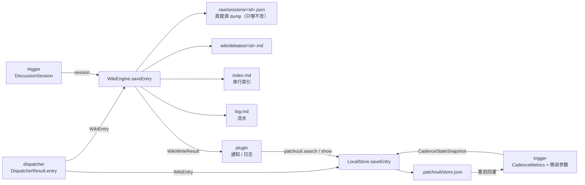
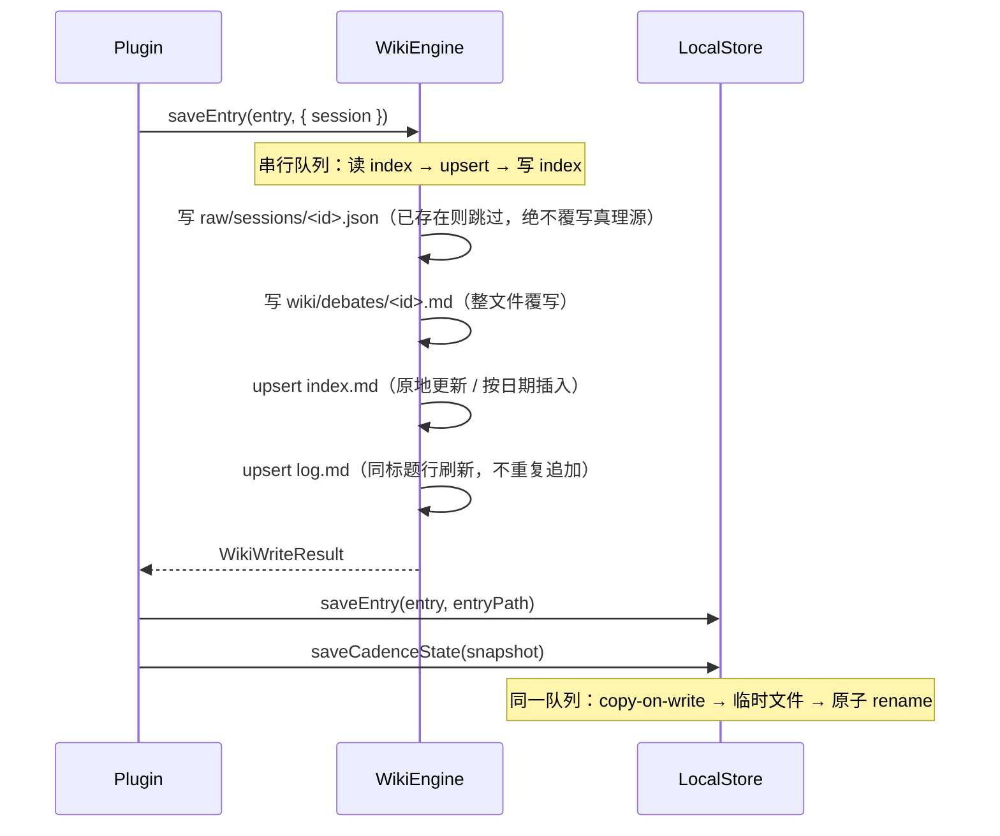

# src/wiki — llmwiki 沉淀与本地持久化层 (L2 模块声明)

> 上游：`src/dispatcher/` 产出 `WikiEntry` ｜ 下游：`src/plugin/` 暴露查询指令
> 契约源：`src/types.ts` (`WikiEntry` / `WikiStorageConfig` / `CadenceStateSnapshot`)

本模块只做两件事：**把一次讨论结算变成可积累的 llmwiki 资产**（`layout.ts` + `engine.ts`），以及**把沉淀元数据和群的节奏特征存下来**（`storage.ts`）。不解析模型输出、不判断该不该沉淀、不触碰 Koishi 运行时——因此可以脱离插件单独单元测试。

---

## 1. 文件组织

```
src/wiki/
├── layout.ts      # 目录布局：raw/ · wiki/ · .patchouli/ 的路径推导与骨架创建
├── engine.ts      # WikiEngine：DiscussionSession → raw/sessions；WikiEntry → wiki/debates；维护 index.md / log.md
├── storage.ts     # LocalStore：本地 JSON 仓储（词条元数据 + 节奏快照 + 检索）
├── plain-text.ts  # 内联数学去标记：LaTeX（`$\rightarrow$`）→ Unicode 纯文本，卡片 / 展厅 / 落盘共用
├── discard-dump.ts # 丢弃轮次留证：被判定不沉淀的整轮消息 + 判定依据（有界轮转）
└── README.md      # 本文件（L2 契约声明）
```

落盘产物（运行时生成，均在 `WikiStorageConfig.wikiDir` 下，架构与本地 `llmwiki` 仓库一致）：

```
<wikiDir>/
├── index.md                        # 导航层：单行索引（自动增量维护，严禁重复行）
├── log.md                          # 时间流水（自动增量维护）
├── raw/sessions/<entryId>.json     # 真理源：本轮 DiscussionSession 原始消息 dump（只增不改）
├── wiki/debates/<entryId>.md       # 编译产物：词条正文（一字目一文件，可覆写）
├── .patchouli/store.json           # LocalStore 文档（元数据 + 节奏快照）
├── .patchouli/custom-prompt.txt    # 自定义系统提示词（悬浮窗设置页写入，插件启动时回灌）
└── .patchouli/discards/<date>-<sessionId>.json  # 丢弃轮次留证（开关 observability.discardDumps，默认关；开启后 40 份 / 8 MiB 双限）
```

`entrySubdir` / `rawSubdir` / `indexFileName` / `logFileName` 可由 `WikiEngineOptions` 覆盖；`databasePath` 由 `WikiStorageConfig` 覆盖（缺省为 `<wikiDir>/.patchouli/store.json`）。

### 1.1 `layout.ts` 导出

| 导出 | 说明 |
| :--- | :--- |
| `DEFAULT_WIKI_SUBDIR = 'data/llmwiki'` | 未配置 `storage.wikiDir` 时的默认子目录（由 `src/plugin` 按 `ctx.baseDir` 锚定解析） |
| `RAW_SESSIONS_SUBDIR` / `WIKI_DEBATES_SUBDIR` / `PATCHOULI_DIR_NAME` / `DISCARDS_DIR_NAME` | 三段骨架与留证子目录的相对目录常量 |
| `resolveWikiLayout(rootDir)` | 纯路径推导 → `WikiLayout`（`rootDir/rawDir/rawSessionsDir/wikiDir/entryDir/patchouliDir/discardsDir/indexPath/logPath/storePath/customPromptPath`） |
| `ensureWikiLayout(rootDir)` | `mkdir -p` 建全 `raw/sessions/`、`wiki/debates/`、`.patchouli/`，幂等、不清理既有内容；**不建 `discards/`**（留证目录由首次写入懒创建） |

---

## 2. 数据流



一次结算的落盘顺序与并发语义：



关键点：`engine` 与 `store` 各自串行化自己的写操作，互不阻塞；跨模块的先后顺序由 `plugin` 编排，本模块不互相依赖。

---

## 3. 对外接口契约

### 3.1 `WikiEngine`（`engine.ts`）

| 成员 | 签名 | 语义 |
| :--- | :--- | :--- |
| `constructor` | `(options: WikiEngineOptions)` | `wikiDir` 必填；其余可覆盖默认布局（`entrySubdir` = `wiki/debates`、`rawSubdir` = `raw/sessions`）、摘要长度、时钟 |
| `wikiDir` / `entriesDir` / `rawSessionsDir` | `string` | 绝对路径只读访问器（根 / 词条目录 / 原始会话目录） |
| `entryPath` | `(id: string) => string` | 词条 Markdown 绝对路径（`id` 中的文件系统非法字符替换为 `-`） |
| `sessionDumpPath` | `(id: string) => string` | 原始会话 dump 绝对路径 `<wikiDir>/raw/sessions/<id>.json` |
| `saveEntry` | `(entry: WikiEntry, options?: { session?: DiscussionSession }) => Promise<WikiWriteResult>` | 写原始会话 dump（若有 session）+ 写词条 + 更新索引 + 更新流水；同 `id` 重复调用为幂等覆写，但**不覆写已存在的 raw dump** |
| `saveSessionDump` | `(session: DiscussionSession, entryId: string) => Promise<WikiRawWriteResult>` | 单独沉淀真理源 dump；目标已存在则返回 `{ created: false }` |
| `readSessionDump` | `(id: string) => Promise<string \| undefined>` | 读原始会话 JSON 文本；不存在返回 `undefined` |
| `readEntry` | `(id: string) => Promise<string \| undefined>` | 读正文；不存在返回 `undefined` |
| `removeIndexEntry` / `removeLogEntry` | `(text: string, title: string) => string` | 文本级删除该标题的全部托管行（`- ` 开头且含 `[[标题]]`），删除后仍保证脚手架完整；模块级纯函数与实例门面同名等价 |
| `deleteEntry` | `(id: string, title?: string) => Promise<WikiDeleteResult>` | 删除 `wiki/debates/<id>.md` 与 `raw/sessions/<id>.json`，并清除 `index.md` / `log.md` 对应行；`title` 省略时从词条 H1 反推；`ok` = 至少删除一项（重复删除幂等返回 `false`）；与 `saveEntry` 共用串行队列 |
| `clearAllEntries` | `() => Promise<WikiClearResult>` | 删除 `wiki/debates/*.md` 与 `raw/sessions/*.json`（直接文件、不递归），`index.md` / `log.md` 重置为初始脚手架；目录骨架与 `.patchouli/` 仓储保留 |
| `updateEntryMarkdown` | `(id: string, markdown: string, metadata?: { title?: string; summary?: string; date?: string }) => Promise<void>` | 覆写词条正文；给出任意元数据时 upsert `index.md` 单行（缺失字段从正文 H1 / `Date:` / `## 摘要` 反推；标题变更清除旧标题行，含连续改名时进程内记忆的上一个标题）；未给元数据时只写正文 |
| `markSuperseded` | `(id: string, intoTitle: string) => Promise<{ path: string; title: string } \| undefined>` | 把词条标记为「已被归并」：`Status:` 改写为 `superseded` 并插入 `Merged-Into: [[目标标题]]`（正文其余逐行不动），从 `index.md` 移除该标题托管行，向 `log.md` 追加 `- <时间> [<channelId>] 归并 [[旧标题]] → [[目标标题]]`（复用脚手架与同标题去重，重复调用只有一行）；词条 Markdown 不存在时返回 `undefined` 且不写任何文件；与 `saveEntry` 共用串行队列 |

纯函数（导出，便于无 I/O 断言）：

| 函数 | 说明 |
| :--- | :--- |
| `renderEntryMarkdown(entry)` | `WikiEntry` → llmwiki 词条 Markdown，输出仅依赖入参（无时间戳，幂等）；`kind` 输出 `Kind:` 行，`sources` 长度 ≥2 输出多行 `Sources:` 列表（单源 / 缺省仍是 `Source: raw/sessions/<id>.json`），`related` 输出 `Related: [[A]], [[B]]`；`narrative` 非空时在 `## 背景` 之后插入 `## 讨论脉络`（）；`glossary` 非空时在摘句前插入 `## 名词注` |
| `sourcePathOf(entryId)` | 词条头部 `Source:` 值：`raw/sessions/<id>.json` |
| `toRawSessionDocument(session, entryId)` | `DiscussionSession` → `RawSessionDocument`（剥离 `ChatMessage.raw` 的 Koishi 事件对象） |
| `formatIndexLine(entry, maxSummaryLength?)` | 渲染索引单行 `- [[标题]] - YYYY-MM-DD 摘要` |
| `formatLogLine(entry, at)` | 渲染流水行 `- YYYY-MM-DD HH:mm [channelId] 沉淀条目 [[标题]] (共 N 条消息)` |
| `upsertIndexEntry(indexText, line, title, date)` | 索引文本级 upsert：原地更新 + 清重 + 日期倒序插入 |
| `upsertLogEntry(logText, line, title)` | 流水文本级 upsert：同标题行刷新，否则追加 |
| `removeIndexEntry(indexText, title)` | 删除该标题的全部索引托管行（含历史重复行），并维持 `# 标题 + ## 沉淀词条` 脚手架 |
| `removeLogEntry(logText, title)` | 删除该标题的全部流水托管行，并维持 `# Patchouli Knowledge Log` 脚手架 |

`WikiWriteResult` 字段：`entryId` / `title` / `entryPath` / `indexPath` / `logPath` / `rawSessionPath` / `rawSessionCreated` / `indexFileCreated` / `indexLineInserted` / `logFileCreated`。
`WikiRawWriteResult` 字段：`path` / `created`。
`WikiDeleteResult` 字段：`ok`（至少删除一项产物）/ `deletedFile`（词条 md）/ `deletedRaw`（原始 dump）。
`WikiClearResult` 字段：`clearedDebatesCount` / `clearedRawsCount`（实际删除的直接文件数）。

### 3.2 `LocalStore`（`storage.ts`）

| 成员 | 签名 | 语义 |
| :--- | :--- | :--- |
| `constructor` | `(config: WikiStorageConfig, options?: LocalStoreOptions)` | `wikiDir` 必填，`databasePath` 缺省为 `<wikiDir>/.patchouli/store.json` |
| `path` | `string` | 存储文件绝对路径 |
| `saveEntry` | `(entry: WikiEntry, entryPath?: string) => Promise<WikiEntryRecord>` | 覆盖式写入元数据，保留首次 `createdAt` |
| `deleteEntry` | `(id: string) => Promise<boolean>` | 删除单条元数据并原子写回；键不存在返回 `false`（不写盘），`cadence` 与其他词条保留 |
| `updateEntry` | `(id: string, patch: WikiEntryPatch) => Promise<WikiEntryRecord>` | 局部更新 `title` / `summary` / `status` / `tags` / `participants`，刷新 `updatedAt`；不存在抛错，非法字段抛 `TypeError` |
| `clearEntries` | `() => Promise<void>` | 清空全部词条元数据并原子写回，**`cadence` 原样保留**（调优参数不随清空丢失） |
| `getEntry` | `(id: string) => Promise<WikiEntryRecord \| undefined>` | 按 id 取元数据（深拷贝，外部修改不污染缓存） |
| `searchEntries` | `(keyword: string, channelId?: string, options?: { view?: 'meta'\|'full'; limit?: number }) => Promise<WikiEntryRecord[]>` | 关键词 AND 检索；默认 `view='full'`：先命中 `id/标题/摘要/标签`，未命中项再穿透 Markdown 正文（背景/矩阵/共识/分歧/引用）；空关键词 = 该范围内全部。**排序**：命中位置权重（标题 3 > id/摘要/标签 2 > 正文 1）逐词累加后倒序，同分按 `createdAt` 倒序、再按 `id` 升序 |
| `listEntriesBetween` | `(fromMs: number, toMs: number, channelId?: string) => Promise<WikiEntryRecord[]>` | 按 `createdAt ∈ [fromMs, toMs)` 过滤（可选限定群），**升序**返回（同一时刻按 `id` 升序）；纯内存读，供主题聚合挑选当日材料 |
| `listEntriesByStatus` | `(status: EntryStatus, channelId?: string) => Promise<WikiEntryRecord[]>` | 按状态取词条（可选限定群），日期倒序（同日按 `updatedAt` 倒序）；供主题聚合挑选回看窗口内仍待定 / 未决的材料 |
| `listChannels` | `() => Promise<string[]>` | 已沉淀词条涉及的群聊（升序去重），供前端分群下拉 |
| `getRecentEntries` | `(channelId?: string, limit?: number) => Promise<WikiEntryRecord[]>` | 日期倒序（同日按 `updatedAt` 倒序）；`limit` 缺省 20 |
| `queryEntries` | `(query?: WikiEntryQuery) => Promise<WikiEntryRecord[]>` | 组合条件：`channelId/date/from/to/tag/status/keyword/view/limit`（`view` 默认 `full`） |
| `saveCadenceState` | `(state: CadenceStateSnapshot) => Promise<CadenceStateSnapshot>` | 覆盖式写入某群节奏快照 |
| `loadCadenceState` | `(channelId: string) => Promise<CadenceStateSnapshot \| undefined>` | 重启回灌单群 |
| `listCadenceStates` | `() => Promise<CadenceStateSnapshot[]>` | 全量列出（`updatedAt` 倒序），供启动批量回灌 |

`WikiEntryRecord` = `WikiEntry` 的检索向投影：`id/title/channelId/date/status/tags/summary/metadata{messageCount,participantCount,durationMinutes,peakRate}` + `kind?` + `sources?` + `path?` + `createdAt/updatedAt`。**正文不重复入库**，需要正文走 `WikiEngine.readEntry(id)`。

---

### 3.3 丢弃轮次留证（`discard-dump.ts`）

为什么存在：`discardReason` / `qualityScore` 是**模型自评**，落盘前无法复核。只留一行日志时，
「这一轮确实没料」与「判据过严误杀」在事后不可区分——「跑了一整天却零沉淀」因此无法归因。
本模块把被丢弃轮次的**消息全集**与判定依据一起留证，**只增不改、有界轮转**。

**空间保证（硬约束）**：份数 `DISCARD_DUMP_LIMIT = 40` + 目录字节 `DISCARD_DUMP_MAX_BYTES = 8 MiB` 双限，
单条消息按 `DISCARD_MESSAGE_MAX_CHARS = 2000` 字（码点）截断；轮转**至少保留最新一份**（哪怕它自身超预算）。
落盘由插件配置 `observability.discardDumps`（默认 `false`）控制，目录由首次写入懒创建——关闭时不写一个字节、不建空目录。

| 导出 | 签名 | 语义 |
| :--- | :--- | :--- |
| `DISCARD_DUMP_LIMIT = 40` | `number` | 默认保留份数，超出按写入时间删除最旧的 |
| `DISCARD_DUMP_MAX_BYTES = 8 MiB` | `number` | 默认目录字节预算；与份数同时生效 |
| `DISCARD_MESSAGE_MAX_CHARS = 2000` | `number` | 单条消息内容落盘截断长度（按码点，代理对安全） |
| `discardDumpName(session, nowMs)` | `(DiscussionSession, number) => string` | 推导文件名（不含扩展名）：`<YYYY-MM-DD>-<sessionId>`，日期优先取 `session.startTime` |
| `saveDiscardDump(options)` | `({ dir, session, verdict, now?, limit?, maxBytes?, maxMessageChars? }) => Promise<{ path, pruned }>` | 写一份留证并轮转；`pruned` 为本次被删除的旧文件路径 |
| `readDiscardDump(path)` | `(string) => Promise<DiscardDumpDocument>` | 读回留证（排障 / 测试用） |
| `listDiscardDumps(dir)` | `(string) => Promise<string[]>` | 列出留证绝对路径，**按写入时间升序**；目录不存在返回 `[]` |
| `pruneDiscardDumps(dir, { limit?, maxBytes? })` | `(string, DiscardRetention) => Promise<string[]>` | 按份数 + 字节双重上限滚动删除，返回被删路径 |

`DiscardVerdict.kind` 四态严格区分丢弃来源：

| kind | 触发点 | 携带字段 |
| :--- | :--- | :--- |
| `MODEL` | 模型明确判定不值得沉淀 | `discardReason` + `qualityScore` |
| `FLOOR` | 未调用模型，缓冲条数 `< minDiscussionMessages`（L-01 冷群保护） | `minDiscussionMessages` |
| `FAILURE` | 运行时失败（模型 / 网络 / 输出不可解析） | `failureReason` + `qualityScore` |
| `GATE` | 调度质量门（插件 `trigger.dispatchMargin`）在调用模型前短路：`potentialPeak.quality < Θ_burst × margin` | `qualityScore`（本轮峰值质量） |

调用方（`src/plugin`）把落盘包在 `try/catch` 内：留证失败只记告警，**绝不影响沉淀主流程与 AIMD 闭环**。

---

## 4. 文件格式契约

### 4.1 词条 `<wikiDir>/wiki/debates/<id>.md`

严格对齐本地 llmwiki 规范：H1 标题 + 连续元数据行 + 固定章节。

```markdown
# AI 对齐与自由意志的争论

Status: verified
Date: 2026-10-25
Tags: [[ai]], [[alignment]], [[philosophy]]
Channel: 10086
Source: raw/sessions/2026-10-25-ai-alignment.json
Participants: [[Yellow A]], [[Yellow B]], [[Yellow D]]

## 摘要
## 背景
## 讨论脉络 / 主题综述       # 词条主体叙事，非空才输出
## 观点碰撞矩阵              # Markdown 表格（反驳列标注 `(质疑者: X)`）+ `### 论据细分` 逐点展开
## 共识与结论                # 有序列表
## 未决分歧与开放思考        # 无序列表
## 名词注                    # `- **术语**：释义` 列表，glossary 非空才输出
## 原始言论 / 金句采撷       # 引用块 + 语境
```

渲染规则：

- `Status` 取 `verified | tentative | open` 原值，不做翻译或降级。
- `Tags` 一律渲染为双链 `[[tag]]`；空标签集写 `_（未标注）_`。
- `Source` 恒为 `raw/sessions/<id>.json`（相对 llmwiki 根目录），与本轮真理源 dump 同名，可反查原始消息。
  归并 / 主题这类**多源**词条（`WikiEntry.sources` 长度 ≥2）改输出 `Sources:` 多行列表：

  ```markdown
  Sources:
    - raw/sessions/<id-a>.json
    - raw/sessions/<id-b>.json
  ```

- `Kind:` 行只在 `WikiEntry.kind` 存在时输出（`debate` / `topic`），旧词条无此字段即无此行。
- `Related:` 行只在 `WikiEntry.related` 非空时输出，逐条渲染双链：`Related: [[甲]], [[乙]]`。
- `narrative` 非空时，在 `## 背景` 之后插入 `## 讨论脉络` 小节；正文按空行分段，不做单行折叠。
- `Status` 增加第四态 `superseded`：历史归并留下的碎片由 `WikiEngine.markSuperseded` 改写头部，
  并插入 `Merged-Into: [[目标标题]]`；这类词条保留在 `wiki/debates/` 作为历史证据，但不再出现在 `index.md`。
- `Participants` 来自 `WikiEntry.participants`，逐名渲染双链（`[[群友A]], [[群友B]]`）；空名单写 `_（未记录）_`，该行恒存在。
- 词条头部**不再渲染 `Metrics:` 行**：规模信息（消息数 / 参与人数 / 时长 / 峰值速率）保留在 `.patchouli/store.json` 的 `metadata` 与 `log.md` 的「共 N 条消息」中，头部只留 llmwiki 规范字段。
- 观点碰撞矩阵的「反驳 / 质疑」列在正文后追加 `(质疑者: A、B)`（来自 `WikiDebatePoint.opponents`）；`### 论据细分` 使用 `- **质疑/反驳** (质疑者: A、B)：` 标题行，无障碍地暴露反方发言人。
- 表格单元格内 `|` 转义为 `\|`；所有正文段落折叠换行为单行（`sanitizeInline`），因此词条**不会出现非预期断行**。
- 内联数学一律摊平为纯文本（`plain-text.ts`）：`$\rightarrow$` → `→`、`\le` → `≤`、`\times` → `×`，
  成对美元之间没有 LaTeX 记号的片段（价格 `$5`）原样保留；卡片长图、展厅详情与落盘正文同口径，
  因为三者的消费方都没有数学渲染器。提示词层同时禁止模型输出 LaTeX。
- 五个空集合章节都有占位文案（如 `_（本轮讨论未收敛出明确共识）_`），保证文件结构恒完整，便于外部 Agent 解析。
- 语气/声称完全来自 `WikiEntry`，引擎不生成、不改写内容。

### 4.1.1 真理源 `<wikiDir>/raw/sessions/<id>.json`

`saveEntry(entry, { session })` 时由同一串行队列先落盘；文件已存在则跳过（**raw 是真理源，只增不改**）。

```json
{
  "version": 1,
  "id": "2026-10-25-ai-alignment",
  "sessionId": "0f1e…-uuid",
  "channelId": "10086",
  "startTime": 1792934000000,
  "endTime": 1792935440000,
  "peakRate": 14,
  "triggerReason": "burst-then-quiescence",
  "messageCount": 42,
  "messages": [
    { "id": "m-1", "userId": "u-1", "userName": "Yellow A", "content": "…", "timestamp": 1792934000000 }
  ]
}
```

`ChatMessage.raw`（Koishi 事件对象）在投影阶段被剥离：它体积巨大、可能含循环引用与敏感字段，且不属于讨论事实本身。

### 4.2 索引 `<wikiDir>/index.md`

```markdown
# Patchouli Knowledge Index

## 沉淀词条

- [[更新的词条]] - 2026-11-01 更新的一条
- [[AI 对齐与自由意志的争论]] - 2026-10-25 第三次更新
- [[旧的词条]] - 2026-10-20 更早的一条
```

不变量（对应 `LESSONS.md L-03`）：

1. **一条词条一行**，格式恒为 `- [[标题]] - YYYY-MM-DD 摘要`；摘要折叠空白并截断（默认 320 字，超出补 `…`）。
2. **原地更新**：标题命中既有行 → 替换该行，不新增。
3. **清重**：文件里出现同标题多行（含手工误追加）时，保留首个位置并删除其余行。
4. **插入位置**：`## 沉淀词条` 分区内按 `Date` 倒序定位（新词条在上）；无日期行视为最旧；无分区则补建 `# Patchouli Knowledge Index` + `## 沉淀词条` 骨架。
5. 分区以外的用户内容原样保留，引擎只动自己维护的分区。

### 4.3 流水 `<wikiDir>/log.md`

```markdown
# Patchouli Knowledge Log

- 2026-10-25 21:07 [10086] 沉淀条目 [[AI 对齐与自由意志的争论]] (共 42 条消息)
```

追加式流水；同一标题已存在时**原地刷新时间戳**（重复调用 `saveEntry` 不产生重复行）。时间取本机本地时区（`YYYY-MM-DD HH:mm`），与 `Date` 字段互不替代。

### 4.4 存储 `<wikiDir>/.patchouli/store.json`

```json
{
  "version": 1,
  "entries": {
    "2026-10-25-ai-alignment": {
      "id": "2026-10-25-ai-alignment",
      "title": "AI 对齐与自由意志的争论",
      "channelId": "10086",
      "date": "2026-10-25",
      "status": "verified",
      "tags": ["ai", "alignment", "philosophy"],
      "summary": "群友围绕对齐是否等价于限制自由展开交锋",
      "participants": ["Yellow A", "Yellow B", "Yellow D"],
      "metadata": { "messageCount": 42, "participantCount": 6, "durationMinutes": 18, "peakRate": 14 },
      "path": "wiki/debates/2026-10-25-ai-alignment.md",
      "createdAt": 1792933680000,
      "updatedAt": 1792933680000
    }
  },
  "cadence": {
    "10086": {
      "channelId": "10086",
      "options": { "burstMultiplier": 3.1, "minBurstRate": 7 },
      "metrics": {
        "currentRate": 0.5, "baselineRate": 2.4, "baselineDeviation": 1.1,
        "burstRatio": 0.2, "lastMessageTime": 1761390000000, "phase": "IDLE", "bufferedCount": 0
      },
      "updatedAt": 1761390000000
    }
  }
}
```

`options` 是 `Partial<TriggerOptions>`：只存被调度器反向微调过的键，触发器侧以「配置文件默认值 ← 快照覆盖」的顺序合并，因此新增配置项不会因旧快照缺失而报错。

**校验边界**：本层只做**类型**过滤（仅放行 8 个有限数值键，缺键忽略），**不做区间与跨字段校验**。越界、非数值、以及 `coolingRatioThreshold >= burstMultiplier`（迟滞带消失）由触发器 `updateOptions` 抛 `RangeError` 拒绝。回灌方必须按频道 `try/catch` 跳过非法快照，其余群继续恢复；自动落盘的数据天然合法，该分支只兜手工改库与磁盘损坏。

**回灌顺序**：先 `updateOptions(channelId, snapshot.options)`（同步 `windowSizeSeconds` / `baselineEwmaAlpha` 到基线估算器），再 `baseline.setInitialRate(channelId, snapshot.metrics.baselineRate, { resetSamples: true })`，避免基线先被旧配置的采样窗污染。

---

### 4.5 丢弃留证 `<wikiDir>/.patchouli/discards/<date>-<sessionId>.json`

与 `raw/sessions/<id>.json` **同构**（同样走 `toRawSessionDocument`，同样剥离 `ChatMessage.raw`），只多一个 `verdict` 段：

```json
{
  "version": 1,
  "id": "2026-10-27-session-alpha",
  "sessionId": "session-alpha",
  "channelId": "100000001",
  "startTime": 1793100000000,
  "endTime": 1793100400000,
  "peakRate": 26,
  "triggerReason": "瞬时速率超过门限",
  "messageCount": 2,
  "messages": [
    { "id": "m1", "userId": "u1", "userName": "甲", "content": "…", "timestamp": 1793100000000 }
  ],
  "verdict": {
    "kind": "MODEL",
    "discardReason": "LOW_DENSITY",
    "qualityScore": 0.15,
    "recordedAt": 1793100500000
  }
}
```

- 目录不是 llmwiki 真理源：`raw/sessions/` 只收编已成词条的轮次（契约不变），留证是可轮转的排障证据。
- 文件名含 UUID，日同 ID 冲突不存在；重复写同名文件为幂等替换。
- `verdict` 里 `discardReason` / `failureReason` / `minDiscussionMessages` 按 `kind` 出现，互不冒充。
- 单条 `messages[].content` 落盘前按 `DISCARD_MESSAGE_MAX_CHARS`（2000 字，按码点）截断并以 `…` 收尾：
  留证要回答的是"这一轮有没有料"，不需要全文。

## 5. 健壮性契约

| 场景 | 行为 |
| :--- | :--- |
| 并发结算（多群同时沉淀） | 各自内部串行队列；索引/流水不会丢失更新 |
| 进程崩溃于写盘中途 | 先写 `*.tmp` 再 `rename` 原子替换，旧文件始终完整可读 |
| `store.json` 损坏（非法 JSON） | 隔离为 `store.json.corrupt-<ts>`，`console.warn` 一次，以空库继续启动（绝不阻断插件加载） |
| 存储字段类型不符 | 逐字段守卫：缺失/非法字段回落到安全默认值，`id`/`title` 缺失或空串的记录整条丢弃 |
| `index.md` / `log.md` 被手工改写 | 保留非托管内容，按不变量重新收敛；重复行被清除 |
| 删除 / 清空与并发沉淀交错 | 与 `saveEntry` 共用同一串行队列；索引 / 流水不会残留已删除词条的行 |
| 删除单个词条 | 托管行删除、脚手架保留；`index.md` / `log.md` 原本不存在时不凭空创建；重复删除幂等 |
| 清空知识库 | 只删 `wiki/debates/*.md` 与 `raw/sessions/*.json` 直接文件（不递归），目录与 `.patchouli/` 保留；词条元数据清空但 `cadence` 原样保留 |
| 外部 JSON 进入内存 | 一律 `unknown` → 类型守卫逐字段解析，全库无 `: any` / `as any` |
| 丢弃留证写盘失败（磁盘满 / 权限） | 只记一条告警，不抛出、不影响本轮沉淀判定与 AIMD 步进 |
| 留证开关关闭（默认） | `recordDiscard` 直接返回：不写文件、不建目录、不做任何 IO |
| 留证目录不存在 | `listDiscardDumps` 返回 `[]`、轮转不抛 `ENOENT`；首次写入时 `mkdir -p` 自建（不随骨架预建空目录） |
| 留证无限增长 | 三重硬上限：份数 40、目录 8 MiB、单条 2000 字；轮转至少保最新一份，不存在无界路径 |

## 6. 验收与测试锚点

- `tests/test-suite.md`：**WIKI-01**（词条 + 单行索引 + 流水，无重复）、**STORE-01**（持久化后可按关键词 / 时间倒序检索）。
- `tests/wiki-edit-delete.test.mjs`：**WIKI-EDIT-01..02**（托管行删除与脚手架维持）、**WIKI-DELETE-01..05**（单条删除 / 标题反推 / 不存在幂等 / 并发串行 / 标题漂移清理）、**WIKI-CLEAR-01..02**（清空与重置）、**WIKI-UPDATE-01**（正文覆写 + 索引同步）、**STORE-DELETE-01**、**STORE-UPDATE-01..02**、**STORE-CLEAR-01**、**SYSTEM-DELETE-01**（插件门面全链路）。
- 建议断言的三个不变量：同 `id` 连续 `saveEntry` 两次后 `index.md` 与 `log.md` 中该标题各出现 **1** 次；索引行顺序为日期倒序；新建 `LocalStore` 实例能读到上一实例写入的 `CadenceStateSnapshot`（`options` 与 `metrics` 逐字段相等）。
- 删除 / 清空不变量：词条产物与托管行同生共死；`clearAllEntries` 与 `clearEntries` 均保留 `cadence`；重复删除不得改写文件。
- `tests/discard-dump.test.mjs`：**DISCARD-DUMP-01**（留证文档结构与 verdict）、**02**（份数上限滚动删除）、**03**（目录缺失容忍）、**04**（模型舍弃 → `kind=MODEL` 且不产出词条）、**05**（缓冲不足 → `kind=FLOOR` 且**不调用模型**）、**06**（调度失败 → `kind=FAILURE` 且带失败说明、不伪造归因）、**07**（字节预算优先淘汰最旧、最新一份禁止被删）、**08**（单条内容按码点截断、短消息不动）、**09**（开关关闭时零写入、零目录）。
